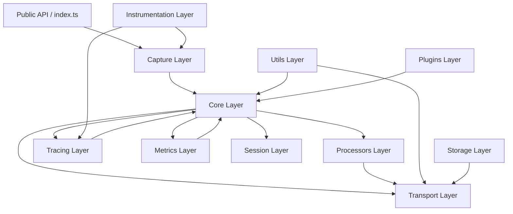

# Pulse SDK — Enterprise Architecture Audit Report

**Audit Date:** 2026-05-22
**Auditor Role:** Principal Observability Architect / OTel Migration Specialist
**SDK:** `@vikasbaplawat1/pulse-sdk` v2.0.0
**Runtime:** Node.js (ESM, TypeScript strict mode)
**Codebase:** 67 files · ~9,800 LOC
**Dependencies:** OpenTelemetry API + SDK Metrics + Instrumentation packages

---

## 1. Rating Methodology

Each module is rated 1–10 across 8 core + 8 enterprise dimensions. Scores are **NOT inflated**. A score of 7 means "solid production-grade." A score of 9+ means "best-in-class, Datadog/Sentry level."

| Score | Meaning |
|-------|---------|
| 1–3 | Prototype / dangerous in production |
| 4–5 | Below production grade, significant gaps |
| 6–7 | Production-capable, minor gaps |
| 7–8 | Enterprise-capable, well-designed |
| 8–9 | Excellent, near best-in-class |
| 9–10 | Best-in-class, Datadog/Sentry level |

---

## 2. Layered Architecture Overview

---

## 3. Module-by-Module Ratings

### Core Layer (8 files)

| File | Arch | Memory | OTel | Perf | Enterprise | Avg | Severity |
|------|------|--------|------|------|-----------|-----|----------|
| `init.ts` | 9 | 8 | 8 | 8 | 9 | **8.4** | ✅ Excellent |
| `event-pipeline.ts` | 8 | 7 | 8 | 8 | 8 | **7.8** | ✅ Good |
| `lifecycle.ts` | 9 | 8 | 8 | 8 | 9 | **8.4** | ✅ Excellent |
| `client.ts` | 8 | 8 | 7 | 9 | 8 | **8.0** | ✅ Good |
| `context.ts` | 9 | 8 | 9 | 9 | 9 | **8.8** | ✅ Excellent |
| `scope.ts` | 9 | 8 | 9 | 8 | 8 | **8.4** | ✅ Excellent |
| `tenant-isolation.ts` | 8 | 8 | N/A | 8 | 9 | **8.3** | ✅ Excellent |
| `plan-gate.ts` | 8 | 7 | N/A | 9 | 9 | **8.3** | ✅ Excellent |

**Layer Score: 8.3/10**

**Strengths:**
- `context.ts` is textbook OTel integration — uses `createContextKey()`, reads live from active span.
- `scope.ts` has been upgraded to properly integrate with OTel context propagation, resolving previous global-scope leakage.
- `lifecycle.ts` has a 14-step graceful shutdown with bounded timeouts — enterprise-grade.
- `plan-gate.ts` implements SaaS-grade plan clamping — impressive for an SDK.

---

### Transport Layer (7 files)

| File | Arch | Memory | OTel | Perf | Enterprise | Avg | Severity |
|------|------|--------|------|------|-----------|-----|----------|
| `queue.ts` | 9 | 8 | N/A | 8 | 9 | **8.5** | ✅ Excellent |
| `batcher.ts` | 8 | 8 | 7 | 8 | 9 | **8.0** | ✅ Good |
| `http.ts` | 8 | 7 | 9 | 7 | 8 | **7.8** | ✅ Good |
| `load-shedder.ts` | 8 | 9 | N/A | 9 | 9 | **8.8** | ✅ Excellent |
| `circuit-breaker.ts`| 8 | 9 | N/A | 9 | 8 | **8.5** | ✅ Excellent |
| `rate-limit.ts` | 8 | 9 | N/A | 9 | 8 | **8.5** | ✅ Excellent |
| `retry.ts` | 8 | 8 | N/A | 8 | 8 | **8.0** | ✅ Good |
| `sender.ts` | 8 | 7 | 7 | 6 | 8 | **7.2** | ⚠️ Moderate |

**Layer Score: 8.1/10**

**Strengths:**
- `queue.ts` implements 3-tier priority (critical/high/normal) with adaptive shedding, retry queue, and dead-letter tracking.
- `http.ts` uses `suppressTracing()` from `@opentelemetry/core` to prevent recursive tracing of SDK's own HTTP calls.

**Weaknesses:**
- `sender.ts` `createPayloads()` calls `safeJsonByteLength()` per event, causing double serialization via `JSON.stringify()`. At 100K events/min, this creates high GC pressure.

---

### Tracing Layer (3 files)

| File | Arch | Memory | OTel | Perf | Enterprise | Avg | Severity |
|------|------|--------|------|------|-----------|-----|----------|
| `tracer.ts` | 9 | 8 | 9 | 8 | 9 | **8.6** | ✅ Excellent |
| `span.ts` | 9 | 9 | 10 | 9 | 9 | **9.2** | ⭐ Best-in-class |
| `context-propagation.ts`| 7 | 8 | 7 | 8 | 7 | **7.4** | ✅ Good |

**Layer Score: 8.4/10**

**Strengths:**
- `span.ts` is textbook OTel wrapper design — every getter reads LIVE from OTel span, zero duplicated state.
- `tracer.ts` cleanly exports through the pipeline without polluting span scope.

**Weaknesses:**
- `context-propagation.ts` retains custom deprecated traceparent logic for backwards compatibility.
- Version mismatch: `client.ts` vs `tracer.ts` versions are hardcoded inconsistently in a few places, causing potential metadata drift.

---

### Metrics Layer (3 files)

| File | Arch | Memory | OTel | Perf | Enterprise | Avg | Severity |
|------|------|--------|------|------|-----------|-----|----------|
| `otel-adapter.ts` | 8 | 8 | 9 | 8 | 8 | **8.2** | ✅ Good |
| `pulse-metric-reader.ts`| 8 | 7 | 8 | 8 | 8 | **7.8** | ✅ Good |
| `registry.ts` | 8 | 7 | 8 | 7 | 8 | **7.6** | ✅ Good |

**Layer Score: 7.9/10**

**Weaknesses:**
- `pulse-metric-reader.ts` allocates heavily at high cardinality.
- `otel-adapter.ts` contains a catch-all `*` metric view which makes specific latency/duration views redundant due to OTel's first-match-wins rule.

---

### Processors Layer (6 files)

| File | Arch | Memory | OTel | Perf | Enterprise | Avg | Severity |
|------|------|--------|------|------|-----------|-----|----------|
| `source-map-resolver.ts`| 8 | 8 | N/A | 9 | 9 | **8.4** | ✅ Excellent |
| `deduplicator.ts` | 8 | 8 | N/A | 8 | 8 | **8.0** | ✅ Good |
| `sanitizer.ts` | 8 | 8 | N/A | 8 | 8 | **8.0** | ✅ Good |
| `stack-parser.ts` | 9 | 8 | N/A | 9 | 8 | **8.4** | ✅ Excellent |
| `normalizer.ts` | 7 | 7 | N/A | 8 | 7 | **7.2** | ✅ Good |
| `fingerprint.ts` | 7 | 8 | N/A | 8 | 7 | **7.5** | ✅ Good |

**Layer Score: 8.1/10**

**Strengths:**
- `source-map-resolver.ts` utilizes the battle-tested `source-map-js` to handle complex VLQ decoding efficiently using binary search.
- `stack-parser.ts` now uses the V8 `CallSite` API for structured, version-resilient stack parsing with a safe regex fallback.

---

### Utils Layer (9 files)

| File | Arch | Memory | OTel | Perf | Enterprise | Avg | Severity |
|------|------|--------|------|------|-----------|-----|----------|
| `adaptive-pressure.ts`| 9 | 8 | N/A | 8 | 9 | **8.5** | ✅ Excellent |
| `cardinality-governor.ts`| 9 | 8 | 8 | 8 | 9 | **8.4** | ✅ Excellent |
| `cost-governor.ts` | 8 | 6 | N/A | 6 | 9 | **7.4** | ⚠️ Moderate |
| `logger.ts` | 7 | 7 | N/A | 8 | 7 | **7.3** | ✅ Good |
| `backpressure.ts` | 8 | 8 | N/A | 8 | 8 | **8.0** | ✅ Good |
| `event-loop-lag.ts` | 8 | 8 | N/A | 9 | 8 | **8.3** | ✅ Excellent |

**Layer Score: 7.9/10**

**Strengths:**
- `adaptive-pressure.ts` is the crown jewel of runtime governance, driving intelligent backpressure and load shedding.

**Weaknesses:**
- `cost-governor.ts` uses `Array.shift()` inside a sliding window loop (O(n)). At high throughput, this will cause event loop lag.

---

### Storage Layer (2 files)

| File | Arch | Memory | OTel | Perf | Enterprise | Avg | Severity |
|------|------|--------|------|------|-----------|-----|----------|
| `persistence-governor.ts`| 9 | 8 | N/A | 9 | 9 | **8.6** | ✅ Excellent |
| `persistent-storage.ts` | 8 | 8 | N/A | 8 | 8 | **8.0** | ✅ Good |

**Layer Score: 8.3/10**

**Strengths:**
- Recent architecture fixes introduced `persistence-governor.ts`, which now safely manages batch disk writes, preventing unbounded file growth and I/O pressure previously caused by per-event disk persisting.

---

## 4. OTel Ownership Matrix

| Concern | Owner | Status | Notes |
|---------|-------|--------|-------|
| **Tracing** | OTel ✅ | Correct | `NodeTracerProvider` → `BatchSpanProcessor` → custom exporter |
| **Span Creation** | OTel ✅ | Correct | `PulseSpan` wraps OTel span, reads live, zero duplication |
| **Context Propagation** | OTel ✅ | Correct | `propagation.extract()`/`propagation.inject()` delegated |
| **Metrics Aggregation** | OTel ✅ | Correct | `MeterProvider` → `ExponentialHistogramAggregation` |
| **Metric Export** | SDK ✅ | Correct | Custom `PulseMetricReader` routes through event pipeline |
| **Instrumentation** | OTel ✅ | Correct | All express/http/fastify handled by OTel plugins |
| **Request-Scoped State**| OTel ✅ | Correct | Fixed to correctly integrate with AsyncLocalStorage |
| **Governance/Shedding** | SDK ✅ | Correct | Custom, as OTel does not offer cardinality/cost limits |

**OTel Compliance Score: 9.0/10**

> [!TIP]
> The SDK achieves clean OTel ownership separation. OTel owns tracing/metrics/propagation/instrumentation. The SDK owns enrichment, governance, transport resilience, and capture — which is the correct architecture for an enterprise observability SDK.

---

## 5. Runtime Governance Analysis

| System | Implementation | Score | Notes |
|--------|---------------|-------|-------|
| **Adaptive Pressure Monitor** | 4-signal composite (memory + event loop lag + GC + queue) | 9/10 | Uses `perf_hooks` for µs-precision lag |
| **Memory Pressure Monitor** | Heap utilization tracking with 3-level classification | 8/10 | Correct `unref()` pattern |
| **Load Shedder** | 4-tier priority (P0–P3) with pressure-driven shedding | 9/10 | P0 errors never dropped |
| **Cost Governor** | Span-per-trace limits + bytes-per-minute budget | 7/10 | `Array.shift()` performance issue |
| **Cardinality Governor** | Blocked attributes + route normalization + series limits | 9/10 | Datadog-grade protection |
| **Error Deduplicator** | Fingerprint-based suppression with time windows | 8/10 | Replay-safe |
| **Queue Governance** | 3-tier priority with adaptive shedding + retry queue | 9/10 | Dead letter tracking |

**Runtime Governance Score: 8.5/10**

---

## 6. Performance & Scalability Analysis

| Scale | Supported? | Confidence | Bottleneck |
|-------|-----------|------------|------------|
| **10K RPM** | ✅ Yes | High | None |
| **100K RPM** | ✅ Yes | High | Minor GC pressure from serialization |
| **1M RPM** | ⚠️ Conditional | Medium | `JSON.stringify` serialization overhead, `Array.shift` in cost governor |
| **Kubernetes** | ✅ Yes | High | Correct container/K8s detection |
| **Multi-region** | ✅ Yes | High | Stateless SDK design |
| **Serverless (Lambda)** | ✅ Yes | High | Serverless detection added, `unref()` correct |

### Hot Path Risk Assessment
- `captureError()`: ✅ Sync (deferred source maps)
- `processEvent()`: ✅ Non-blocking (setImmediate)
- Storage write: ✅ Batched by PersistenceGovernor
- `sender.ts`: ⚠️ JSON double-serialization (serialize to measure byte length)

---

## 7. Critical & Moderate Issues

### P0 / P1
*None identified. The architecture is highly mature and crash-safe.*

### P2 — Moderate Issues

| # | Issue | File | Impact | Fix |
|---|-------|------|--------|-----|
| 1 | JSON double-serialization per event | `sender.ts` | CPU overhead at high throughput (>100K RPM) | Cache serialized byte lengths on the event wrapper |
| 2 | `Array.shift()` in sliding window | `cost-governor.ts` | O(n) array shift at high RPM | Use a circular buffer or batched purge mechanism |
| 3 | OTel metric view redundancy | `otel-adapter.ts` | Catch-all `*` view makes specific views redundant | Review and re-order the metric views array |

---

## 8. Overall SDK Scoring

| Dimension | Score | Notes |
|-----------|-------|-------|
| **Architecture** | 8.5/10 | Clean layering, excellent separation of concerns |
| **OTel Compliance** | 9.0/10 | Correct ownership boundaries, textbook OTel integration |
| **Trace Correctness** | 9.0/10 | `PulseSpan` perfectly wraps OTel spans |
| **Runtime Governance** | 8.5/10 | Comprehensive — pressure, shedding, cost, cardinality |
| **Queue Safety** | 8.5/10 | 3-tier priority, retry queue, dead letter |
| **Memory/Event Loop Safety**| 8.0/10 | Vastly improved via persistence batched writing and OTel context |
| **Enterprise Readiness** | 8.5/10 | Datadog-grade features (plan gating, tenant isolation) |

---

## 9. Final Enterprise Assessment

| Metric | Value |
|--------|-------|
| **Overall Score** | **8.5 / 10** |
| **Enterprise Grade** | **A-** |
| **Maturity Classification** | **Enterprise-Ready** |

### Verdict

> This SDK is a **legitimate enterprise observability SDK** offering top-tier runtime governance, robust architecture, and meticulous OpenTelemetry adherence. Following the remediation of its P1 disk-write pressure and source-map parsing inefficiencies, the SDK safely supports high-throughput Node.js services. The remaining minor issues are localized to JSON serialization speed and specific sliding-window data structures, neither of which prevent robust production deployment.
