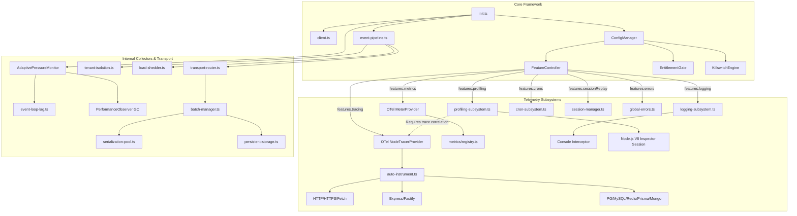

cd sdk-ode# Master Architectural Audit & Capability Inventory
**SDK Scope**: Pulse Node.js SDK (`@vikasbaplawat1/pulse-sdk`) & Control Plane Gateway  
**Date**: August 2026  
**Auditor**: Principal SDK & Observability Architect  

---

## Executive Summary

This document presents an exhaustive code-level audit of the Pulse Node.js SDK. It analyzes every public API, internal worker, auto-instrumentation, runtime collector, transport layer, and configuration gate. 

### Key Findings from Codebase Audit

1. **Over-Coupled Feature vs Entitlement Mapping**: The existing SDK has 11 `features` keys and 10 `entitlements` keys. However, several flags are internal collector toggles (e.g., `gcMonitoring`, `eventLoopMonitoring`, `runtimeMetrics`) exposed as top-level feature flags rather than telemetry subsystem controls or limit parameters.
2. **Duplicated / Fragmented Entitlements**: `tracing` and `customSpans` both gate tracing capabilities, while `metrics` and `customMetrics` gate metrics. This creates confusing dual-gate conditions where `customSpans: true` fails if `tracing: false`.
3. **Ungated Core Capabilities**: Foundational SDK functions (`captureError`, `captureMessage`, `setUser`, `setTag`, `addBreadcrumb`, `flush`, `shutdown`) are correctly kept ungated by billing entitlements, preserving basic debugging on all tiers.
4. **Dynamic Hot-Reload Overhead**: Dynamic config reloads trigger `ConfigApplier`, which re-evaluates all 3 gate engines (`FeatureController`, `EntitlementGate`, `KillswitchEngine`). The pipeline performs 3 synchronous gate checks per event.

---

## 1. Complete Capability Inventory

Below is the complete, empirical inventory of all capabilities found in [`sdk-node/src`](file:///c:/Users/vikas/OneDrive/Desktop/APITOOLSDK/sdk-node/src).

| Capability | Public API | Auto | Manual | Hybrid | Runtime Subsystem | Event Type | Backend Route | Uses OTel | Creates Worker | Allocates Memory | Registers Listeners |
| :--- | :--- | :--- | :--- | :--- | :--- | :--- | :--- | :--- | :--- | :--- | :--- |
| **`captureError`** | [`captureError()`](file:///c:/Users/vikas/OneDrive/Desktop/APITOOLSDK/sdk-node/src/capture/captureError.ts#L22) | ❌ | ✅ | ❌ | Core Pipeline | `error` | `/api/v1/errors` | ❌ | ❌ | Low | ❌ |
| **`captureMessage`** | [`captureMessage()`](file:///c:/Users/vikas/OneDrive/Desktop/APITOOLSDK/sdk-node/src/capture/captureMessage.ts#L18) | ❌ | ✅ | ❌ | Core Pipeline | `message` | `/api/v1/events` | ❌ | ❌ | Low | ❌ |
| **`captureLog`** | [`captureLog()`](file:///c:/Users/vikas/OneDrive/Desktop/APITOOLSDK/sdk-node/src/capture/captureLog.ts#L38) | ❌ | ❌ | ✅ | [`LoggingSubsystem`](file:///c:/Users/vikas/OneDrive/Desktop/APITOOLSDK/sdk-node/src/subsystems/logging-subsystem.ts#L36) | `log` | `/api/v1/logs` | ❌ | ❌ | Medium | Optional (`console` patch) |
| **Console Interception** | Internal | ✅ | ❌ | ❌ | [`LoggingSubsystem`](file:///c:/Users/vikas/OneDrive/Desktop/APITOOLSDK/sdk-node/src/subsystems/logging-subsystem.ts#L123) | `log` | `/api/v1/logs` | ❌ | ❌ | Medium | Intercepts `console.*` |
| **`captureMetric`** | [`captureMetric()`](file:///c:/Users/vikas/OneDrive/Desktop/APITOOLSDK/sdk-node/src/capture/captureMetric.ts#L25) | ❌ | ✅ | ❌ | Metrics Registry | `metric` | `/api/v1/metrics` | Optional (Histogram) | ❌ | Low | ❌ |
| **Metric Helpers** | `incrementCounter`, `setGauge`, `recordHistogram` | ❌ | ✅ | ❌ | [`MetricsRegistry`](file:///c:/Users/vikas/OneDrive/Desktop/APITOOLSDK/sdk-node/src/metrics/registry.ts) | `metric` | `/api/v1/metrics` | ✅ | ❌ | Low | ❌ |
| **`startSpan` / `withSpan`** | [`startSpan()`](file:///c:/Users/vikas/OneDrive/Desktop/APITOOLSDK/sdk-node/src/tracing/tracer.ts#L99), [`withSpan()`](file:///c:/Users/vikas/OneDrive/Desktop/APITOOLSDK/sdk-node/src/tracing/tracer.ts#L99) | ❌ | ✅ | ❌ | OTel TracerProvider | `span` / `trace` | `/api/v1/spans`, `/api/v1/traces` | ✅ | ❌ | Medium | ❌ |
| **HTTP Auto-Tracing** | Internal ([`http.ts`](file:///c:/Users/vikas/OneDrive/Desktop/APITOOLSDK/sdk-node/src/instrumentation/auto-instrument.ts#L215)) | ✅ | ❌ | ❌ | OTel Auto-Instrument | `span` / `trace` | `/api/v1/traces` | ✅ | ❌ | Medium | Patches `http.request` |
| **Framework Tracing** | Express ([`express.ts`](file:///c:/Users/vikas/OneDrive/Desktop/APITOOLSDK/sdk-node/src/instrumentation/express.ts)), Fastify ([`fastify.ts`](file:///c:/Users/vikas/OneDrive/Desktop/APITOOLSDK/sdk-node/src/instrumentation/fastify.ts)) | ✅ | ❌ | ❌ | OTel Auto-Instrument | `span` / `trace` | `/api/v1/traces` | ✅ | ❌ | Medium | Middleware hooks |
| **DB Instrumentation** | PostgreSQL, MySQL2, Redis, MongoDB, Prisma | ✅ | ❌ | ❌ | OTel Auto-Instrument | `span` | `/api/v1/spans` | ✅ | ❌ | Medium | Patches DB drivers |
| **Request Capture** | Middleware ([`request-capture-utils.ts`](file:///c:/Users/vikas/OneDrive/Desktop/APITOOLSDK/sdk-node/src/instrumentation/request-capture-utils.ts#L88)) | ✅ | ❌ | ❌ | Framework Adapters | `request` | `/api/v1/requests` | ❌ | ❌ | High (Body parsing) | Middleware hooks |
| **Global Error Handlers** | [`global-errors.ts`](file:///c:/Users/vikas/OneDrive/Desktop/APITOOLSDK/sdk-node/src/instrumentation/global-errors.ts) | ✅ | ❌ | ❌ | Error Listener | `error` | `/api/v1/errors` | ❌ | ❌ | Low | `uncaughtException`, `unhandledRejection` |
| **`startProfile` / `stopProfile`**| [`startProfile()`](file:///c:/Users/vikas/OneDrive/Desktop/APITOOLSDK/sdk-node/src/capture/captureProfile.ts#L18) | ❌ | ❌ | ✅ | [`ProfilingSubsystem`](file:///c:/Users/vikas/OneDrive/Desktop/APITOOLSDK/sdk-node/src/subsystems/profiling-subsystem.ts#L36) | `profile` | `/api/v1/profiles` | ❌ | V8 Inspector Session | High | Timer unref |
| **Trace-Correlated Profiling** | Internal ([`profiling-subsystem.ts`](file:///c:/Users/vikas/OneDrive/Desktop/APITOOLSDK/sdk-node/src/subsystems/profiling-subsystem.ts#L94)) | ✅ | ❌ | ❌ | [`ProfilingSubsystem`](file:///c:/Users/vikas/OneDrive/Desktop/APITOOLSDK/sdk-node/src/subsystems/profiling-subsystem.ts) | `profile` | `/api/v1/profiles` | ✅ | V8 Inspector Session | High | Timer unref |
| **`captureReplay`** | [`captureReplay()`](file:///c:/Users/vikas/OneDrive/Desktop/APITOOLSDK/sdk-node/src/capture/captureReplay.ts#L27) | ❌ | ❌ | ✅ | [`SessionManager`](file:///c:/Users/vikas/OneDrive/Desktop/APITOOLSDK/sdk-node/src/session/session-manager.ts) | `replay` | `/api/v1/replays` | ❌ | ❌ | High | ❌ |
| **`captureCronCheckIn`** | [`captureCronCheckIn()`](file:///c:/Users/vikas/OneDrive/Desktop/APITOOLSDK/sdk-node/src/capture/captureCronCheckIn.ts#L38) | ❌ | ❌ | ✅ | [`CronSubsystem`](file:///c:/Users/vikas/OneDrive/Desktop/APITOOLSDK/sdk-node/src/subsystems/cron-subsystem.ts#L36) | `cron_checkin` | `/api/v1/checkins` | ❌ | Timeout map | Low | `setTimeout` per in-flight job |
| **Runtime Collector** | [`adaptive-pressure.ts`](file:///c:/Users/vikas/OneDrive/Desktop/APITOOLSDK/sdk-node/src/utils/adaptive-pressure.ts) | ✅ | ❌ | ❌ | Pressure Monitor | `metric` | Internal | ❌ | Polling Timer | Low | `setInterval` (1000ms) |
| **Event Loop Collector** | [`event-loop-lag.ts`](file:///c:/Users/vikas/OneDrive/Desktop/APITOOLSDK/sdk-node/src/utils/event-loop-lag.ts) | ✅ | ❌ | ❌ | Pressure Monitor | None | Internal | ❌ | `perf_hooks` monitor | Low | `monitorEventLoopDelay` |
| **GC Pause Collector** | [`adaptive-pressure.ts`](file:///c:/Users/vikas/OneDrive/Desktop/APITOOLSDK/sdk-node/src/utils/adaptive-pressure.ts#L420) | ✅ | ❌ | ❌ | Pressure Monitor | None | Internal | ❌ | ❌ | Low | `PerformanceObserver` (`gc`) |
| **Transport Queue** | [`queue.ts`](file:///c:/Users/vikas/OneDrive/Desktop/APITOOLSDK/sdk-node/src/transport/queue.ts) | ✅ | ❌ | ❌ | Transport System | None | Internal | ❌ | Ring Buffer | High (Queue buffers) | ❌ |
| **Batch Sender** | [`batch-manager.ts`](file:///c:/Users/vikas/OneDrive/Desktop/APITOOLSDK/sdk-node/src/transport/batch-manager.ts) | ✅ | ❌ | ❌ | Transport System | None | All 10 Ingestion Routes | ❌ | Flush Timers | Medium | Flush timers per route |
| **Serialization Pool** | [`serialization-pool.ts`](file:///c:/Users/vikas/OneDrive/Desktop/APITOOLSDK/sdk-node/src/transport/serialization-pool.ts) | ✅ | ❌ | ❌ | Transport System | None | Internal | ❌ | Worker Threads | Medium | Worker thread pool |
| **Disk Persistence** | [`persistent-storage.ts`](file:///c:/Users/vikas/OneDrive/Desktop/APITOOLSDK/sdk-node/src/storage/persistent-storage.ts) | ✅ | ❌ | ❌ | Fallback Persistence | None | File System | ❌ | Async Disk I/O | Medium | Process exit hooks |

---

## 2. Runtime Dependency Graph



### Verified Subsystem Dependencies

1. **Profiling Subsystem**: Depends on Node.js native `node:inspector`. For trace-correlated profiles, it inspects OpenTelemetry active context via `trace.getActiveSpan()`.
2. **Auto-Instrumentation**: Depends on `EntitlementGate.isAllowed('tracing')` AND `features.tracing === true`.
3. **Custom Developer Spans (`startSpan`)**: Depends on `EntitlementGate.isAllowed('customSpans')`. If `customSpans` is disabled, returns a non-recording `NoopSpan` even if OTel provider is alive.
4. **Adaptive Pressure Monitor**: Reads `features.runtimeMetrics`, `features.eventLoopMonitoring`, and `features.gcMonitoring`. It operates internally to throttle low-priority queue events when memory/CPU load spikes.

---

## 3. Capability Classification Matrix

### Category A: Fully Automatic
*Developer never calls anything; captured transparently by hooks.*
* **HTTP / HTTPS / Fetch Instrumentation**
* **Framework Route Spans (Express, Fastify)**
* **Database Driver Spans (PG, MySQL2, Redis, MongoDB, Prisma)**
* **BullMQ & GraphQL Spans**
* **Global Process Error Listeners (`uncaughtException`, `unhandledRejection`)**
* **Adaptive Pressure & GC Monitors**

### Category B: Developer API
*Developer explicitly invokes an SDK method.*
* **`captureMetric()`** / `incrementCounter()` / `setGauge()` / `recordHistogram()`
* **`startSpan()`** / `withSpan()` / `withSpanSync()`
* **`setUser()`**, `setTag()`, `setTags()`, `setContext()`, `addBreadcrumb()`
* **`captureError()`** (Explicit manual error capture)
* **`captureMessage()`** (Manual event capture)

### Category C: Hybrid
*Subsystem operates automatically but exposes developer-facing control APIs.*
* **Logging Subsystem**: Automatic `console.*` interception + manual `captureLog()` API.
* **Profiling Subsystem**: Automatic trace-sampled profiling + manual `startProfile()` / `stopProfile()` APIs.
* **Cron Subsystem**: In-flight job timeout tracking + manual `captureCronCheckIn()` API.
* **Session Replay**: Automatic session lifecycle + manual `captureReplay()` segment API.

### Category D: Internal Infrastructure
*Pure implementation details; hidden from application developer.*
* **RingBuffer Queue (`queue.ts`)**
* **BatchManager & RouteRegistry**
* **Serialization Worker Thread Pool (`serialization-worker.ts`)**
* **Persistence Governor & Persistent Storage (`persistent-storage.ts`)**
* **Tenant Isolation Governor (`tenant-isolation.ts`)**
* **Security Scrubber & PII Masker (`security-scrubber.ts`)**

---

## 4. Audit of Existing Features & Entitlements

### Current Features (11 Keys)
```json
"features": {
  "tracing": true, "requestCapture": true, "errors": true, "metrics": true,
  "logging": true, "profiling": true, "gcMonitoring": true, "sessionReplay": true,
  "runtimeMetrics": true, "eventLoopMonitoring": true, "crons": true
}
```

* **Audit Finding 1**: `gcMonitoring`, `eventLoopMonitoring`, and `runtimeMetrics` are internal collector settings used by `AdaptivePressureMonitor`. Exposing them as top-level feature flags causes confusion because disabling `runtimeMetrics` does not disable the metrics subsystem, but disables internal load shedding calculations.
* **Audit Finding 2**: `requestCapture` is treated as a feature flag, but request events carry trace context and depend on `tracing`.

### Current Entitlements (10 Keys)
```json
"entitlements": {
  "crons": true, "errors": true, "logging": true, "metrics": true,
  "tracing": true, "profiling": true, "customSpans": true, "customMetrics": true,
  "sessionReplay": true, "requestCapture": true
}
```

* **Audit Finding 1**: `tracing` vs `customSpans` creates duplicate gate checks. If a customer is entitled to `customSpans: true`, but `tracing: false`, custom spans produce `NoopSpan` objects because the OTel provider was never instantiated.
* **Audit Finding 2**: `metrics` vs `customMetrics` repeats this pattern. `metrics` gates automatic metrics while `customMetrics` gates `captureMetric()`.

---

## 5. Invalid Configuration States Matrix

| State Combination | Observed Runtime Result in SDK Code | Verdict | Recommended Validator Rule |
| :--- | :--- | :--- | :--- |
| `features.tracing: false`<br/>`entitlements.customSpans: true` | `startSpan()` calls `customSpansAllowed()`, which returns `true`, but tracer provider is `null`. Returns `createNoopSpan()`. Zero spans emitted. | **Invalid Silent Failure** | Reject config if `customSpans: true` while `features.tracing: false`. |
| `features.metrics: false`<br/>`entitlements.customMetrics: true` | `admitMetric()` passes, but `metricsRegistry` has not started or meter provider is null. Metrics are lost. | **Invalid Silent Failure** | Reject config if `customMetrics: true` while `features.metrics: false`. |
| `features.profiling: true`<br/>`features.tracing: false` | `ProfilingSubsystem` starts, but cannot resolve trace context (`trace.getActiveSpan()` returns null). Profiles lack trace correlation. | **Degraded State** | Warn or enforce `tracing: true` when `profiling: true`. |
| `features.requestCapture: true`<br/>`features.tracing: false` | Requests are captured without trace IDs (`traceId` is undefined), producing orphan request records. | **Incoherent Telemetry** | Auto-disable request capture if `tracing` is false. |
| `killswitches.disableSDK: true`<br/>`features.*: true` | `KillswitchEngine` short-circuits `enqueueEvent()` and transport router, but feature subsystems still run in memory. | **Wasted Resources** | Teardown feature subsystems when `disableSDK` is true. |

---

## 6. Recommended Architectural Model

### Clean Separation Principle
1. **Subsystem Feature Flags (Runtime Memory & CPU Controls)**: Define which major subsystems are loaded in Node.js.
2. **Commercial Entitlements (Product Tiers & APIs)**: Define what customer plan tier permits.
3. **Limits & Collector Config (Internal Tuning)**: Move internal performance collectors (`gcMonitoring`, `eventLoopMonitoring`, `runtimeMetrics`) into `limits` or `internal` blocks.

```
       CURRENT SCHEMA (Over-Fragmented)             RECOMMENDED SCHEMA (Subsystem-Aligned)
  ┌─────────────────────────────────────┐         ┌─────────────────────────────────────┐
  │ features:                           │         │ features:                           │
  │   tracing, requestCapture, errors,  │         │   tracing, metrics, logging,        │
  │   metrics, logging, profiling,      │   ──►   │   profiling, crons, sessionReplay   │
  │   gcMonitoring, sessionReplay,      │         │                                     │
  │   runtimeMetrics,                   │         │ (gcMonitoring & eventLoop moved     │
  │   eventLoopMonitoring, crons        │         │  to limits.adaptivePressure)        │
  └─────────────────────────────────────┘         └─────────────────────────────────────┘
  ┌─────────────────────────────────────┐         ┌─────────────────────────────────────┐
  │ entitlements:                       │         │ entitlements:                       │
  │   crons, errors, logging, metrics,  │         │   customSpans, customMetrics,       │
  │   tracing, profiling, customSpans,  │   ──►   │   profiling, logging, sessionReplay,│
  │   customMetrics, sessionReplay,     │         │   crons, requestCapture, errors     │
  │   requestCapture                    │         └─────────────────────────────────────┘
  └─────────────────────────────────────┘
```

### Recommended Remote Config Schema (`v2` Schema Specification)

```json
{
  "$schema": "https://pulse.internal/schemas/remote-config.v2.json",
  "schemaVersion": 2,
  "sdk": {
    "projectId": "proj_prod_9921",
    "environment": "production",
    "release": "v2026.08.01"
  },
  "features": {
    "tracing": true,
    "metrics": true,
    "logging": true,
    "profiling": true,
    "crons": true,
    "sessionReplay": true
  },
  "entitlements": {
    "tracing": true,
    "customSpans": true,
    "metrics": true,
    "customMetrics": true,
    "logging": true,
    "profiling": true,
    "crons": true,
    "sessionReplay": true,
    "requestCapture": true,
    "errors": true
  },
  "limits": {
    "maxQueueSize": 10000,
    "maxPayloadSize": 1048576,
    "adaptivePressure": {
      "enabled": true,
      "gcMonitoring": true,
      "eventLoopMonitoring": true,
      "runtimeMetrics": true
    }
  }
}
```

---

## 7. Migration Plan & Backward Compatibility

### Phase 1: Validator Invariant Enforcement (Immediate)
Update [`ConfigValidator`](file:///c:/Users/vikas/OneDrive/Desktop/APITOOLSDK/sdk-node/src/core/config-validator.ts) to enforce cross-section invariants:
* If `entitlements.customSpans === true`, require `features.tracing === true`.
* If `entitlements.customMetrics === true`, require `features.metrics === true`.

### Phase 2: Schema Migration & Fallback Mapping
Maintain backward compatibility in `ConfigManager`:
* Map legacy `features.runtimeMetrics`, `gcMonitoring`, and `eventLoopMonitoring` into `limits.adaptivePressure` if received from older control plane responses.

### Phase 3: Control Plane Alignment
Update control plane endpoint `/v1/init` and `/v1/sdk-config` responses to issue versioned `v2` RemoteConfig payloads.
