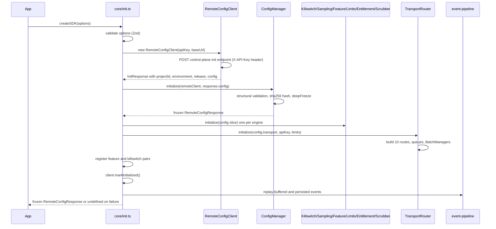
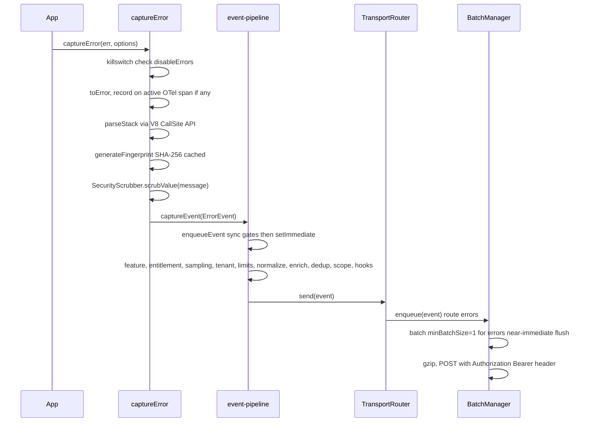
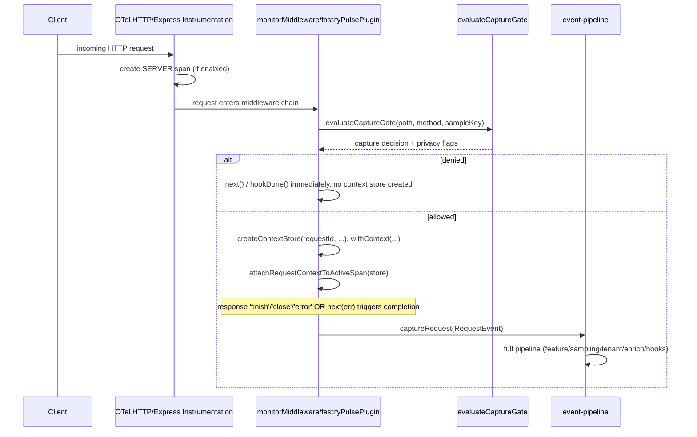
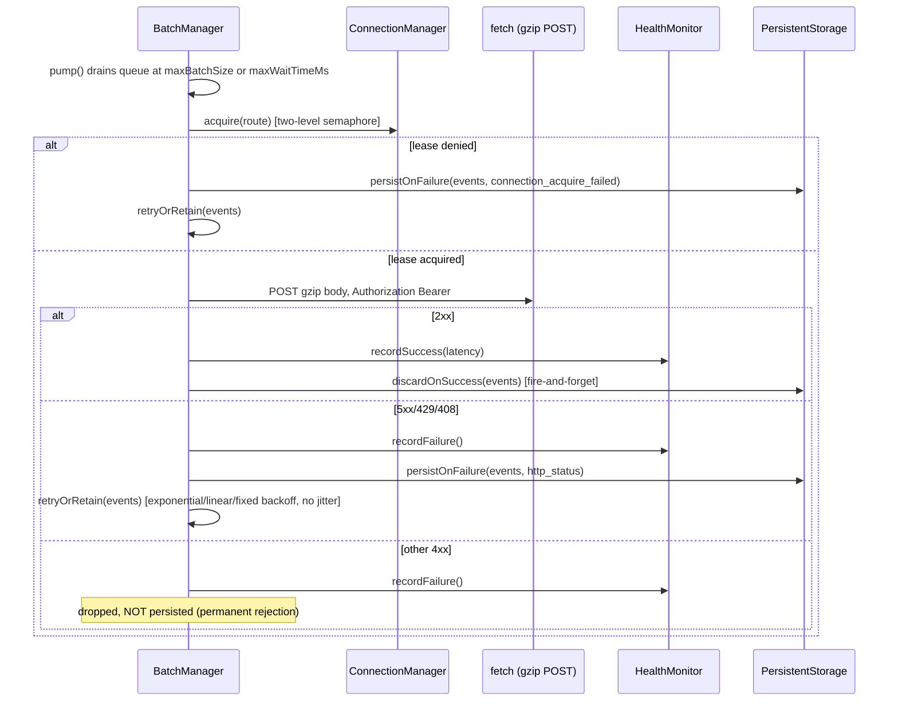
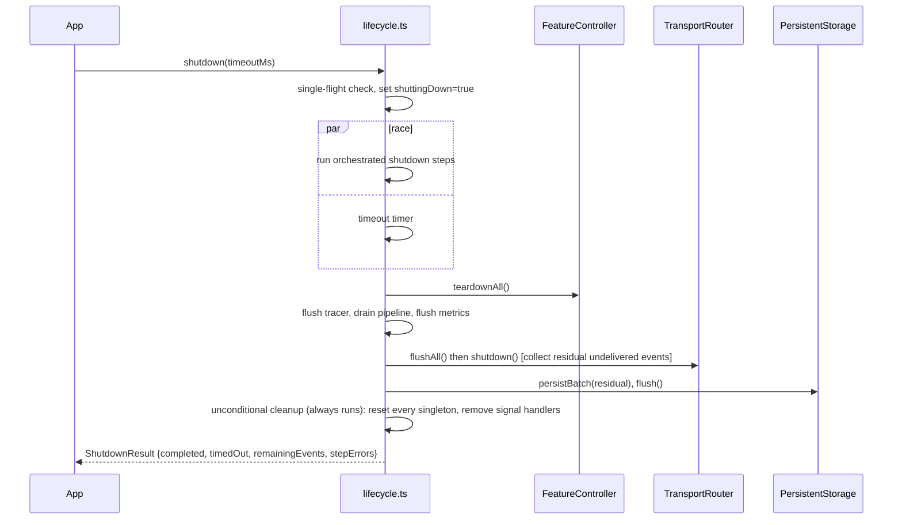
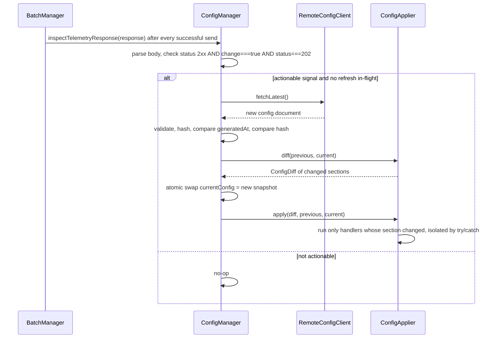

# Pulse SDK — Internal Engineering Guide

**Audience:** Internal engineers working on the SDK itself. This is not customer documentation — it explains implementation, not usage contracts. Every claim below is derived from reading `src/**` in full; see `AUDIT_REPORT.md` for the audit that grounds this document. Proprietary backend endpoints, internal authentication payload shapes, and infrastructure topology are described structurally, not reproduced literally.

## 1. Architecture Overview

### 1.1 High-level shape

The SDK is a single Node.js process runtime built around one idea: **the backend is the sole source of runtime policy.** There is no local defaults file, no merge logic, no partial config. A validated, immutable configuration snapshot (`RemoteConfigResponse`) is fetched exactly once at boot from a single control-plane request, and every subsystem — sampling, killswitches, entitlements, limits, transport routing, privacy scrubbing, instrumentation selection — reads from that one frozen object. The snapshot can later be atomically replaced (never merged) by a second, event-driven refresh.

Everything else is organized as singletons with a consistent lifecycle contract: `initialize()` / `getInstance()` / `handleConfigChange(diff, config)` / `reset()`. This uniformity is what makes the shutdown-and-reinit path (§10) tractable — every engine knows how to tear itself down to a truly clean slate.

```
Application code
      |
      v
createSDK()/init()  --->  RemoteConfigClient  --->  (one HTTP call)  --->  validated snapshot
      |
      v
ConfigManager (immutable snapshot owner)
      |
      +--> KillswitchEngine        +--> SamplingEngine
      +--> FeatureController       +--> LimitsEngine
      +--> EntitlementGate         +--> SecurityScrubber
      +--> TransportRouter (10 per-event-type routes, each with its own BatchManager)
      +--> OTel TracerProvider (PipelineSpanExporter -> event pipeline)
      +--> OTel MeterProvider (PulseMetricReader -> event pipeline)
      +--> LoggingSubsystem / ProfilingSubsystem / CronSubsystem / SessionManager
```

### 1.2 Dependency graph (by direction of control)

`core/init.ts` is the only module that imports and wires almost everything else — it is intentionally a large orchestrator, not a thin entry point. Everything downstream of it (`capture/*`, `tracing/*`, `instrumentation/*`) depends on singletons that `init.ts` constructs, and reads them via `getInstance()`-style static accessors rather than being passed references. This is why capture functions like `captureError()` can be called from anywhere in an application without threading an SDK instance through call sites — at the cost of implicit global state that must be reset correctly on shutdown.

The event pipeline (`core/event-pipeline.ts`) sits at the convergence point: manual capture APIs, the OTel span exporter, the metric reader, the trace aggregator, framework middleware, and subsystem emitters (cron, logging, profiling) all eventually call into the same `enqueueEvent()` function. This is deliberate — it guarantees every event, regardless of source, passes through the same feature/entitlement/sampling/limits/scrubbing gates exactly once.

### 1.3 Component responsibilities (one line each)

| Component | Responsibility |
|---|---|
| `ConfigManager` | Owns the single immutable config snapshot; validates, hashes, and atomically swaps it. No polling, no merge. |
| `KillswitchEngine` | Emergency per-subsystem stop/start, driven by 7 boolean flags in the snapshot. |
| `EntitlementGate` | Billing/plan gates on optional developer APIs (profiling, custom metrics, logging, replay, crons, custom spans). Core capture is never gated here. |
| `FeatureController` | Owns whether a subsystem exists at all (register/teardown pairs per feature name). |
| `SamplingEngine` | Deterministic FNV-1a-hash-based sampling per event family, with longest-prefix route overrides. |
| `LimitsEngine` | Truncates oversized attributes/strings; checks payload size against the configured ceiling. |
| `SecurityScrubber` | Pre-transport redaction of sensitive headers/fields and heuristic PII masking. |
| `TransportRouter` | Owns 10 named routes (one per event type), each with its own bounded queue, `BatchManager`, and connection pool. |
| `BatchManager` | Per-route batching, gzip, send, retry-with-backoff, and failure persistence. |
| `ConnectionManager` | Two-level semaphore (global + per-route) bounding concurrent outbound HTTP requests. |
| `HealthMonitor` | Per-route circuit state (CLOSED/OPEN/HALF_OPEN) and adaptive batch/concurrency scaling. |
| `PulseTracer` / `PipelineSpanExporter` | OTel span lifecycle plus the sole bridge from finished spans into the event pipeline. |
| `TraceAggregator` | Buffers spans by `traceId`, emits one complete `trace` document when the root span arrives (or on orphan timeout). |
| `LoggingSubsystem` | Console-method interception + explicit `captureLog()` path, both routed to the `log` event type. |
| `ProfilingSubsystem` | V8 Inspector-based CPU profiling, auto-triggered on root spans or manually via `startProfile()`. |
| `CronSubsystem` | Check-in tracking with in-flight timeout detection for scheduled-job monitoring. |
| `SessionManager` | Idle/duration-based session lifecycle and crash-free-rate bookkeeping. |
| `PersistentStorage` / `PersistenceGovernor` | Fallback-only, tiered disk persistence for events that failed to send or were still queued at shutdown. |
| `AdaptivePressureMonitor` | Composite pressure score (memory + event-loop lag + queue depth + GC time) driving load-shedding and persistence throttling. |
| `TenantGovernor` | Per-tenant sliding-window admission control with a critical-event reserve. |
| `CardinalityGovernor` | Blocks known high-cardinality metric label keys and normalizes dynamic route segments. |
| `CostGovernor` | Per-trace span-count and duration ceilings, plus a bytes-per-minute budget signal. |

## 2. SDK Boot Sequence

`createSDK(options)` in `src/index.ts` is a one-line wrapper around `init(options)` (`src/core/init.ts`). Nothing else happens in `createSDK` itself.

`init(options)`:

1. `waitForShutdownCompletion()` — blocks if a prior `shutdown()`'s background cleanup is still running. This exists because a timed-out public `shutdown()` call lets cleanup continue after the caller's deadline; a new `init()` must not race that cleanup.
2. `setDebugMode(options.debug ?? false)`, `setLogLevel` if provided.
3. `validateInitOptions(options)` — a Zod schema (`sdkInitOptionsSchema`, `.strict()`) validates `apiKey` (required, non-empty), `maxBreadcrumbs` (0-1000), `shutdownTimeoutMs` (1000-60000), `baseUrl` (must be a bare HTTP(S) origin — no path/query/credentials), `logLevel` (enum), and the shape of hook functions. Any failure throws `SDKError('INVALID_INIT_OPTIONS')` before any network activity.
4. Identity checks: if the SDK is already initialized, a call with the *same* API key (compared via SHA-256 hash) returns the current config; a call with a *different* key throws `SDKError('SDK_ALREADY_INITIALIZED')`. If initialization is already in flight, a call with the same pending identity joins that promise; a different one throws `SDKError('SDK_INIT_IN_PROGRESS')`.
5. The real work runs in an internal `initialize()` function, wrapped so that **any thrown error is caught, logged, and results in a best-effort rollback (`cleanupFailedInitialization()`) followed by returning `undefined`** — `init()` never throws to the caller once options have passed validation.

Inside `initialize()`, in order:

1. `client.setOptions(options)`; `client.initBreadcrumbs(maxBreadcrumbs ?? 100)`.
2. A `RemoteConfigClient` is constructed and its `initialize()` method is called. **This is the SDK's only network operation during boot.** It performs one HTTP POST to a control-plane configuration endpoint, sending the API key via an HTTP header (not in the JSON body — the body is `{}`) and receiving a JSON document that must contain project identity, environment, release, and a complete configuration. Cross-field consistency is checked: the top-level identity fields must exactly match `config.sdk.*`, or the response is rejected as `SDKError('INVALID_INIT_RESPONSE')`.
3. `ConfigManager.getInstance().initialize(remoteClient, response.config)` — validates the payload against a hand-written structural validator (`config-validator.ts`; not Zod — every section, every key, every numeric bound is checked explicitly), computes a canonical `sha256:<hex>` content hash (with `meta.configHash` stripped before hashing, so the hash is stable regardless of what was in that field previously), deep-freezes the object, and marks `ConfigState.Live`.
4. `client.setInitResponse(response)`; `client.applyRemoteIdentity(config)` — this is the **only** place `projectId`/`environment`/`release` are ever set on the client's metadata, and they come exclusively from `config.sdk.*`. The event pipeline re-asserts `event.metadata = client.metadata` after every plugin/processor/`beforeSend` hook has run, so no user code can override these fields on an outgoing event.
5. Every engine singleton is constructed from its slice of the snapshot: `KillswitchEngine`, `SamplingEngine`, `FeatureController`, `LimitsEngine`, `SecurityScrubber`, `EntitlementGate`. `tenantGovernor.configure(config.limits.tenantGovernance)`.
6. `TransportRouter.initialize(config.transport, apiKey, undefined, config.limits)` — builds all 10 routes' queues and `BatchManager`s. If `killswitches.disableTransport` or `disableSDK` is already true in this snapshot, the router is disabled immediately.
7. Killswitch handler pairs are registered for `disableTransport`/`disableSDK` so that a later remote toggle can start/stop the router without a restart.
8. `costGovernor.updateFromConfig(...)`; `eventQueue.configure(config.limits.maxQueueSize)` (the pre-init bootstrap queue's capacity).
9. If `options.plugins` were provided, `initializePlugins()` registers each (rejecting duplicate names) and calls each plugin's `setup(context)` hook in registration order, isolating failures per plugin.
10. Persistent storage is configured with a SHA-256 hash of the API key (used for the on-disk filename) and `persistentStorage.init()` is awaited — this loads any events left on disk from a previous process that failed to deliver them.
11. Source-map resolver is configured if `options.sourceMaps` was provided.
12. `registerSignalHandlers()` (SIGTERM/SIGINT -> `shutdown()`), `errorDeduplicator.start()`, `metricsRegistry.start()`, `configureAdaptivePressure(config)` + `adaptivePressure.start()`, and the API payload scrubber is configured via a dynamic import (kept dynamic to avoid a circular import at module-load time).
13. `detectResources(sdkVersion)` builds the OTel `Resource` attribute set (host, process, OS, container/K8s/cloud hints).
14. Each optional subsystem is registered with `FeatureController.register(name, start, stop)`: `tracing` (starts the OTel tracer + `registerAutoInstrumentations()`), `metrics` (starts the OTel meter provider), `errors` (global error handlers), `logging`, `profiling`, `crons`, `sessionReplay`. Each is *also* paired with a matching `KillswitchEngine.registerSubsystem()` call so a remote killswitch flip and a feature-flag flip both drive the same start/stop functions.
15. `manager.setApplier(new ConfigApplier({...}))` wires up reactive handlers keyed by which top-level config section changed on a *future* refresh (identity, killswitches, sampling, features, limits, privacy, transport, instrumentation, entitlements). These do **not** run during boot — they only fire on a subsequent atomic config replacement (§6).
16. `client.markInitialized()` — **only now** do capture APIs leave pre-init buffering.
17. `filterBufferedEvents(config)` drops any pre-init-buffered events whose feature turned out to be disabled; `replayBufferedEvents(persistedEvents)` concatenates disk-replayed events with the in-memory pre-init buffer and processes them through the pipeline, yielding to the event loop every 100 events via `setImmediate` so a large backlog cannot block the process.
18. A success log is emitted with `projectId`, `environment`, `release`, `configHash`, and the list of active subsystems. The frozen config is returned.

### 2.1 Sequence diagram — initialization



## 3. Complete Event Lifecycle

All ten `SDKEvent` shapes (`error`, `request`, `message`, `metric`, `span`, `trace`, `log`, `profile`, `replay`, `cron_checkin`) converge on `core/event-pipeline.ts`'s `enqueueEvent()`. `captureEvent()` (`src/capture/captureEvent.ts`) is a thin, never-throwing wrapper around it; every other capture function (`captureError`, `captureRequest`, `captureMessage`, `captureMetric`'s fallback path) builds its typed event and calls `captureEvent()`.

### 3.1 Synchronous acceptance gates (run before anything expensive)

In order, each can synchronously reject with a specific reason string:

1. `isSDKShuttingDown()` — rejects `sdk_shutting_down` (bypassed for internally-tagged events like span exports during a shutdown flush).
2. `pipelineDraining` flag — rejects `pipeline_draining` once `drainPendingEventProcessing()` has begun (guarantees drain converges in finite time).
3. `KillswitchEngine.isSDKDisabled()` — rejects `sdk_disabled_by_killswitch`.
4. `loadShedder.shouldShed(event)` — rejects `load_shed` under adaptive pressure (4-tier priority: uncaught/unhandled errors > other errors > requests/spans > everything else).
5. If the SDK is not yet initialized, the event is placed in the bootstrap `EventQueue` (3-tier priority ring buffer: critical 40% / high 40% / normal 20% of capacity) instead of entering async processing. Full -> `pre_init_queue_full`.
6. A hard cap of 10,000 concurrent in-flight async pipeline tasks — beyond that, `pipeline_overloaded`.

If none of these reject, a `Promise` is created, added to a tracked `Set`, and `processEventAsync()` is scheduled via exactly one `setImmediate()` call — this is the "one `setImmediate` per accepted event" scheduling overhead referenced elsewhere in this repository's documentation.

### 3.2 Async pipeline stages (`processEventAsync`)

1. Killswitch re-check (defense in depth for the internal-event bypass).
2. `ensureBaseFields` — assigns `eventId` (`crypto.randomUUID()`) and `timestamp` if missing.
3. Re-check pre-init buffering (race safety).
4. **Feature gate** — a switch on `event.type` against `config.features.*` and `config.killswitches.*`. Notably, `message` events are gated only by the global `disableSDK` killswitch, not by any per-type flag.
5. **Entitlement gate** — only `log`, `profile`, `replay`, and `cron_checkin` are entitlement-gated (against `logging`, `profiling`, `sessionReplay`, `crons` respectively). `error`, `message`, `request`, `metric`, `span`, `trace` are never entitlement-gated — these are treated as core, always-on capabilities.
6. **Sampling** — dispatches to one of `SamplingEngine`'s per-family methods, each keyed by a stable identifier (event ID, fingerprint, trace ID, etc.). See §5.
7. **Tenant admission** — `tenantGovernor.admit(tenantId, isHighPriority)`, where `isHighPriority` is true only for `error` and `span` types.
8. **Attribute limits** — `LimitsEngine.enforceAttributeLimits()` truncates `attributes`/`context`/`tags` to the configured max count and string length.
9. **Normalization** — `normalizeEvent()` fills defaults and truncates oversized strings/objects (depth <= 5, arrays <= 100 items, strings <= 8192 chars generally, messages <= 2048), with a `WeakSet` cycle guard against circular references.
10. **Context enrichment** — trace/span IDs from the active OTel span (if not already set), `requestId` from the async-local `ContextStore`, breadcrumbs (for `error`/`message` only), and `sessionId` from a *non-creating* session-manager lookup (so merely capturing telemetry never manufactures a session as a side effect).
11. **Error deduplication** — for `error` events with a string fingerprint, a composite key (`fingerprint:projectId:release:tenantId:route`) is checked against a 60-second sliding window; duplicates are dropped.
12. **Scope application** — merges user/tags/extra/named-contexts from the active `withScope()` clone or the global fallback, with precedence: request `ContextStore` > active scope > the event's own pre-existing values (never overwritten).
13. **Source context** (errors only, when the internal `attachSourceContext` default is on) — reads the surrounding lines of the error's source file, bounded by a 250ms timeout; on timeout the original frames are kept unchanged.
14. **Plugin `processEvent` hooks** (registration order, 50ms budget each) then **user `eventProcessors`** (50ms each) then **user `beforeSend`** (100ms) then **plugin `beforeSend` hooks** (100ms each). Any hook returning `null` drops the event; a thrown error is logged and the event passes through unchanged.
15. `event.metadata` is force-reassigned to the frozen `client.metadata` — this happens *after* every hook, so no hook can forge SDK/application identity.
16. `TransportRouter.getInstance().send(event)` routes the event to its per-type `BatchManager`. No unconditional disk persistence happens here — persistence is purely a transport-layer fallback (§7).

### 3.3 Sequence diagram — error capture



### 3.4 Sequence diagram — request capture (Express/Fastify)



### 3.5 Sequence diagram — batch send with retry



### 3.6 Sequence diagram — shutdown



## 4. Batching Architecture

Each of the 10 event-type routes owns its own `TransportEventQueue` (a bounded ring buffer with a configurable critical-event reserve) and its own `BatchManager` instance.

- **Batch formation**: `BatchManager.pump()` drains the queue once it reaches `effectiveMaxBatchSize()` (the configured `batchSize`, scaled down under degraded route health) **or** once `maxWaitTimeMs` has elapsed since the first event was queued — whichever comes first, unless a caller forces an immediate flush. Wait time doubles automatically when the route's health state is not `HEALTHY`.
- **Minimum batch size** is hardcoded per route (not remote-configurable): `errors=1, events=1, traces=10, spans=10, metrics=50, logs=10, profiles=1, crons=1, requests=10, replays=1`. Routes with `minBatchSize=1` (errors, crons, profiles, replays, generic events) effectively flush on every event, subject only to the wait-time/health-scaling logic.
- **Serialization and payload sizing**: the batch is scrubbed (`SecurityScrubber.scrubBatch` or per-event `sanitizeEvent` fallback), JSON-stringified, and checked against `limits.maxPayloadSize`. If a multi-event batch exceeds the limit, it is split in half and the overflow is requeued at the front of the queue for the next pump cycle — this repeats until each half fits or a single event alone exceeds the limit (in which case that one event is dropped with reason `event_too_large`). A batch that fails to `JSON.stringify` (circular reference) is dropped wholesale, once, without requeue.
- **Compression**: the wire body is always gzip-compressed via `compressGzip()` in the primary send path, regardless of the configured per-route `compression` value (see `AUDIT_REPORT.md` §4 — this field is validated but currently has no effect on the actual send path).
- **Manual flush**: `flush()` on a `BatchManager` drains with an internal 4-second deadline, calling `pump(true)` repeatedly and racing outstanding work against the remaining time; it also has a fail-fast escape valve that stops retrying early if failures accumulate past `max(5, maxRetries+1)` during the flush window.
- **Automatic flush**: the `ensureTimer()` mechanism described above.
- **Shutdown flush**: `BatchManager.shutdown(timeoutMs=4000)` marks the manager destroyed, cancels pending retry timers (returning their events to the queue), aborts in-flight `AbortController`s, and waits up to the timeout for active sends to settle; anything still in flight past that point is returned as "residual" for the caller to persist.
- **Memory pressure / queue overflow**: `TransportEventQueue.enqueue()` preserves a configured `criticalReserve` of slots even while the ring still has nominal free space; under overflow, the `drop_oldest` strategy evicts the oldest *non-critical* entry to make room for a new critical one, while `drop_newest` simply rejects the incoming event. Criticality here is judged by severity/level/status (`error` with `severity==='fatal'`, `log` with `level==='fatal'`, or `cron_checkin` with `status==='error'`) — a different classification than the bootstrap queue's simpler type-based 3-tier priority.
- **Priority ordering**: within a route's queue, criticality determines eviction order, not send order (a route processes its own queue FIFO once dequeued for batching). Across routes, there is no cross-route priority — each route's `BatchManager` operates independently, bounded only by the shared `ConnectionManager`'s global connection cap. This isolation is stress-test-verified, not just architecturally inferred: `transport-router.test.ts` backlogs 76,000 span events (enough to trigger `queue_full` drops on the spans route specifically) while sending 100 error events concurrently, and confirms the errors are still delivered within 2 seconds — a flooded low-priority route cannot starve or delay a high-priority route's delivery.
- **Retry interaction**: see §7.

## 5. Sampling

All sampling decisions are made by `SamplingEngine` using a single algorithm: **FNV-1a 32-bit hash of a stable identifier, normalized to `[0, 1)` by dividing by 2^32, compared against a configured rate.** Same identifier -> same decision, deterministically, across any number of SDK instances — there is no `Math.random()` anywhere in the sampling path.

- **Per-family rates**: `traces, requests, spans, errors, messages, profiles, replays, metrics, logs, events, crons` — 11 independent rates in `SamplingConfig`.
- **Route overrides**: `config.sampling.routes` is a map keyed by URL prefix; `SamplingEngine.findRouteRates()` performs a true longest-prefix match. A rate of `0` on a matched prefix silences that event family for that route entirely (this is how a health-check-style path gets silenced — there is no separate "ignored routes" list).
- **Trace-level sampling** happens once, at root-span creation, via a custom OTel `Sampler` (`RemoteConfigSampler`) wrapped in a `ParentBasedSampler` — child spans inherit the root's decision through the OTel context, they are never independently re-sampled.
- **Tail-based error promotion**: `PipelineSpanExporter` keeps a span even if it was not sampled at the root, *if* that span carries an error status or an exception event. This is the SDK's error-priority capture strategy — an unsampled trace that turns out to contain an error is still exported.
- **Non-trace helpers** each call their own `SamplingEngine.shouldSampleX()` method with a type-appropriate stable key: request ID, error fingerprint (or event ID/message), metric name+sorted-tags, log event ID, span ID, trace ID, profile ID/trace ID, session ID (replays — no route override possible here, replays are sampled purely by session), or cron event ID/monitor slug.
- **Manual profiling** additionally calls `SamplingEngine.shouldSampleProfile()` *before* actually starting a CPU profile (not just before transporting it), since profiling itself has real CPU cost that should be avoided pre-emptively, not just filtered after the fact.
- **Kill switch interaction**: killswitches are checked before sampling in the event pipeline's gate order — a disabled feature never reaches the sampling decision at all.
- **Configuration precedence**: route override (longest prefix) -> global per-family rate. There is no per-tenant or per-environment sampling override in the current schema; environment/project selection happens entirely upstream, at which configuration snapshot gets served to a given API key.

## 6. Remote Configuration

- **Fetch**: exactly two operations exist on `RemoteConfigClient` — the one-time boot fetch and a refresh fetch, both POSTs with an empty JSON body and the API key in a header, both wrapped in `suppressTracing()` so they never generate their own spans (which would otherwise recurse into the export pipeline). Neither operation retries or polls internally.
- **Poll interval**: none. There is no timer anywhere in the codebase that periodically re-fetches configuration.
- **Cache**: the single frozen snapshot held by `ConfigManager` *is* the cache — there is no separate cache layer, no TTL-based expiry of the config itself.
- **Fallback / offline mode**: if the boot fetch fails for any reason, `init()` catches the error, best-effort tears down anything partially constructed, and returns `undefined`. There is no synthesized fallback configuration — the SDK simply does not start telemetry.
- **Versioning**: `schemaVersion` is checked against `REMOTE_CONFIG_SCHEMA_VERSION` (currently `1`); a snapshot with a *newer* major than the SDK supports is rejected with an explicit "SDK upgrade required" validation error.
- **Schema validation**: a hand-written structural validator (`config-validator.ts`) checks every section exhaustively — booleans, probability ranges `[0,1]`, integer ranges bounded by `SAFETY_CEILINGS`, enum membership, URL scheme/host allow-listing (HTTPS always; HTTP only to loopback), and cross-section invariants (e.g., `transport.queue.maxSize` cannot exceed `limits.maxQueueSize`). Failure produces a list of up to 8 specific error messages plus a count of additional errors; the entire document is rejected, never partially applied.
- **Merge strategy**: none. A refresh either replaces the *entire* snapshot atomically or is ignored (if older by `meta.generatedAt`, or byte-identical by content hash). `ConfigApplier.apply()` then dispatches section-level reactive handlers (identity, killswitches, sampling, features, limits, privacy, transport, instrumentation, entitlements) *based on which top-level sections differ* — but each handler receives the complete new snapshot, not a patch.
- **Feature flags / kill switches**: mechanically, both are boolean-flag sections of the same snapshot, differentiated only by *intent* (features = "does this subsystem exist," killswitches = "emergency stop regardless of feature state").
- **Priority rules**: killswitch > feature flag > entitlement > sampling, in terms of which gate is checked first in the event pipeline (§3.2) — an event can be rejected by an earlier, cheaper gate before a later, more expensive one is ever evaluated.

### 6.1 Sequence diagram — remote config refresh



## 7. Retry Architecture

- **Policy**: per-route, from `config.transport.retry` — `enabled`, `maxRetries`, `backoff` (`exponential | linear | fixed`), `baseDelayMs`.
- **Backoff formula**: exponential = `min(30000, baseDelayMs * 2^(attempt-1))`; linear = `min(30000, baseDelayMs * attempt)`; fixed = `baseDelayMs`. **There is no jitter** — this is a deterministic function of attempt number alone.
- **Maximum attempts**: tracked per-event by `eventId` in a `Map`; once an event's attempt count exceeds `maxRetries`, it is dropped from the retry map (not retried further, but the batch it was in is not otherwise blocked).
- **Retry-eligible failures**: network-level errors (DNS, TCP reset, abort) and HTTP 5xx, 429, or 408 responses. All are persisted to disk (fallback-only, see below) before being requeued.
- **Non-retryable failures**: any other 4xx status is treated as a permanent rejection — the batch is dropped, *not* persisted (replaying a permanent rejection forever would be a bug), and an `onDrop` callback fires with reason `route_unavailable`.
- **Offline mode**: there is no explicit "offline mode" flag; a fully unreachable backend simply drives every route's circuit breaker to `OPEN` (after 10 failures within a 60-second window), which stops new sends to that route until a backoff-scheduled probe succeeds.
- **Queue persistence**: this is where `PersistentStorage` enters — it is a *fallback*, not a durable log of every event. Events are written to disk **only** when an HTTP send actually fails (network error or retryable status) or when a graceful shutdown drains the transport with events still queued. On successful 2xx delivery, any previously-persisted copy of those events is asynchronously discarded (removed from the NDJSON file via an atomic tmp-file-then-rename rewrite). This design exists specifically to avoid the "replay-storm" failure mode where every restart re-sends events that were already delivered — the SDK's own source comments describe an earlier design that persisted unconditionally on every capture and produced exactly that duplicate-billing bug.

## 8. Auto Instrumentation

`registerAutoInstrumentations()` (`src/instrumentation/auto-instrument.ts`) reads `config.instrumentation` and `config.privacy.capture`, and applies one **blanket multiplier** across almost every instrumentation: `EntitlementGate.isAllowed('tracing')`. If the `tracing` entitlement is revoked, every instrumentation flag below evaluates to `false` regardless of its individual config value — the only exception is `eventEmitterPatch`, which is gated by `tracing OR customSpans` (broader, since context-binding is useful even without automatic tracing).

| Instrumentation | Library | How it patches | What it captures | Notable limitation |
|---|---|---|---|---|
| HTTP/HTTPS | `@opentelemetry/instrumentation-http` | Monkey-patches `http`/`https` module methods | Client + server spans, defensive attributes on socket-destruction races | `ignoreOutgoingRequestHook` self-excludes the SDK's own telemetry traffic by comparing target URL against every configured route URL (plus an `x-pulse-internal` header fast path) |
| Undici/fetch | `@opentelemetry/instrumentation-undici` | Hooks into Undici's diagnostics channel | Fetch-based outbound requests | Same self-exclusion logic, separately implemented for Undici's array-form headers |
| Express | `@opentelemetry/instrumentation-express` | Wraps route/middleware dispatch | Route-level span naming | The SDK's own `monitorMiddleware` does **not** create spans itself — it only enriches whatever span this instrumentation already created |
| Fastify | `@opentelemetry/instrumentation-fastify` | Wraps hook lifecycle | Route-level spans | Same non-span-creating relationship with `fastifyPulsePlugin` |
| GraphQL | `@opentelemetry/instrumentation-graphql` | Wraps `graphql-js` execution | Per-resolver spans, optional | `captureResolvers: false` sets `ignoreResolveSpans: true` |
| Prisma | `@prisma/instrumentation` | Prisma's own instrumentation hook | Query/transaction spans | `captureQueries: false` drops engine-level (`prisma:engine:*`) spans entirely; `captureParams` has no library-level hook — enforced only by downstream scrubbing |
| MongoDB | `@opentelemetry/instrumentation-mongodb` | Wraps driver command execution | Command spans | `enhancedDatabaseReporting` toggled by `privacy.capture.body` |
| Redis | `@opentelemetry/instrumentation-redis-4` | Wraps command dispatch | Command spans | A hardcoded sensitive-command list (`AUTH`, `CONFIG SET/GET`, `DEL`, `EXPIRE(AT)`, `GET`, `SET`, `HSET`, `HGET`, `HGETALL`) is always redacted regardless of capture settings |
| BullMQ | `opentelemetry-instrumentation-bullmq` | Wraps queue/worker lifecycle | Job/event spans, bulk/flow controls | `emitCreateSpansForBulk`/`emitCreateSpansForFlow`/`requireParentSpanForPublish` passed through from remote config |
| Axios | Custom SDK-authored wrapper (`axios.ts`) | Patches `Axios.prototype.request` directly (not a constructor property, so both the default instance and `axios.create()` instances are covered) | Axios-specific span attributes in addition to the underlying Node HTTP spans | Loading is ESM-safe via a 3-strategy resolution chain (consumer's `node_modules` via `createRequire(cwd)`, then dynamic `import()`, then the SDK's own `node_modules`) since Axios is a peer, not a bundled dependency |
| PostgreSQL | `@opentelemetry/instrumentation-pg` | Wraps `pg` client/pool methods | Query spans | `enhancedDatabaseReporting` gated by `captureQueries`/`privacy.capture.body` |
| MySQL2 | `@opentelemetry/instrumentation-mysql2` | Wraps `mysql2` connection methods | Query spans | `maskStatement` is the *inverse* of `captureQueries` — statements are masked unless explicitly enabled |
| EventEmitter context binding | SDK-authored (`event-emitter-patch.ts`) | Patches `EventEmitter.prototype.on/addListener/once/prependListener/prependOnceListener` | N/A — not a span source, a context-propagation fix | Preserves Node's `.listener` backlink convention so `removeListener`/`listeners()` still work against wrapped listeners |

**Performance overhead**: not independently benchmarked in this repository; the SDK's design choices (suppressed self-tracing, `setImmediate`-deferred pipeline, batched sends, OTel's own low-overhead span creation) are consistent with keeping per-request overhead small, but no concrete number is available — Not Found In Codebase.

**Disable options**: any instrumentation flag set to `false` (or its object form's `enabled: false`) in the remote snapshot prevents registration; `killswitches.disableTracing` or `disableSDK` also prevents the whole `registerAutoInstrumentations()` call from running its `startTracing` closure in `init.ts`.

**Known limitations / edge cases**: HTTP instrumentation has a documented upstream race condition (socket destroyed before response formed) that the SDK works around with a heuristic error classifier (`isOtelInstrumentationError`) plus defensive `requestHook`/`responseHook` attribute-setting and an (admittedly currently inert, per its own comment) `ClientRequest.prototype.emit` patch reserved for future socket-level interception.

## 9. Context Propagation

Two propagation channels exist side by side and are kept deliberately synchronized:

1. **OpenTelemetry's own context** (`AsyncLocalStorageContextManager`, registered once at tracer init) — owns trace/span identity, propagates through promises, timers, and (after the EventEmitter patch) event listeners.
2. **The SDK's `ContextStore`** (`core/context.ts`) — carries `requestId`, breadcrumbs, user/session IDs, tags, and extra data. Stored *both* on a dedicated `AsyncLocalStorage` instance and as a value on the OTel context (via `createContextKey`), read with AsyncLocalStorage checked first and the OTel context value as fallback.

`withContext(store, fn)` installs both simultaneously. `getTraceId()`/`getSpanId()` always prefer the *live* active OTel span's context over a stale snapshot stored in `ContextStore`, so IDs remain correct even if a new span started after the store was created.

**Worker threads**: OTel context/lifecycle intentionally stays on the main thread. `core/worker-context.ts` provides `serializeContext()`/`createWorkerData()`/`extractWorkerContext()` for passing a *snapshot* (`traceId`, `spanId`, `traceFlags`, `traceState`, `requestId`, `sessionId`, `tenantId`) into a worker via `workerData`, for correlation only — workers never create their own OTel providers. This module currently has no import path from either public entry point (see `AUDIT_REPORT.md` §4); it is dead-from-the-outside despite being fully implemented.

**Queues / crons**: `CronSubsystem` does not propagate a request context across job boundaries — each check-in is its own independent event, correlated only by `monitorSlug`.

## 10. Shutdown

`shutdown(timeoutMs?)` (`core/lifecycle.ts`) is single-flight — concurrent callers share the in-flight promise. It races an internal `completion` promise (the real cleanup work) against the timeout; if the deadline wins, `timedOut: true` is reported but **cleanup keeps running in the background**, and a subsequent `init()` blocks on `waitForShutdownCompletion()` so the two can never race.

Orchestrated steps, each independently timeout-bounded and failure-isolated (a failing step is recorded in `stepErrors` but does not block the rest):

`beforeShutdown` hooks -> stop accepting new queue events -> pre-teardown metrics flush -> `FeatureController.teardownAll()` (tears down tracing/metrics/errors/logging/profiling/crons/sessionReplay in one pass) -> force-flush the OTel tracer -> drain in-flight pipeline work -> final metrics flush + meter provider shutdown -> `flush()` (drains pipeline again, `TransportRouter.flushAll()`, `persistentStorage.flush()`) -> plugin `teardown()` hooks -> shut down the OTel tracer provider -> reset Cron/Profiling/Logging/Session subsystems -> detach global error handlers -> stop the error deduplicator -> persist residual events (transport-router residuals first, then the legacy bootstrap queue) -> shut down persistent storage.

An unconditional cleanup phase runs *regardless* of whether the orchestrated phase succeeded or timed out — it null-resets every singleton (`ConfigManager`, `FeatureController`, `KillswitchEngine`, `EntitlementGate`, `SamplingEngine`, `LimitsEngine`, `SecurityScrubber`), removes signal handlers, resets auto-instrumentation, resets the tenant governor and cardinality governor, stops the adaptive pressure monitor, and awaits termination of the serialization worker-thread pool. This unconditional phase is what makes the next `init()` a genuinely clean start rather than an accumulation of stale state. `full-lifecycle.test.ts` verifies this under real conditions, not just by code inspection: 5 consecutive init→capture→shutdown cycles against a real HTTP mock server leave SIGTERM/SIGINT/`uncaughtException`/`unhandledRejection` listener counts at *exactly* their pre-test baseline after every cycle, active handles grow by no more than 2 across all 5 cycles, and heap usage stays bounded to under 4x the first cycle's level — with a follow-up fresh re-init afterward still successfully capturing and routing events to the backend.

- **SIGINT/SIGTERM**: handled via `process.on` (not `.once`, so removal is explicit and controlled) and trigger graceful `shutdown()`.
- **uncaughtException**: captured (unless classified as the known OTel socket-lifecycle race, which is logged at debug level and *not* treated as a crash), `process.exitCode` is set to `1` to preserve Node's default fatal-exit semantics, and a bounded `crashFlush()` (default 2s) attempts to drain the transport before the process actually exits.
- **unhandledRejection**: captured without the OTel-race filtering or exit-code mutation (rejections do not crash the process by default in modern Node).
- **`close()`/`flush()`**: `flush()` (no shutdown) drains the pipeline, flushes all transport routes, and flushes persistent storage — the runtime stays live and accepting new events afterward.
- **Force exit timeout**: `crashFlush(timeoutMs = 2000)` is the crash-path variant — it races a pipeline+transport drain against a hard timeout, swallows all errors, and deliberately skips subsystem teardown and plugin teardown (the process is assumed to be terminating imminently; anything more would risk making a crash worse).

## 11. Performance

Concrete, code-verified figures:

- One `setImmediate()` scheduled per accepted event (deferred async processing).
- Plugin/`eventProcessor` hooks: 50ms budget each; `beforeSend` hooks: 100ms budget each.
- Source-context file reads: 250ms total budget per error event; individual file reads within that budget capped at 50ms with an LRU cache (50 files, 500 lines each).
- Metric label serialization has its own small LRU cache (1000 entries) to avoid repeated sort+stringify on hot label combinations.
- Fingerprint computation is cached (1000 entries, 60-second TTL) to avoid recomputing SHA-256 for repeated identical errors.
- Histogram recording is O(1) per call via OTel's exponential-histogram aggregation — the SDK explicitly moved away from an earlier design that stored raw values and sorted on flush (documented in `otel-adapter.ts`'s comments as the fix for a previously observed p99 accuracy error).
- Persistence writes are chunked (200 events stringified per event-loop turn during a flush) to avoid blocking the host application during a large buffered write.
- Everything CPU-bound in the hot capture path (stack parsing, fingerprinting, PII regex scrubbing) runs synchronously in the calling code, not deferred — only the pipeline processing itself (feature/sampling/enrichment/hooks/transport routing) is deferred.
- `tests/integration/load.test.ts` is a real load/regression test against a live HTTP mock backend: it asserts a sustained capture-rate *floor* of at least 5,000 events/second (deliberately conservative — the test's own comment characterizes the SDK's typical hot-path throughput as "comfortably above 100k/s" on modern hardware, though that higher figure is not itself an asserted regression gate, only the 5,000/s floor is), that `shutdown()` converges within 15 seconds even with a 50,000-event in-flight backlog, and that peak heap during that burst stays under 5x baseline. A companion test deliberately saturates per-route queues (200,000 error events in a tight loop) and asserts that every dropped event surfaced via `TransportRouter.getDebugState().droppedEvents` carries a non-empty route, reason, and positive count — drops, when they occur under real overload, are always attributable, never silent.

## 12. Edge Cases

- **SDK initialized twice** — same API key: returns the existing config, no-op. Different API key: throws `SDK_ALREADY_INITIALIZED`.
- **Invalid API key** — rejected before any network call by `validateApiKey()` (empty string or control characters) and again by the Zod init-options schema.
- **Network unavailable at boot** — the one boot request fails, `init()` returns `undefined`, no telemetry starts; application code continues running.
- **Network unavailable during steady state** — routes' circuit breakers open after 10 failures/60s; batches are persisted to disk and retried with backoff up to the configured max attempts, then dropped from the retry map (but not deleted from disk unless explicitly discarded on later success).
- **Queue full** — bootstrap queue: sheds a lower-priority event to make room for a higher-priority one, or drops the incoming event. Per-route transport queue: respects a critical-event reserve; overflow strategy is `drop_oldest` (evict oldest non-critical) or `drop_newest` (reject incoming).
- **Batch full / oversized** — split-in-half retry loop down to single-event granularity; a single event still over the limit is dropped.
- **Process crash** — anything not yet persisted between "queued in a `BatchManager`" and "HTTP send actually attempted" can be lost (a genuinely unavoidable window, bounded by `maxWaitTimeMs`, 1-10 seconds depending on route).
- **Flush timeout** — `flush()`/`BatchManager.flush()` are bounded (4-second internal deadline in the latter); they return without guaranteeing full delivery.
- **Transport unavailable** — `TransportRouter.send()` returns `false` if disabled or misconfigured; the pipeline logs and drops the event (not persisted, since the transport layer never got the chance to attempt a send).
- **Remote config unavailable at refresh time** — the last valid snapshot is retained; no timer or retry is scheduled, another attempt happens only after a future `change: true` telemetry acknowledgment.
- **Sampling disabled** (rate 0) — the event family is dropped deterministically for every occurrence, not probabilistically.
- **Instrumentation conflict** — a global `Symbol.for` guard prevents double-registration across multiple SDK imports in one process (monorepo defense); console-method wrapping detects and warns if another library already wrapped the same slot, and restore-on-shutdown only reverts the wrapper if it is still the active one.
- **Circular references** — normalization (`WeakSet` cycle guard) and batch serialization (drop-on-`JSON.stringify`-failure) both handle this without crashing.
- **Huge payloads** — capped at multiple layers: per-string truncation, per-object depth/array-length limits, and the batch-splitting logic described in §4.
- **Memory pressure** — the composite `AdaptivePressureMonitor` score (max of memory/event-loop-lag/queue-depth/GC-time sub-scores) drives both the load shedder (drops low-priority telemetry) and the persistence governor (reduces disk-write volume) independently.
- **Recursive logging** — the SDK's own internal logger writes directly to `process.stdout`/`stderr`, deliberately bypassing `console.*`, specifically because an earlier design that wrote through `console.*` created a feedback loop with the console-interception `LoggingSubsystem` (documented in `logger.ts`'s header comment as an observed high-volume storm under debug mode).
- **Scrubbing traversal failure** — if a payload property throws while being read during privacy scrubbing (e.g., a getter that raises instead of returning a value), `SecurityScrubber` fails *closed*, not open: the entire containing section is dropped from the output rather than partially scrubbed or passed through unredacted, and a bare `scrubValue()` call on such a value returns the literal string `'[Redacted]'`. This favors losing a field over ever risking an unredacted leak from a payload the scrubber could not fully traverse (test-verified in `security-scrubber.test.ts`'s "Failure handling" suite).

## 13. Design Decisions

- **Immutable snapshot, no merge, no polling.** The alternative (partial config, deep-merge, periodic refetch) was explicitly rejected in favor of atomic replacement, because partial/merged config makes "what is actually active right now" ambiguous under concurrent updates. The tradeoff is that every refresh is all-or-nothing — a single invalid field anywhere in a huge document rejects the entire update, even if 99% of it was fine.
- **Fallback-only persistence.** Persisting every event unconditionally (an earlier design) is simpler to reason about but produces duplicate-delivery storms on every restart. The current design accepts a small unavoidable loss window (between queuing and the first send attempt) in exchange for not replaying already-delivered events.
- **Deterministic (hash-based) sampling over random sampling.** Guarantees the same trace/error/session always gets the same decision across SDK instances and restarts, which is essential for distributed tracing coherence (a downstream service must agree with its caller on whether a trace is sampled) — at the cost of losing true statistical independence between successive decisions for the same key.
- **Direct-to-stream internal logging.** Solves the console-interception feedback loop at the cost of the SDK's own debug output not being capturable by whatever the host application does to `console.*` (e.g., a host's own log-shipping wrapper around `console` will not see SDK debug lines).
- **Separate `features`/`killswitches`/`entitlements` axes.** Three boolean-flag sections that could theoretically have been one, kept separate because they answer different questions (does the subsystem exist / is it emergency-stopped / is this specific optional API billable) and because killswitches need to be checked on a hotter path than entitlements.
- **Strict local options, forward-compatible remote config.** `SDKInitOptions` is validated by a `.strict()` Zod schema that rejects any unrecognized key — deliberately catching typos in application code as early and loudly as possible. The remote `RemoteConfigResponse`, by contrast, explicitly tolerates unknown top-level fields (`config-validator.test.ts`'s "extra unknown top-level fields are tolerated (forward compat)" case) — every *known* field is still checked exhaustively, but an older SDK does not reject a snapshot merely because the backend has started sending a field it doesn't yet understand. The two schemas sit at opposite ends of strictness on purpose: local input is a closed contract meant to fail fast, remote input is an open contract meant to evolve without breaking already-deployed SDK versions.
- **OTel-native metrics instead of custom aggregation.** A concrete historical bug (sort-based percentile computation causing a documented p99 accuracy error on small windows, per `otel-adapter.ts`'s comments) motivated moving to OTel's exponential-histogram aggregation with server-side percentile computation from raw bucket data — O(1) recording at the cost of the backend needing to understand exponential-histogram bucket math.

## 14. Future Improvements (opportunities observed during this audit, not commitments)

- Add jitter to the retry backoff formula (§7) — currently purely deterministic by attempt number, which does not protect against synchronized retry storms across many SDK instances recovering from the same outage simultaneously.
- Reconcile the `transport.routes.*.compression` config field with actual behavior — either wire it up to actually select gzip/none on the primary send path, or remove it from the validated schema to avoid operator confusion.
- Either implement heap profiling or remove `'heap'` from `ProfileEvent.profileType` and the corresponding `PROFILING_DEFAULTS.heap` flag, so the type system does not model a capability that does not exist.
- Wire up or remove `TRACING_DEFAULTS.propagation.b3` similarly.
- Provide an actual export path for `core/worker-context.ts`'s functions if worker-thread correlation is intended to be a supported capability, or remove the module.
- Compute `MetricEvent.rate` from real observed throughput rather than always emitting `0`.
