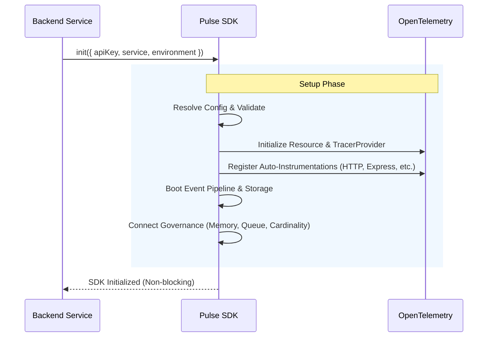
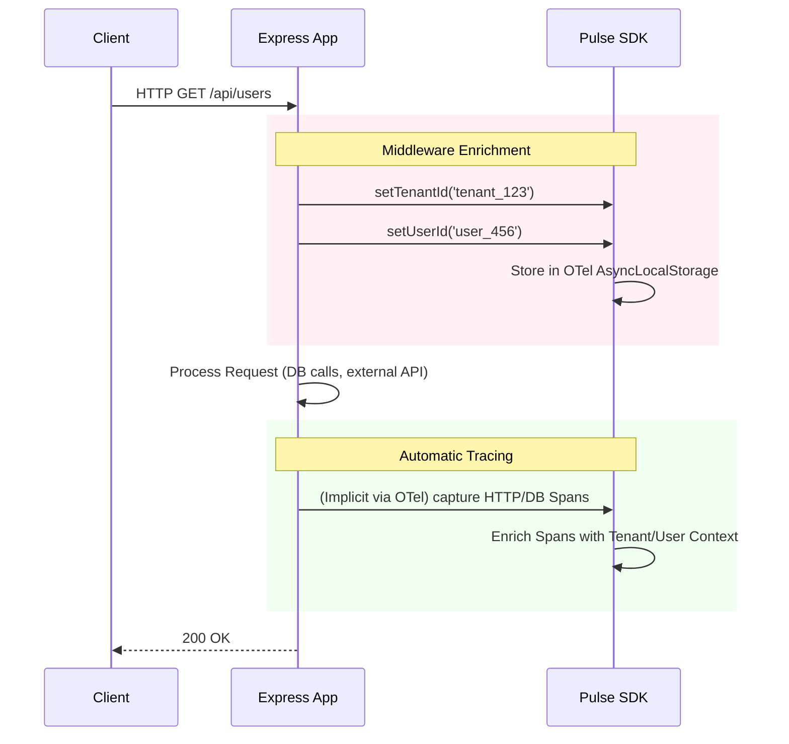
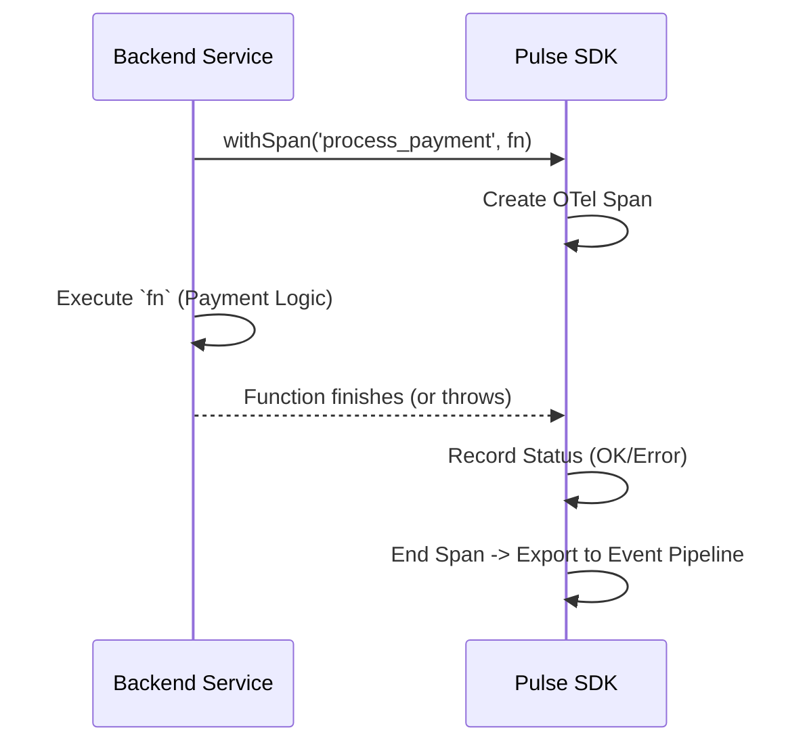
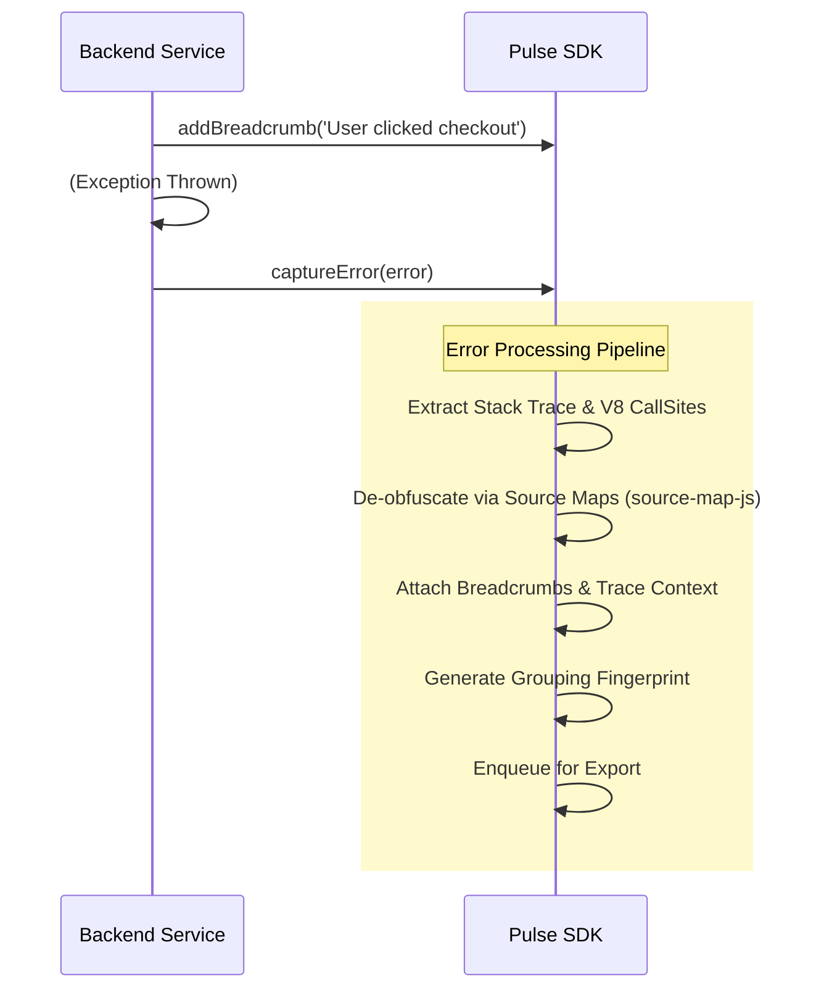

# Pulse SDK — Backend Integration Flow Document

This document outlines the step-by-step lifecycle and flow for implementing the Pulse Node.js SDK across a backend environment.

---

## 1. SDK Initialization (Application Startup)

Initialization must happen **before** any other modules (like Express, HTTP, or databases) are imported. This allows the OpenTelemetry auto-instrumentation to hook into `require` calls.



**Implementation Code:**
```typescript
import { init } from '@vikasbaplawat1/pulse-sdk';

init({
  apiKey: process.env.PULSE_API_KEY,
  service: 'user-service',
  environment: process.env.NODE_ENV || 'development',
  release: process.env.npm_package_version,
  enableTracing: true, // Auto-instruments HTTP/Express/Fastify
  enableMetrics: true
});

// Important: Import your server/app AFTER init()
import { app } from './app';
```

---

## 2. Request Lifecycle & Context Enrichment

Because the SDK utilizes OpenTelemetry's `AsyncLocalStorageContextManager`, all context is automatically propagated across asynchronous boundaries.

You only need to enrich the context once per request (typically via a middleware).



**Implementation Code:**
```typescript
import { setContext, setTenantId, setUserId } from '@vikasbaplawat1/pulse-sdk';

app.use((req, res, next) => {
  // Bind standard attributes for the entire request lifecycle
  if (req.user) setUserId(req.user.id);
  if (req.tenant) setTenantId(req.tenant.id);
  
  // Custom business context
  setContext({
    route: req.path,
    region: 'us-east-1'
  });
  
  next();
});
```

---

## 3. Manual Tracing (Custom Business Logic)

While HTTP and Database calls are auto-instrumented, you can wrap complex custom business logic in spans to measure exact execution times.



**Implementation Code:**
```typescript
import { withSpan } from '@vikasbaplawat1/pulse-sdk';

async function processPayment(orderId: string) {
  // This wraps the execution in a span and measures duration automatically
  return await withSpan('process_payment', async (span) => {
    span.setAttribute('orderId', orderId);
    
    const result = await stripe.charges.create({ ... });
    span.setAttribute('chargeId', result.id);
    
    return result;
  }); // Span safely closed even if stripe.charges throws
}
```

---

## 4. Error Capture & Breadcrumbs

Errors caught by Express/Global handlers can be captured. Breadcrumbs are tracked automatically for network requests but can be added manually.



**Implementation Code:**
```typescript
import { captureError, addBreadcrumb } from '@vikasbaplawat1/pulse-sdk';

app.post('/checkout', async (req, res) => {
  addBreadcrumb({
    category: 'business_logic',
    message: 'Starting checkout process',
    data: { cartSize: req.body.items.length }
  });

  try {
    await processPayment(req.body);
  } catch (error) {
    // Captures the error, stack trace, active traceId, and recent breadcrumbs
    captureError(error, {
      context: { cartSize: req.body.items.length },
      severity: 'error'
    });
    res.status(500).send('Checkout failed');
  }
});
```

---

## 5. Shutdown and Cleanup

When the Node.js process shuts down (e.g., Kubernetes scaling down), you must flush the SDK to ensure no telemetry is lost in the queues.

```typescript
import { shutdown } from '@vikasbaplawat1/pulse-sdk';

process.on('SIGTERM', async () => {
  console.log('SIGTERM received. Shutting down gracefully...');
  
  // Closes the server
  server.close();

  // Flushes OTel exporters, writes persistent queues to disk, and closes connections
  await shutdown(5000); // Wait up to 5s to flush
  
  process.exit(0);
});
```
