# SDK-NODE ENTERPRISE-GRADE ARCHITECTURE ANALYSIS

## PHASE 3 — WORKFLOW & EXECUTION FLOW ANALYSIS

This document provides detailed step-by-step workflows, sequence diagrams, flowcharts, execution trees, timing diagrams, and lifecycle diagrams for every major SDK workflow. All diagrams are in Mermaid format (renderable in GitHub, GitLab, Notion, and VS Code with Mermaid extension).

---

## TABLE OF CONTENTS

1. [SDK Initialization Workflow](#1-sdk-initialization-workflow)
2. [Express Middleware Request Workflow](#2-express-middleware-request-workflow)
3. [Error Capture Workflow](#3-error-capture-workflow)
4. [Span / Tracing Workflow](#4-span--tracing-workflow)
5. [Metric Capture Workflow](#5-metric-capture-workflow)
6. [Transport & Batching Workflow](#6-transport--batching-workflow)
7. [Graceful Shutdown Workflow](#7-graceful-shutdown-workflow)
8. [Crash / Uncaught Exception Workflow](#8-crash--uncaught-exception-workflow)
9. [Remote Config Refresh Workflow](#9-remote-config-refresh-workflow)
10. [Persistent Storage Crash Recovery Workflow](#10-persistent-storage-crash-recovery-workflow)
11. [Context Propagation Workflow](#11-context-propagation-workflow)
12. [Load Shedding & Backpressure Workflow](#12-load-shedding--backpressure-workflow)
13. [Full End-to-End Request Lifecycle](#13-full-end-to-end-request-lifecycle)

---

---

## 1. SDK INITIALIZATION WORKFLOW

### 1.1 Step-by-Step Execution

```
Phase 0 — Pre-Init Guard
  ├── Check if already initialized → if yes, warn and return
  ├── validateInitOptions(options) → throw if apiKey missing
  └── Set client.initializing = true

Phase 1 — Remote Config Fetch
  ├── ConfigManager.initialize(options)
  ├── POST /v1/config { apiKey, capabilities[] }
  ├── Timeout: 3000ms
  ├── On success → mergeConfigs(remote, defaults)
  ├── applySafetyClamps() → enforce ceiling values
  ├── buildUserOverrides(options) → user options win
  ├── freezeDeep(config) → immutable snapshot
  └── On failure → use defaults (degraded mode)

Phase 2 — Version Policy Enforcement
  ├── VersionPolicy.enforce(config.versionPolicy, SDK_VERSION)
  ├── If BLOCKED → throw SDKError (hard stop)
  ├── If DEGRADED → FeatureController.setDegradedMode(true)
  └── If OK → continue

Phase 3 — Control Plane Initialization
  ├── KillswitchEngine.initialize(config.killswitches)
  ├── SamplingEngine.initialize(config.sampling)
  ├── FeatureController.initialize(config.features)
  ├── LimitsEngine.initialize(config.limits)
  └── SecurityScrubber.initialize(config.security)

Phase 4 — Transport Router Initialization
  ├── TransportRouter.initialize(config.transport, apiKey, ingestUrl)
  ├── Create ConnectionManager (semaphores per route)
  ├── Create BatchManager per route (errors, traces, metrics, logs, ...)
  └── Create EventQueue per route

Phase 5 — Legacy Init Flow
  ├── sendInitRequest(apiKey, baseUrl) → POST /v1/init
  ├── Receive: projectId, plan, planFeatures, ingestion config
  └── mergeConfig(existing, initResponse)

Phase 6 — Subsystem Registration (via FeatureController)
  ├── register('tracing', initTracer, shutdownTracer)
  │     └── NodeTracerProvider + BatchSpanProcessor + PipelineSpanExporter
  ├── register('metrics', otelMetrics.init, otelMetrics.shutdown)
  │     └── MeterProvider + ExponentialHistogramAggregation + PulseMetricReader
  ├── register('errors', setupGlobalErrorHandlers, resetGlobalErrorHandlers)
  │     └── process.on('uncaughtException') + process.on('unhandledRejection')
  ├── register('logging', LoggingSubsystem.start, LoggingSubsystem.stop)
  ├── register('profiling', ProfilingSubsystem.start, ProfilingSubsystem.stop)
  ├── register('crons', CronSubsystem.start, CronSubsystem.stop)
  └── register('session', SessionManager.init, SessionManager.reset)

Phase 7 — Config Change Listeners
  ├── configManager.onConfigChange(killswitchEngine.handleConfigChange)
  ├── configManager.onConfigChange(samplingEngine.handleConfigChange)
  ├── configManager.onConfigChange(featureController.handleConfigChange)
  ├── configManager.onConfigChange(limitsEngine.handleConfigChange)
  ├── configManager.onConfigChange(transportRouter.handleConfigChange)
  └── configManager.onConfigChange(securityScrubber.handleConfigChange)

Phase 8 — Background Services
  ├── configManager.startRefreshLoop() → setInterval(300s)
  ├── adaptivePressure.start() → setInterval(2s)
  ├── registerSignalHandlers() → SIGTERM, SIGINT → shutdown()
  ├── persistentStorage.init() → replay persisted events
  └── filterBufferedEvents() → replay pre-init buffered events

Phase 9 — SDK Ready
  ├── client.initialized = true
  ├── client.initializing = false
  └── Drain pre-init event buffer → processEvent() for each
```

### 1.2 Sequence Diagram

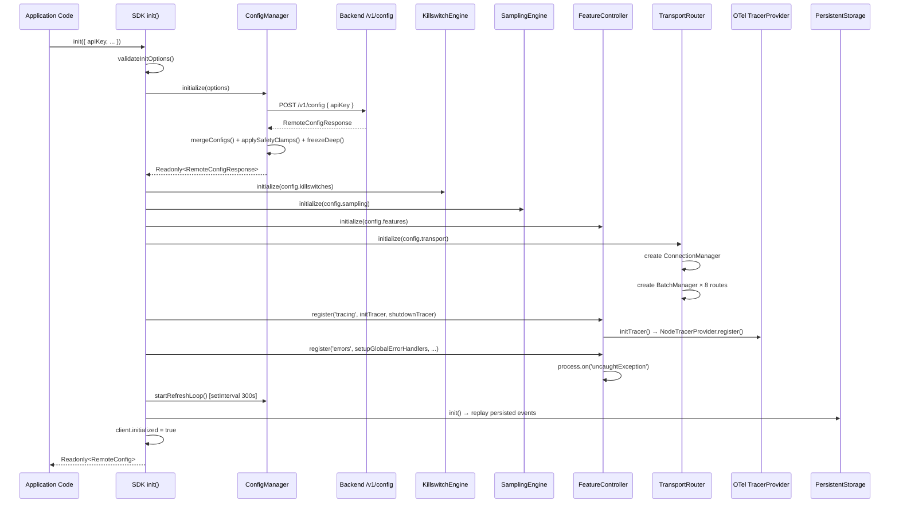

### 1.3 Initialization Timing Diagram

```mermaid
gantt
    title SDK Initialization Timeline
    dateFormat  x
    axisFormat  %Lms

    section Network I/O
    POST /v1/config (3s timeout)     :0, 150
    POST /v1/init (5s timeout)       :160, 300

    section In-Memory
    validateInitOptions              :0, 2
    KillswitchEngine.initialize      :155, 158
    SamplingEngine.initialize        :158, 161
    FeatureController.initialize     :161, 164
    LimitsEngine.initialize          :164, 167
    SecurityScrubber.initialize      :167, 170

    section Async Setup
    TransportRouter.initialize       :170, 185
    initTracer (OTel)                :305, 320
    otelMetrics.init                 :320, 330
    setupGlobalErrorHandlers         :330, 332
    persistentStorage.init           :332, 340

    section Background
    configManager.startRefreshLoop   :340, 342
    adaptivePressure.start           :342, 344
    SDK Ready                        :344, 345
```

### 1.4 Initialization State Machine

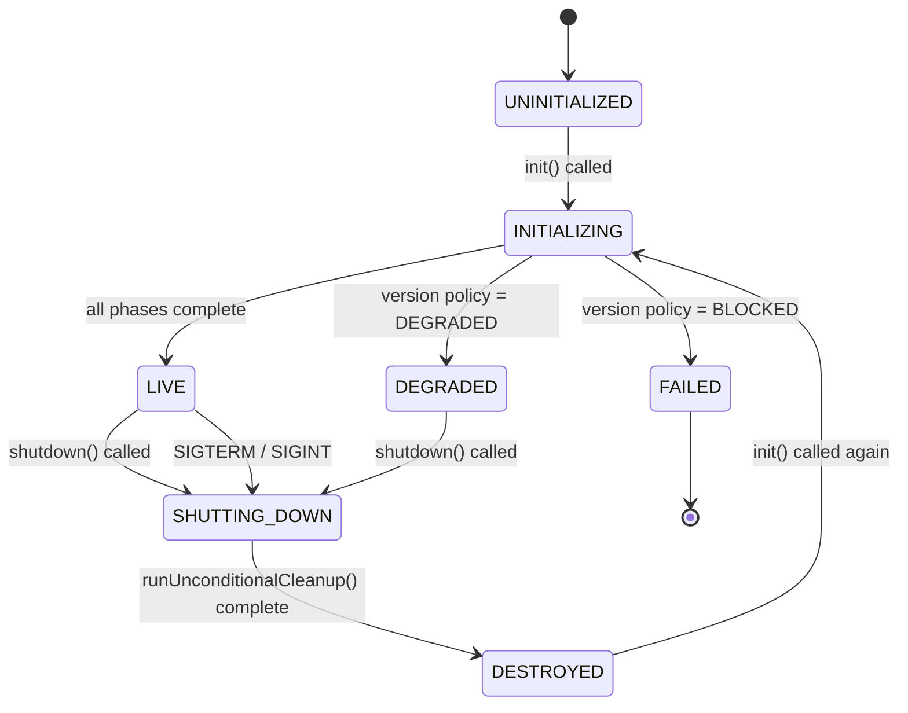

---

---

## 2. EXPRESS MIDDLEWARE REQUEST WORKFLOW

### 2.1 Step-by-Step Execution

```
Step 1 — Request Arrives at monitorMiddleware
  ├── Extract path from req.path / req.originalUrl / req.url
  └── Strip query string → clean path

Step 2 — Fast Path Ignore Check
  ├── matchesIgnoredPath(path, options.ignorePaths)
  └── If match → next() immediately (zero SDK overhead)

Step 3 — Request Identity Resolution
  ├── requestId = req.headers['x-request-id'] ?? req.headers['x-correlation-id'] ?? generateId()
  └── tenantId = req.headers['x-tenant-id']

Step 4 — Capture Gate Evaluation
  ├── evaluateCaptureGate({ path, method, sampleKey: requestId, tenantId })
  │     ├── KillswitchEngine.isSDKDisabled() → reject if true
  │     ├── SamplingEngine.shouldSampleRequest(requestId, path)
  │     │     └── FNV-1a hash(requestId) / 2^32 < samplingRate?
  │     ├── tenantGovernor.checkTenant(tenantId) → rate limit per tenant
  │     └── Returns { capture: bool, allowHeaders, allowQuery, allowBody }
  └── If !capture → next() (no allocation, no tracking)

Step 5 — Full Identity Resolution (only if capture=true)
  ├── userId = readUserId(req) → x-user-id / user.id / userId headers
  ├── sessionId = req.headers['x-session-id']
  ├── userAgent = req.headers['user-agent']
  ├── referer = req.headers['referer']
  ├── clientIp = resolveClientIp(req.headers, req.socket.remoteAddress)
  └── startTime = Date.now()

Step 6 — Context Store Creation
  ├── createContextStore(requestId, maxBreadcrumbs, { userId, sessionId, tags })
  └── Store: { requestId, breadcrumbs: RingBuffer, user, tags, traceId, spanId }

Step 7 — withContext(store, fn) — AsyncLocalStorage binding
  ├── AsyncLocalStorage.run(store, fn)
  ├── All code inside fn() and its async descendants see this store
  └── attachRequestContextToActiveSpan(store) → enrich OTel span

Step 8 — Response Lifecycle Hooks
  ├── res.once('finish', captureCompletion)  ← normal response
  ├── res.once('close', captureCompletion)   ← connection closed
  └── res.once('error', captureError)        ← response error

Step 9 — next() — Hand off to route handlers
  └── Route handlers execute inside AsyncLocalStorage context

Step 10 — captureCompletion() fires on res.finish/close
  ├── Guard: if (captured) return  ← idempotent
  ├── bodySnapshot = captureBodySnapshot(req.body, captureBody)
  ├── responseSize = res.getHeader('content-length')
  ├── recordCaptureAccepted(tenantId) → tenant rate counter
  ├── activeSpan = trace.getActiveSpan()  ← OTel span from HttpInstrumentation
  └── activeSpan.setAttributes({
          'http.route': normalizedRoute(req),
          'http.status_code': res.statusCode,
          'pulse.request_id': requestId,
          'pulse.latency_ms': Date.now() - startTime,
          'pulse.tenant_id': tenantId,
          'pulse.user_id': userId,
          'http.client_ip': clientIp,
          ...
      })
```

### 2.2 Sequence Diagram

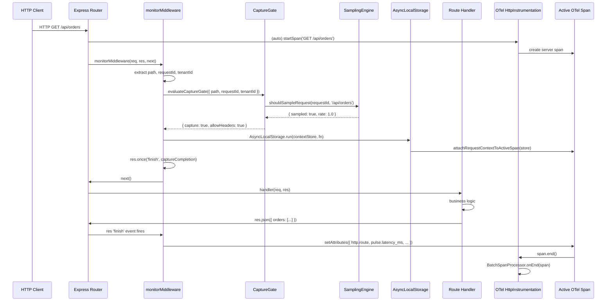

### 2.3 Middleware Execution Flowchart

```mermaid
flowchart TD
    A[Request arrives] --> B{Path in ignorePaths?}
    B -->|Yes| C[next() — zero overhead]
    B -->|No| D[Extract requestId + tenantId]
    D --> E{evaluateCaptureGate}
    E -->|SDK disabled| F[next() — no capture]
    E -->|Not sampled| F
    E -->|Tenant rate limited| F
    E -->|Capture = true| G[Resolve full identity]
    G --> H[createContextStore]
    H --> I[AsyncLocalStorage.run]
    I --> J[Attach context to OTel span]
    J --> K[Register res.finish/close/error hooks]
    K --> L[next() — route handlers run]
    L --> M{Response event}
    M -->|finish/close| N[captureCompletion]
    M -->|error| O[captureError]
    N --> P[Enrich active OTel span with Pulse attrs]
    P --> Q[OTel span.end → BatchSpanProcessor]
    O --> R[enqueueEvent → error pipeline]
```

---

---

## 3. ERROR CAPTURE WORKFLOW

### 3.1 Step-by-Step Execution

```
Step 1 — captureError(error, options) called
  ├── Killswitch gate: KillswitchEngine.isKilled('disableErrors') → return if true
  └── Sampling gate: SamplingEngine.shouldSampleError(error.message)
        └── FNV-1a hash(errorMessage) / 2^32 < config.sampling.errors?

Step 2 — Error Normalization
  ├── toError(error) → ensure Error instance (handles string, unknown)
  └── activeSpan = trace.getActiveSpan()
        ├── activeSpan.recordException(normalized)
        └── activeSpan.setStatus({ code: ERROR, message })

Step 3 — Stack Frame Parsing
  ├── parseStack(error.stack, error) → StackFrame[]
  │     ├── V8 CallSite API (if available) → precise line/col
  │     └── Regex fallback for pre-serialized stacks
  └── Path normalization (if ERROR_DEFAULTS.grouping.normalizePaths):
        └── /home/user/app/src/index.js → src/index.js

Step 4 — Fingerprint Generation
  ├── generateFingerprint(error, normalizedFrames, customFingerprint)
  │     ├── If customFingerprint provided → use it
  │     ├── Else: hash(error.name + top 3 frame filenames + line numbers)
  └── fingerprint = "TypeError:src/routes/orders.js:42:src/db.js:18"

Step 5 — Context Enrichment
  ├── ctx = getRequestContext() → from AsyncLocalStorage
  ├── breadcrumbs = ctx?.breadcrumbs.toArray() ?? []
  ├── traceId = getTraceId() → from OTel active span context
  └── spanId = getSpanId() → from OTel active span context

Step 6 — ErrorEvent Construction
  └── event = {
        type: 'error',
        message, name, stack: stackFrames,
        fingerprint, severity,
        timestamp: epochMs(),
        context, breadcrumbs,
        requestId: ctx?.requestId,
        traceId, spanId
      }

Step 7 — captureEvent(event) → enqueueEvent(event)
  ├── [SYNC] Killswitch re-check
  ├── [SYNC] LimitsEngine.admitEvent()
  ├── [SYNC] isCriticalMemoryPressure() → reject if heap > 90%
  ├── [SYNC] loadShedder.shouldShed(event) → p1_error, shed only at critical pressure
  └── [ASYNC via setImmediate] processEventAsync(event)

Step 8 — Async Pipeline Processing
  ├── ensureBaseFields() → eventId, timestamp, metadata
  ├── isFeatureEnabled('errors') → check FeatureController
  ├── LimitsEngine.enforceAttributeLimits() → trim context/tags
  ├── normalizeEvent() → truncate message(2048), name(256), context(depth 5)
  ├── enrichFromContext() → attach traceId, spanId, sessionId, breadcrumbs
  ├── errorDeduplicator.isDuplicate(fingerprint) → drop if seen within 60s
  ├── applyScopeToEvent() → attach user, tags, extra from Scope
  ├── attachSourceContext() → source map resolution for stack frames
  ├── Plugin.processEvent() → each plugin transforms event
  ├── beforeSend hook → user can modify or drop
  └── TransportRouter.send(event) → 'errors' route → BatchManager

Step 9 — Persistence Decision
  ├── persistenceGovernor.shouldPersist(event)
  │     ├── tier = 'critical' (error type)
  │     └── ALWAYS persist regardless of pressure
  └── persistentStorage.persist(event) → pendingWrites.push → scheduleFlush
```

### 3.2 Sequence Diagram

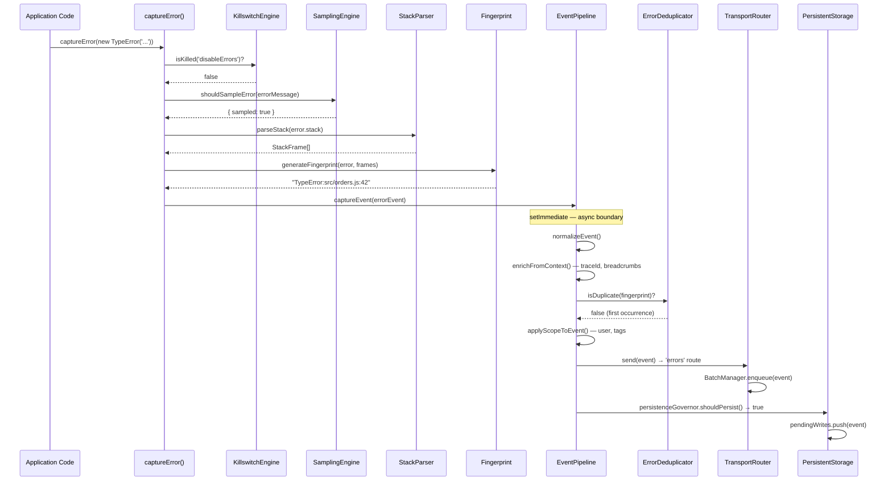

### 3.3 Error Deduplication Flow

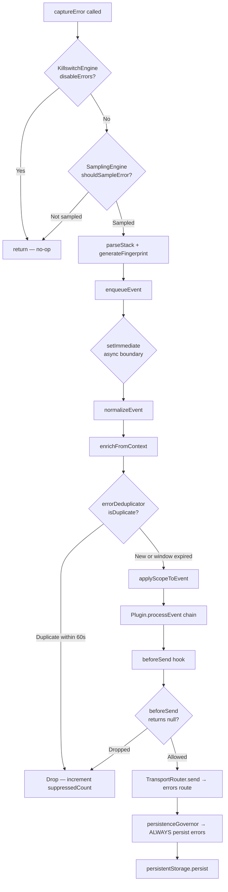

---

---

## 4. SPAN / TRACING WORKFLOW

### 4.1 Step-by-Step Execution

```
Step 1 — Span Creation (withSpan / startSpan)
  ├── tracer = getTracer() → global OTel tracer
  ├── otelOptions = toOtelSpanOptions(options)
  │     ├── kind: SpanKind.INTERNAL / SERVER / CLIENT
  │     ├── attributes: withRequestContextAttributes(options.attributes)
  │     └── links: PulseSpan.toOTelLinks(options.links)
  └── tracer.startActiveSpan(name, otelOptions, async (otelSpan) => { ... })

Step 2 — Sampling Decision (at span creation)
  ├── RemoteConfigSampler.shouldSample(context, traceId, spanName, ...)
  │     ├── url = attributes['http.route'] ?? 'http.target' ?? 'http.url'
  │     ├── SamplingEngine.shouldSampleTrace(traceId, url)
  │     │     └── FNV-1a hash(traceId) / 2^32 < config.sampling.traces
  │     ├── If sampled → RECORD_AND_SAMPLED
  │     └── If not sampled → RECORD (not NOT_RECORD — kept for error promotion)
  └── ParentBasedSampler propagates root decision to all child spans

Step 3 — Context Propagation (AsyncLocalStorage)
  ├── AsyncLocalStorageContextManager.with(ctx, fn)
  ├── All async operations inside fn() inherit the span context
  └── getActiveSpan() returns this span anywhere in the async tree

Step 4 — Child Span Attachment
  ├── Any startSpan() inside fn() creates a child span
  ├── Child span's parentSpanId = parent.spanId
  └── SpanDurationTracker.recordChildInterval(traceId, parentSpanId, start, end)

Step 5 — Span Attributes & Events
  ├── span.setAttribute(key, value) → otelSpan.setAttribute()
  ├── span.addEvent(name, attrs) → otelSpan.addEvent()
  └── span.recordError(error) → otelSpan.recordException() + setStatus(ERROR)

Step 6 — Span End
  ├── span.end(endTime?) → otelSpan.end()
  ├── _isEnded = true
  └── BatchSpanProcessor.onEnd(span) → add to export buffer

Step 7 — Batch Export (timer fires every 5000ms or buffer full at 512)
  ├── BatchSpanProcessor.export(spans[]) → PipelineSpanExporter.export()
  └── For each ReadableSpan:
        ├── spanToEvent(span) → SDK event format
        │     ├── traceId, spanId, parentSpanId
        │     ├── startTime, endTime, duration (hrTime → ms)
        │     ├── attributes (OTel semantic conventions)
        │     ├── events (span.addEvent() calls)
        │     ├── status, kind
        │     └── resource attributes
        ├── Apply privacy.capture.* gates:
        │     ├── headers → strip http.request.header.*
        │     ├── body → strip http.request.body
        │     ├── query → strip URL query params
        │     └── cookies → strip cookie headers
        ├── Apply limits.maxSpanAttributes → trim attributes
        ├── Compute exclusive duration:
        │     ├── childIntervals = spanDurationTracker.getChildIntervals(traceId, spanId)
        │     ├── computeExclusiveDuration(start, end, childIntervals)
        │     └── event.exclusiveDuration = result.exclusiveDuration
        ├── Tail-sampling error promotion:
        │     └── if !sampled && span.status === ERROR → export anyway
        └── processEvent(spanEvent) → event pipeline → TransportRouter

Step 8 — Trace Cleanup
  ├── If root span (no parentSpanId):
  └── spanDurationTracker.cleanupTrace(traceId) → free memory
```

### 4.2 Sequence Diagram

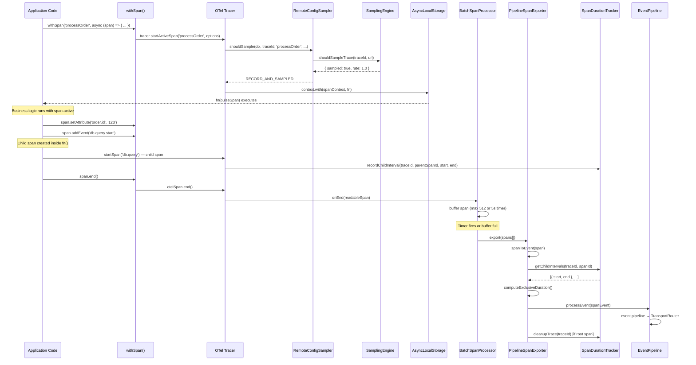

### 4.3 Span Lifecycle State Machine

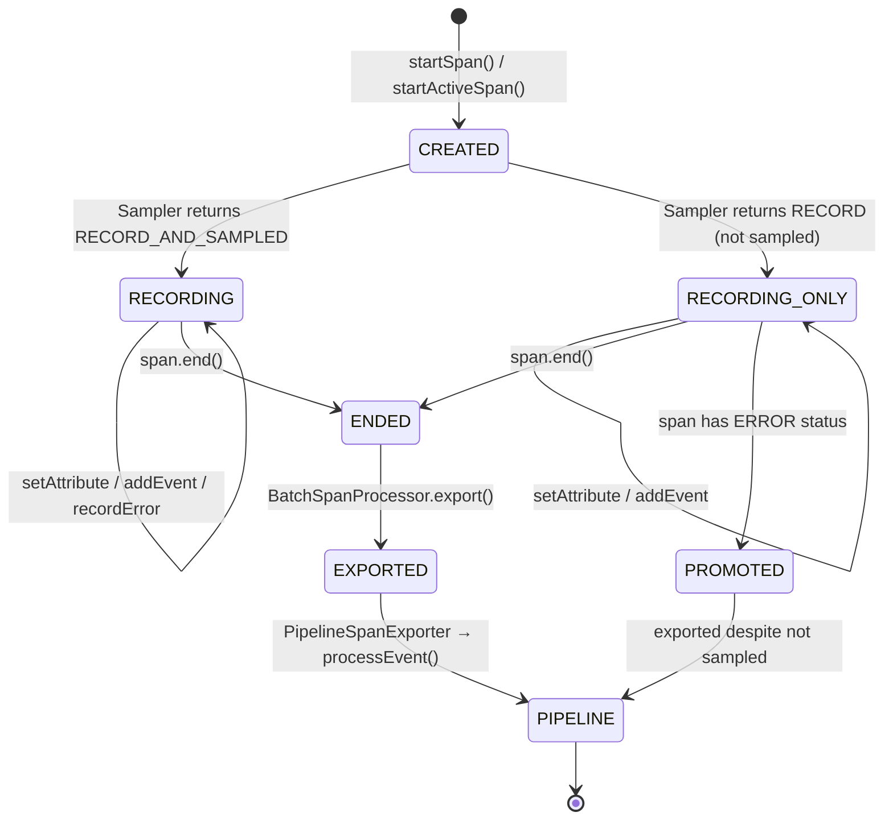

### 4.4 Exclusive Duration Computation

```mermaid
gantt
    title Exclusive Duration Calculation
    dateFormat  x
    axisFormat  %Lms

    section Parent Span (200ms total)
    Parent span                    :0, 200

    section Child Spans
    Child A (DB query)             :0, 50
    Child B (External API)         :30, 110
    Child C (Cache lookup)         :150, 180

    section Merged Coverage
    Merged A+B (overlap absorbed)  :0, 110
    Merged C                       :150, 180

    section Exclusive Duration
    Self time (200 - 140 = 60ms)   :110, 150
```

---

---

## 5. METRIC CAPTURE WORKFLOW

### 5.1 Step-by-Step Execution

```
Step 1 — captureMetric(name, value, type, options) called
  ├── Killswitch gate: KillswitchEngine.isKilled('disableMetrics') → return if true
  └── Route by type:
        ├── 'histogram' → metricsRegistry.recordHistogram(name, value, { labels })
        ├── 'counter'   → metricsRegistry.incrementCounter(name, value, { labels })
        └── 'gauge'     → metricsRegistry.setGauge(name, value, { labels })

Step 2 — MetricsRegistry Processing
  ├── canRegisterMetric(name) → check registeredMetrics.size < 500
  ├── cardinalityGovernor.sanitizeAttributes(name, labels)
  │     ├── Remove blocked attributes (userId, traceId, requestId, ...)
  │     ├── Normalize route paths (/users/123 → /users/:id)
  │     └── Enforce max 10 dimensions per metric
  ├── seriesKey = serializeLabels(sanitized) → "env=prod,region=us-east"
  └── cardinalityGovernor.canRecordSeries(name, seriesKey)
        ├── Check totalSeries < 5000
        └── Check instrumentSeries.size < 1000

Step 3 — OTel MeterProvider Recording
  ├── otelMetrics.recordHistogram(name, value, sanitized)
  │     └── meter.createHistogram(name).record(value, sanitized)
  │           └── ExponentialHistogramAggregation.record(value)
  │                 └── O(1) bucket increment (no sorting)
  └── Data stored in OTel SDK memory until PulseMetricReader.collect()

Step 4 — PulseMetricReader Collection (on flush or interval)
  ├── Triggered by: metricsRegistry.flush() or MeterProvider.forceFlush()
  ├── Collect all metric data from MeterProvider
  ├── Convert to SDK event format:
  │     └── { type: 'metric', metricName, metricType, value, tags, timestamp }
  └── processEvent(metricEvent) → event pipeline → TransportRouter → 'metrics' route
```

### 5.2 Sequence Diagram

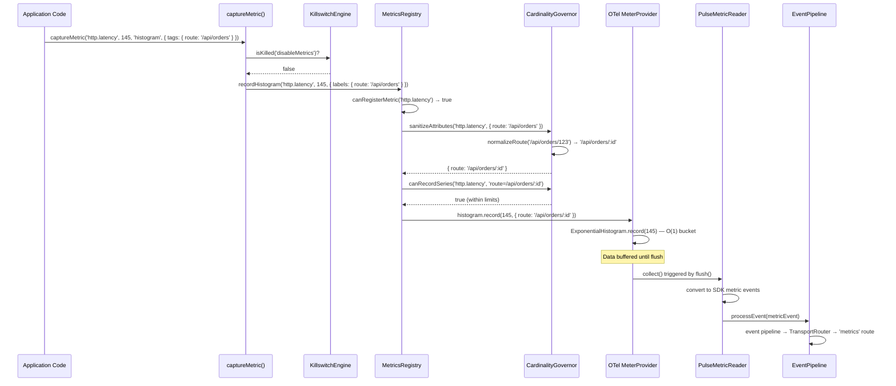

### 5.3 Metric Type Routing Flowchart

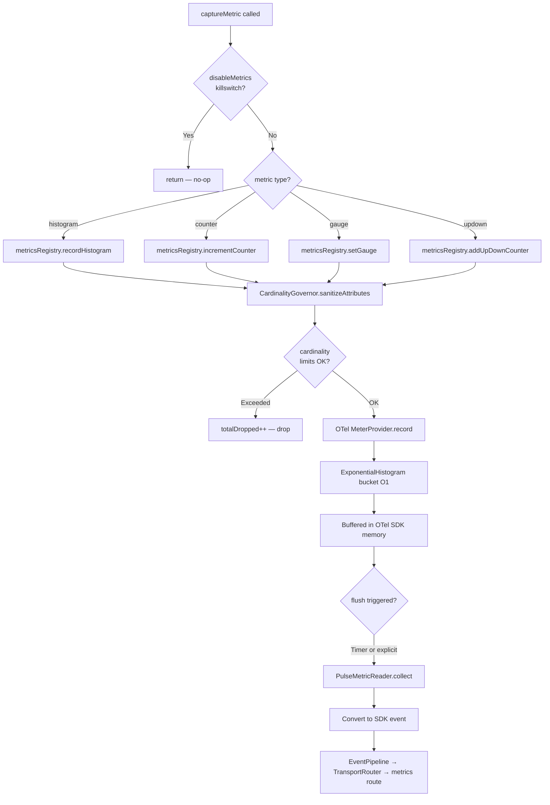

---

## 6. TRANSPORT & BATCHING WORKFLOW

### 6.1 Step-by-Step Execution

```
Step 1 — Event arrives at TransportRouter.send(event)
  ├── if disabled → return false
  ├── route = routeRegistry.resolve(event)
  │     ├── 'error' → 'errors'
  │     ├── 'request' → 'requests'
  │     ├── 'span' → 'traces'
  │     ├── 'metric' → 'metrics'
  │     └── 'log' → 'logs'
  └── batchManagers.get(route).enqueue(event)

Step 2 — BatchManager.enqueue(event)
  ├── if shutting down → return false
  ├── buffer.push(event)
  ├── pump() → check flush conditions
  │     ├── if buffer.length >= maxBatchSize → flush immediately
  │     └── if maxWaitElapsed() → flush immediately
  └── ensureTimer() → arm flush timer (maxWaitMs = 5000ms)

Step 3 — Flush Trigger (timer or size)
  ├── nextSerializableBatch() → take up to maxBatchSize events
  │     └── filter out events that fail JSON serialization
  └── sendBatch(batch)

Step 4 — sendBatch(batch)
  ├── circuitBreaker.canExecute()?
  │     ├── CLOSED → proceed
  │     ├── OPEN → skip (endpoint down, buffer events)
  │     └── HALF_OPEN → allow 1 probe
  ├── inFlight++ (concurrency tracking)
  ├── sender.sendEvents(batch)
  └── On success:
        ├── circuitBreaker.recordSuccess()
        ├── persistentStorage.discard(batch)
        └── inFlight--

Step 5 — sender.sendEvents(batch)
  ├── createPayloads(events, apiKey, maxPayloadBytes)
  │     └── O(n) incremental byte tracking → split into chunks
  └── For each payload:
        └── retry(() => postJson(ingestUrl, payload), {
                retries: config.maxRetries,
                retryable: isRetryable,
                budget: globalRetryBudget
              })

Step 6 — HTTP POST
  ├── POST https://ingest.pulse.io/v1/events
  ├── Headers: { 'Content-Type': 'application/json', 'x-api-key': apiKey }
  ├── Body: { apiKey, events: [...] }
  ├── Compression: gzip if config.compression = true
  └── Timeout: config.timeoutMs (default 10000ms)

Step 7 — Response Handling
  ├── 200 OK → success → circuitBreaker.recordSuccess()
  ├── 429 Too Many Requests → retry with Retry-After header
  ├── 5xx Server Error → retry with exponential backoff
  └── 4xx Client Error → no retry → dead letter

Step 8 — Failure Path
  ├── circuitBreaker.recordFailure()
  ├── if consecutiveFailures >= 5 → circuit OPENS
  ├── persistentStorage.persist(events) → write to NDJSON
  └── eventQueue.requeueFront(events) → retry on next tick
```

### 6.2 Sequence Diagram

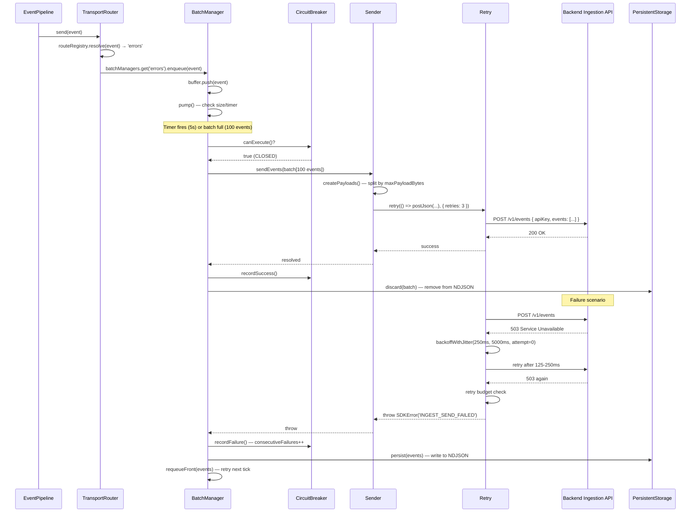

### 6.3 Circuit Breaker State Transitions

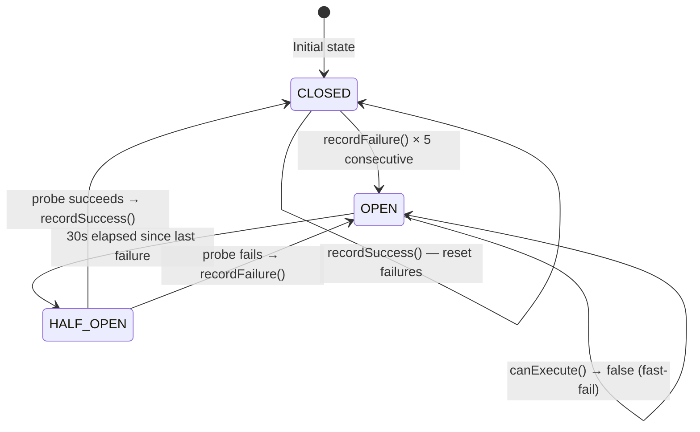

### 6.4 Retry Backoff Timing Diagram

```mermaid
gantt
    title Retry Backoff with Full Jitter (baseDelay=250ms, maxDelay=5000ms)
    dateFormat  x
    axisFormat  %Ls

    section Attempt 1
    Request                :0, 100
    Failure                :100, 101
    Backoff jitter 125-250ms :101, 225

    section Attempt 2
    Request                :225, 325
    Failure                :325, 326
    Backoff jitter 250-500ms :326, 700

    section Attempt 3
    Request                :700, 800
    Failure                :800, 801
    Backoff jitter 500-1000ms :801, 1500

    section Attempt 4 (final)
    Request                :1500, 1600
    Success or Dead Letter :1600, 1601
```

---

---

## 7. GRACEFUL SHUTDOWN WORKFLOW

### 7.1 Step-by-Step Execution (14 Orchestrated Steps)

```
Trigger: shutdown() called OR SIGTERM/SIGINT received

Pre-Shutdown
  ├── isSDKShuttingDown = true
  ├── Start global timeout timer (default 10s)
  └── Promise.race([runOrchestratedShutdown(), timeoutPromise])

Step 1  — beforeShutdown hooks
  └── Run all user-registered hooks (max 5s each)

Step 2  — Stop accepting new events
  └── eventQueue.setShuttingDown(true) → all new add() calls rejected

Step 3  — FeatureController.teardownAll()
  ├── Stop LoggingSubsystem
  ├── Stop ProfilingSubsystem
  └── Stop CronSubsystem

Step 4  — flushTracer()
  └── BatchSpanProcessor.forceFlush() → export all buffered spans → PipelineSpanExporter

Step 5  — drainPendingEventProcessing()
  └── Wait for all setImmediate-deferred processEventAsync() calls to complete

Step 6  — metricsRegistry.flush() + otelMetrics.shutdown()
  ├── PulseMetricReader.collect() → export all buffered metrics
  └── MeterProvider.shutdown()

Step 7  — flush() — transport queues
  └── Batcher.flush() → drain eventQueue → sendEvents() → HTTP POST

Step 8  — teardownPlugins()
  └── Call teardown() on each registered plugin

Step 9  — shutdownTracer()
  └── NodeTracerProvider.shutdown() → release context manager + processors

Step 10 — CronSubsystem.reset()
Step 11 — ProfilingSubsystem.reset()
Step 12 — LoggingSubsystem.reset()
Step 13 — resetSessionManager()
Step 14 — resetGlobalErrorHandlers()
         └── process.removeListener('uncaughtException')
             process.removeListener('unhandledRejection')
             restore console.error

Unconditional Cleanup (runs even if orchestrator timed out):
  ├── TransportRouter.shutdown() → drain all BatchManagers
  ├── eventQueue.clear()
  ├── resetEventPipeline()
  ├── client.clear()
  ├── ConfigManager.reset()
  ├── FeatureController.reset()
  ├── KillswitchEngine.reset()
  ├── SamplingEngine.reset()
  ├── LimitsEngine.reset()
  ├── SecurityScrubber.reset()
  ├── tenantGovernor.reset()
  └── stopBatcher()
```

### 7.2 Shutdown Sequence Diagram

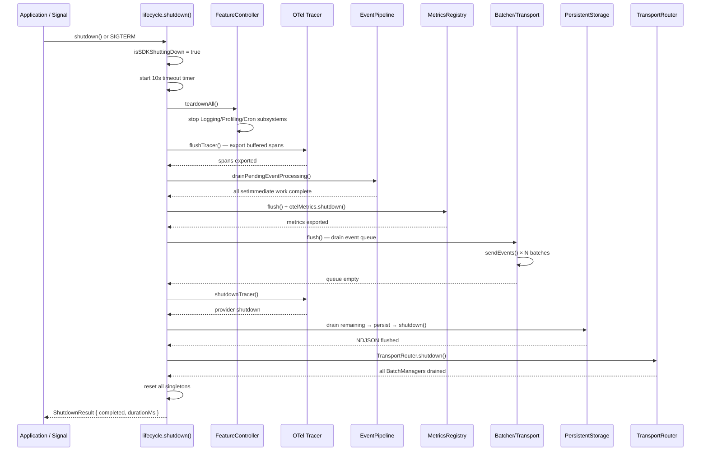

### 7.3 Shutdown Flowchart

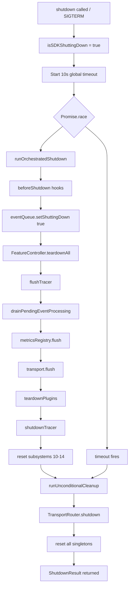

---

## 8. CRASH / UNCAUGHT EXCEPTION WORKFLOW

### 8.1 Step-by-Step Execution

```
Trigger: process.on('uncaughtException', handler) fires

Step 1 — OTel Instrumentation Error Filter
  ├── isOtelInstrumentationError(err)?
  │     └── Check for known OTel race condition: socket destroyed before response
  └── If OTel error → log warn + return (do NOT crash-flush)

Step 2 — captureError(err, { mechanism: 'uncaughtException' })
  ├── Killswitch check (disableErrors)
  ├── Sampling check (shouldSampleError)
  ├── parseStack(err.stack) → StackFrame[]
  ├── generateFingerprint(err, frames)
  └── enqueueEvent(errorEvent) → setImmediate(processEventAsync)

Step 3 — crashFlush(timeoutMs=2000)
  ├── Bounded 2-second timeout (process must not hang)
  ├── drainPendingEventProcessing() → wait for setImmediate queue
  ├── Batcher.flush() → drain eventQueue → sendEvents()
  │     ├── Attempt 1: sendEvents(batch) → HTTP POST
  │     ├── On failure: persist to NDJSON + requeue
  │     └── Max 3 attempts
  └── persistentStorage.flush() → write all pending NDJSON

Step 4 — Process continues (SDK never calls process.exit)
  └── Node.js default behavior: process exits after uncaughtException handler
```

### 8.2 Crash Flush Sequence Diagram

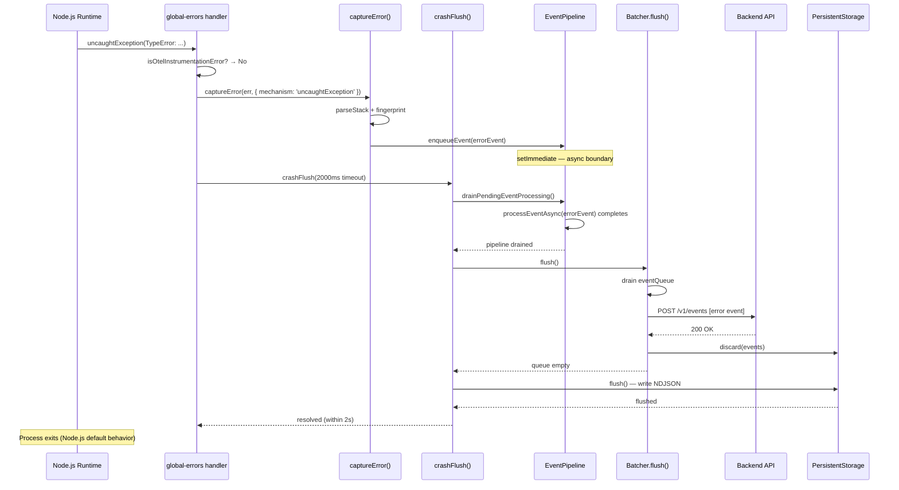

---

---

## 9. REMOTE CONFIG REFRESH WORKFLOW

### 9.1 Step-by-Step Execution

```
Trigger: setInterval fires every 300s (configurable)

Step 1 — refreshConfig()
  ├── if destroyed → return
  └── fetchConfig() → POST /v1/config { apiKey, capabilities }

Step 2 — Config Diffing
  ├── configDiffer.diff(oldConfig, newConfig)
  └── Returns ConfigDiff:
        ├── killswitches: { added: [], removed: [], changed: [] }
        ├── sampling: { changed: bool }
        ├── features: { changed: bool }
        ├── limits: { changed: bool }
        └── hasChanges: bool

Step 3 — If hasChanges → notify all listeners
  ├── KillswitchEngine.handleConfigChange(diff, newConfig)
  │     ├── For each killswitch that changed:
  │     │     ├── Activated → call subsystem.shutdown()
  │     │     └── Deactivated → call subsystem.startup()
  │     └── Update currentState atomically
  ├── SamplingEngine.handleConfigChange(diff, newConfig)
  │     └── this.config = { ...newConfig.sampling }
  ├── FeatureController.handleConfigChange(diff, newConfig)
  │     ├── Feature turned ON → factory() → subsystem starts
  │     └── Feature turned OFF → teardown() → subsystem stops
  ├── LimitsEngine.handleConfigChange(diff, newConfig)
  │     └── this.config = { ...newConfig.limits }
  ├── TransportRouter.handleConfigChange(diff, newConfig)
  │     └── Update batch sizes, timeouts, concurrency per route
  └── SecurityScrubber.handleConfigChange(diff, newConfig)
        └── Update PII patterns, blocked headers

Step 4 — Config frozen and stored
  ├── config = freezeDeep(newConfig)
  └── All engines read new config on next operation
```

### 9.2 Config Refresh Sequence Diagram

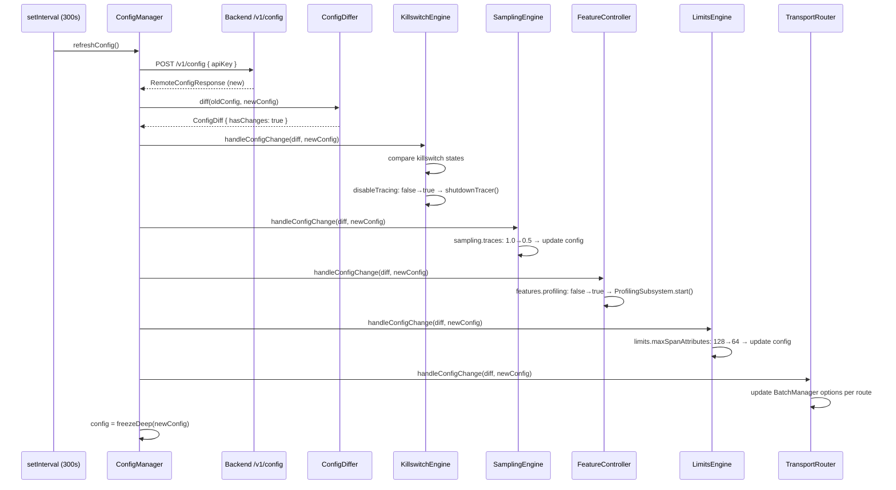

---

## 10. PERSISTENT STORAGE CRASH RECOVERY WORKFLOW

### 10.1 Step-by-Step Execution

```
WRITE PATH (during normal operation):
  Step 1 — persistentStorage.persist(event)
    ├── pendingWrites.push(event)
    └── scheduleFlush() → setTimeout(0) if not already scheduled

  Step 2 — flush() (async, serialized)
    ├── enqueueWrite(async () => {
    │     lines = pendingWrites.map(JSON.stringify).join('\n') + '\n'
    │     pendingWrites = []
    │     await fs.appendFile(filePath, lines)
    │   })
    └── writeQueue = writeQueue.then(operation) — serialized, never concurrent

  Step 3 — File rotation check
    ├── if file size > 10MB → rotate()
    │     ├── rename current → .bak
    │     └── if .bak files > 5 → delete oldest
    └── Continue writing to new file

DISCARD PATH (after successful send):
  Step 1 — persistentStorage.discard(events)
    ├── Read current NDJSON file
    ├── Parse all lines → Event[]
    ├── Filter out events with matching eventIds
    └── rewriteFile(remaining) → overwrite file

REPLAY PATH (on SDK init after crash):
  Step 1 — persistentStorage.init()
    ├── ensureDirectory() → mkdir -p .tmp/pulse-sdk/events/
    ├── checkAndRotate() → handle oversized files
    └── replay() → read NDJSON → parse → return Event[]

  Step 2 — filterBufferedEvents(config)
    ├── For each replayed event:
    │     ├── Check if event type is still enabled (features.*)
    │     └── Re-enqueue via processEvent()
    └── Events re-enter the pipeline as if freshly captured
```

### 10.2 Crash Recovery Sequence Diagram

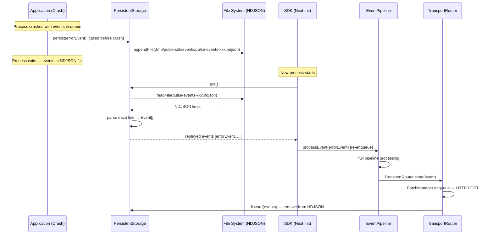

---

## 11. CONTEXT PROPAGATION WORKFLOW

### 11.1 Distributed Trace Context Flow

```
INCOMING REQUEST (extractTraceContext):
  Step 1 — HTTP request arrives with traceparent header
    └── traceparent: 00-4bf92f3577b34da6a3ce929d0e0e4736-00f067aa0ba902b7-01

  Step 2 — extractTraceContext(req.headers)
    ├── propagation.extract(otelContext.active(), headers, headerGetter)
    │     └── W3CTraceContextPropagator.extract()
    │           ├── Parse traceparent: version-traceId-spanId-flags
    │           └── Create SpanContext { traceId, spanId, traceFlags }
    └── Returns OTel Context with embedded SpanContext

  Step 3 — AsyncLocalStorage stores context
    └── All async operations in this request see the same traceId

OUTGOING REQUEST (injectTraceContext):
  Step 1 — SDK makes outbound HTTP call
    └── injectTraceContext(headers, ctx?)

  Step 2 — W3C headers injected
    ├── propagation.inject(activeCtx, headers, headerSetter)
    │     └── headers['traceparent'] = '00-{traceId}-{spanId}-01'
    └── Pulse custom headers:
          ├── headers['x-pulse-trace-id'] = traceId
          ├── headers['x-pulse-span-id'] = spanId
          └── headers['x-pulse-sampled'] = '1'

IN-PROCESS PROPAGATION:
  ├── AsyncLocalStorageContextManager.with(ctx, fn)
  ├── All code inside fn() and its async descendants inherit context
  └── getActiveSpan() → reads from AsyncLocalStorage
```

### 11.2 Context Propagation Sequence Diagram

```mermaid
sequenceDiagram
    participant ServiceA as Service A
    participant MW as monitorMiddleware
    participant ALS as AsyncLocalStorage
    participant Route as Route Handler
    participant HTTP as Outbound HTTP
    participant ServiceB as Service B

    ServiceA->>MW: GET /api/orders\ntraceparent: 00-abc123-def456-01
    MW->>MW: extractTraceContext(req.headers)
    MW->>ALS: context.with(extractedCtx, fn)
    ALS->>Route: handler runs with traceId=abc123

    Route->>HTTP: fetch('https://service-b/items')
    HTTP->>HTTP: injectTraceContext(headers)
    HTTP->>ServiceB: GET /items\ntraceparent: 00-abc123-newSpanId-01\nx-pulse-trace-id: abc123

    Note over ServiceB: Same traceId — distributed trace connected

    ServiceB-->>HTTP: 200 OK
    HTTP-->>Route: response
    Route-->>MW: res.json(...)
    MW->>MW: captureCompletion — enrich OTel span
```

### 11.3 AsyncLocalStorage Context Tree

```mermaid
flowchart TD
    A["Request arrives\ntraceId: abc123\nspanId: root001"] --> B["AsyncLocalStorage.run(store)"]
    B --> C["Route Handler\ngetTraceId() → abc123"]
    C --> D["DB Query\ngetTraceId() → abc123\ngetSpanId() → root001"]
    C --> E["External API call\ngetTraceId() → abc123\ngetSpanId() → root001"]
    D --> F["Promise.then()\ngetTraceId() → abc123 ✓"]
    E --> G["async/await\ngetTraceId() → abc123 ✓"]
    F --> H["captureError()\ntraceId auto-attached ✓"]
    G --> H
```

---

---

## 12. LOAD SHEDDING & BACKPRESSURE WORKFLOW

### 12.1 Step-by-Step Execution

```
AdaptivePressureMonitor polls every 2000ms:
  ├── memoryScore = scoreMemory(heapUtilization)
  │     ├── < 70% → 0
  │     ├── 70-90% → 40
  │     └── > 90% → 80
  ├── lagScore = scoreLag(eventLoopLag_p99)
  │     ├── < 50ms → 0
  │     ├── 50-200ms → 20
  │     ├── 200-500ms → 45
  │     └── > 500ms → 75
  ├── queueScore = scoreQueue(queueUtilization)
  │     ├── < 50% → 0
  │     ├── 50-80% → 25
  │     ├── 80-95% → 50
  │     └── > 95% → 75
  ├── gcScore = scoreGC(gcPercent)
  │     ├── < 10% → 0
  │     ├── 10-30% → 25
  │     └── > 30% → 50
  ├── compositeScore = max(memoryScore, lagScore, queueScore, gcScore)
  └── level = scoreToLevel(compositeScore)
        ├── < 25 → 'normal'
        ├── < 50 → 'elevated'
        ├── < 75 → 'high'
        └── ≥ 75 → 'critical'

Event Admission (enqueueEvent):
  ├── isCriticalMemoryPressure() → heap > 90%?
  │     └── If critical AND event is low priority → reject synchronously
  └── loadShedder.shouldShed(event)
        ├── classifyEvent(event) → P0/P1/P2/P3
        └── evaluate(priority, pressureLevel)

Queue Tier Overflow:
  ├── critical tier full → shed 1 high event to make room
  ├── high tier full → shed 1 normal event to make room
  └── normal tier full → drop event (notifyDrop)

Batcher Tick Guards:
  ├── memory.level === 'critical' → skip tick entirely
  ├── !circuitBreaker.canExecute() → skip tick
  ├── !rateLimiter.tryAcquire() → skip tick
  └── inFlightCount >= maxConcurrentSends → skip tick
```

### 12.2 Backpressure Decision Flowchart

```mermaid
flowchart TD
    A[Event arrives at enqueueEvent] --> B{SDK shutdown?}
    B -->|Yes| Z[Reject — shutdown_rejected]
    B -->|No| C{KillswitchEngine\nisSDKDisabled?}
    C -->|Yes| Z
    C -->|No| D{isCriticalMemoryPressure\nheap > 90%?}
    D -->|Yes + low priority| Z
    D -->|No or high priority| E{loadShedder\nshouldShed?}
    E -->|Shed| Z
    E -->|Allow| F{SDK initialized?}
    F -->|No| G[Buffer to pre-init queue]
    F -->|Yes| H[setImmediate — async pipeline]
    H --> I{EventQueue.add}
    I --> J{Tier full?}
    J -->|critical full| K[Shed 1 high event → add critical]
    J -->|high full| L[Shed 1 normal event → add high]
    J -->|normal full| Z
    J -->|Space available| M[Add to tier]
    K --> M
    L --> M
    M --> N[BatchManager.enqueue]
```

### 12.3 Pressure Level Transition Diagram

```mermaid
stateDiagram-v2
    [*] --> normal : SDK starts
    normal --> elevated : compositeScore 25-49
    elevated --> normal : compositeScore < 25
    elevated --> high : compositeScore 50-74
    high --> elevated : compositeScore < 50
    high --> critical : compositeScore >= 75
    critical --> high : compositeScore < 75

    note right of normal
        Shed nothing
        All events accepted
    end note

    note right of elevated
        Shed nothing
        Warning logged
    end note

    note right of high
        Shed P3 (metrics, messages)
        Errors and spans survive
    end note

    note right of critical
        Shed P2 + P3
        Only P0 + P1 survive
        Batcher tick skipped
    end note
```

---

## 13. FULL END-TO-END REQUEST LIFECYCLE

This is the master workflow combining all subsystems for a single HTTP request from arrival to backend ingestion.

### 13.1 Complete Execution Tree

```
HTTP GET /api/orders/123 arrives
│
├── [OTel HttpInstrumentation] — auto-instrumented
│     ├── extractTraceContext(req.headers) → traceId from upstream
│     ├── startSpan('GET /api/orders/:id', { kind: SERVER })
│     └── AsyncLocalStorage.run(spanContext, handler)
│
├── [monitorMiddleware] — Pulse Express middleware
│     ├── matchesIgnoredPath('/api/orders/123') → false
│     ├── requestId = req.headers['x-request-id'] ?? generateId()
│     ├── evaluateCaptureGate({ path, requestId, tenantId })
│     │     ├── SamplingEngine.shouldSampleRequest(requestId, '/api/orders/:id')
│     │     │     └── FNV-1a(requestId) / 2^32 < 1.0 → sampled
│     │     └── tenantGovernor.checkTenant(tenantId) → allowed
│     ├── createContextStore(requestId, 100, { userId, tags })
│     ├── AsyncLocalStorage.run(store, fn)
│     ├── attachRequestContextToActiveSpan(store)
│     ├── res.once('finish', captureCompletion)
│     └── next()
│
├── [Route Handler] — user code
│     ├── DB query → Prisma instrumentation creates child span
│     │     ├── startSpan('prisma:query', { kind: CLIENT })
│     │     ├── SpanDurationTracker.recordChildInterval(traceId, parentSpanId, ...)
│     │     └── span.end()
│     ├── External API → OTel HttpInstrumentation creates child span
│     │     ├── injectTraceContext(outboundHeaders)
│     │     └── span.end()
│     └── res.json({ orders: [...] })
│
├── [res.finish event fires]
│     ├── captureCompletion()
│     ├── activeSpan.setAttributes({
│     │     'http.route': '/api/orders/:id',
│     │     'http.status_code': 200,
│     │     'pulse.request_id': requestId,
│     │     'pulse.latency_ms': 145
│     │   })
│     └── OTel span.end()
│
├── [BatchSpanProcessor] — timer fires (5s) or buffer full (512)
│     └── PipelineSpanExporter.export(spans[])
│           ├── spanToEvent(rootSpan) → SDK event
│           ├── spanToEvent(dbSpan) → SDK event
│           ├── spanToEvent(httpSpan) → SDK event
│           ├── computeExclusiveDuration() for each span
│           └── processEvent(spanEvent) × 3
│
├── [EventPipeline] — for each span event
│     ├── normalizeEvent()
│     ├── enrichFromContext()
│     ├── applyScopeToEvent()
│     ├── Plugin.processEvent()
│     └── TransportRouter.send(event) → 'traces' route
│
├── [BatchManager 'traces'] — accumulates spans
│     ├── buffer.push(spanEvent) × 3
│     ├── timer fires (5s) → pump()
│     └── sendBatch(batch[3 spans])
│
├── [Sender]
│     ├── createPayloads(events, apiKey, maxPayloadBytes)
│     └── retry(() => postJson(ingestUrl, payload), { retries: 3 })
│
└── [Backend Ingestion API]
      ├── POST /v1/events { apiKey, events: [root, db, http spans] }
      └── 200 OK → spans ingested
```

### 13.2 Master Sequence Diagram

```mermaid
sequenceDiagram
    participant Client as HTTP Client
    participant OTel as OTel HttpInstrumentation
    participant MW as monitorMiddleware
    participant ALS as AsyncLocalStorage
    participant Route as Route Handler
    participant Prisma as Prisma Instrumentation
    participant BSP as BatchSpanProcessor
    participant PSE as PipelineSpanExporter
    participant EP as EventPipeline
    participant BM as BatchManager (traces)
    participant SND as Sender
    participant BE as Backend API

    Client->>OTel: GET /api/orders/123
    OTel->>OTel: extractTraceContext(headers)
    OTel->>OTel: startSpan('GET /api/orders/:id')
    OTel->>MW: monitorMiddleware(req, res, next)
    MW->>MW: evaluateCaptureGate → sampled
    MW->>ALS: AsyncLocalStorage.run(contextStore)
    MW->>OTel: attachRequestContextToActiveSpan
    MW->>Route: next()

    Route->>Prisma: db.order.findMany()
    Prisma->>Prisma: startSpan('prisma:query')
    Prisma-->>Route: orders[]
    Prisma->>BSP: span.end() → onEnd(dbSpan)

    Route->>Route: res.json({ orders })
    Route->>MW: res 'finish' event
    MW->>OTel: activeSpan.setAttributes({ pulse.latency_ms: 145 })
    OTel->>BSP: span.end() → onEnd(rootSpan)

    Note over BSP: Timer fires (5s)

    BSP->>PSE: export([rootSpan, dbSpan])
    PSE->>PSE: spanToEvent() × 2
    PSE->>PSE: computeExclusiveDuration()
    PSE->>EP: processEvent(rootSpanEvent)
    PSE->>EP: processEvent(dbSpanEvent)
    EP->>BM: TransportRouter.send() → enqueue × 2
    BM->>BM: buffer accumulates

    Note over BM: Timer fires (5s)

    BM->>SND: sendBatch([rootSpan, dbSpan])
    SND->>BE: POST /v1/events { events: [...] }
    BE-->>SND: 200 OK
    SND-->>BM: success
```

### 13.3 End-to-End Timing Diagram

```mermaid
gantt
    title End-to-End Request Lifecycle Timeline
    dateFormat  x
    axisFormat  %Lms

    section Request Processing
    HTTP request arrives              :0, 1
    OTel span created                 :1, 2
    monitorMiddleware gate check      :2, 3
    AsyncLocalStorage.run             :3, 4
    Route handler executes            :4, 100
    DB query (Prisma span)            :10, 60
    External API call (OTel span)     :65, 95
    res.json sent                     :100, 101

    section Span Export
    res.finish → span.end()           :101, 102
    BatchSpanProcessor buffer         :102, 5102
    BSP timer fires                   :5102, 5103
    PipelineSpanExporter.export()     :5103, 5110
    computeExclusiveDuration          :5110, 5112

    section Event Pipeline
    processEvent × 3 spans            :5112, 5125
    normalizeEvent + enrichFromContext :5125, 5130
    TransportRouter.send              :5130, 5132

    section Transport
    BatchManager buffer               :5132, 10132
    BatchManager timer fires          :10132, 10133
    HTTP POST to backend              :10133, 10283
    200 OK received                   :10283, 10284
    persistentStorage.discard         :10284, 10290
```

---

## 14. WORKFLOW SUMMARY TABLE

| Workflow | Trigger | Async Boundary | Key Guards | Output |
|----------|---------|----------------|------------|--------|
| SDK Init | `init()` call | `await` chain | validateInitOptions, versionPolicy | `client.initialized = true` |
| Express Request | HTTP request | `setImmediate` (pipeline) | captureGate, sampling, tenantGovernor | OTel span enriched |
| Error Capture | `captureError()` | `setImmediate` | killswitch, sampling, deduplication | Error event → transport |
| Span Tracing | `withSpan()` / OTel auto | `BatchSpanProcessor` timer | RemoteConfigSampler, privacy gates | Span event → transport |
| Metric Capture | `captureMetric()` | `PulseMetricReader.collect()` | killswitch, cardinality governor | Metric event → transport |
| Transport Batch | Timer (5s) or size | `setTimeout` | circuitBreaker, rateLimiter, memory | HTTP POST to backend |
| Graceful Shutdown | `shutdown()` / SIGTERM | `await` chain | 10s global timeout | All singletons reset |
| Crash Flush | `uncaughtException` | `await` chain | 2s hard timeout | Events persisted + sent |
| Config Refresh | `setInterval` (300s) | `await` chain | configDiffer.hasChanges | All engines hot-swapped |
| Crash Recovery | `init()` after crash | `await` chain | feature flags | Persisted events replayed |
| Context Propagation | Request boundary | AsyncLocalStorage | W3C TraceContext | traceId/spanId on all events |
| Load Shedding | Every event | Synchronous | pressure level, priority tier | Events dropped or queued |

---

*Document generated by Kiro — Phase 3 Workflow & Execution Flow Analysis*
*SDK: sdk-node (Pulse SDK) | Analysis Date: May 2026*
