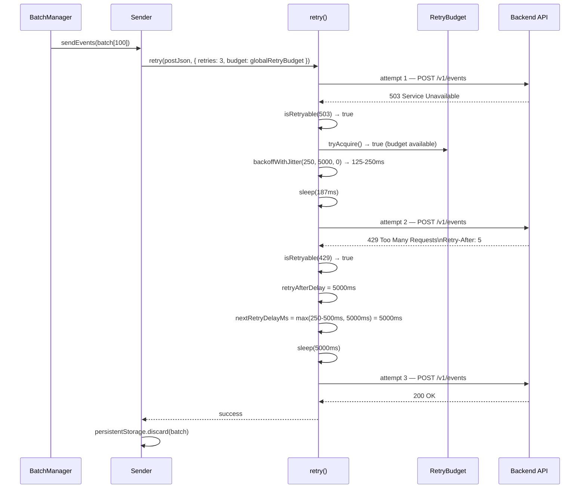
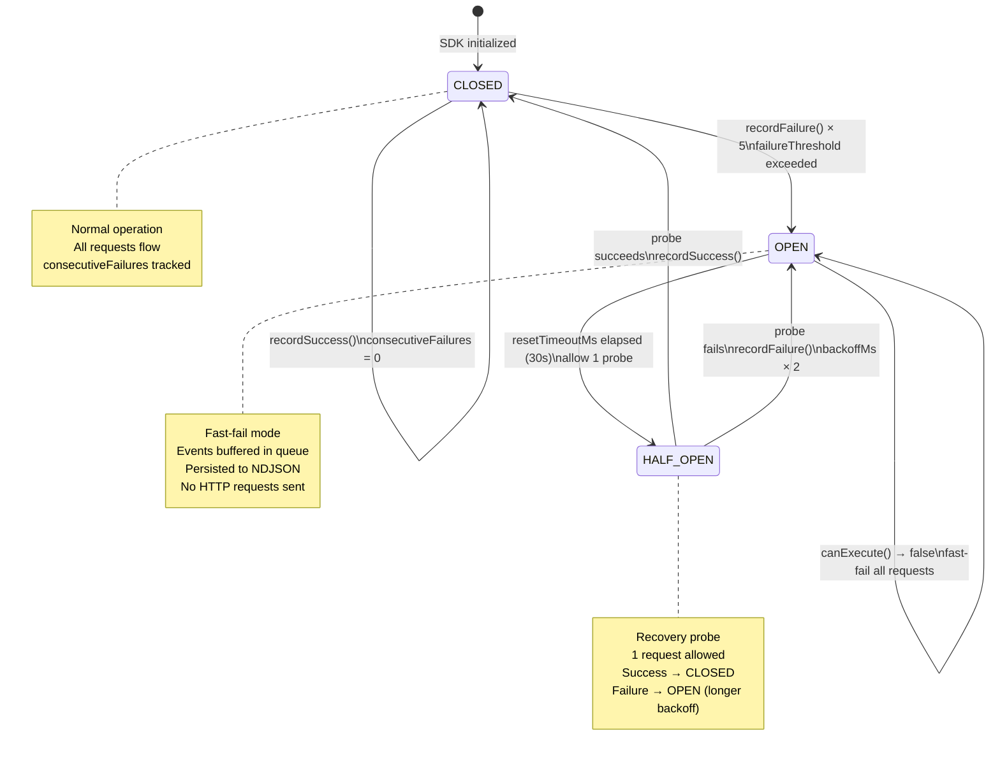
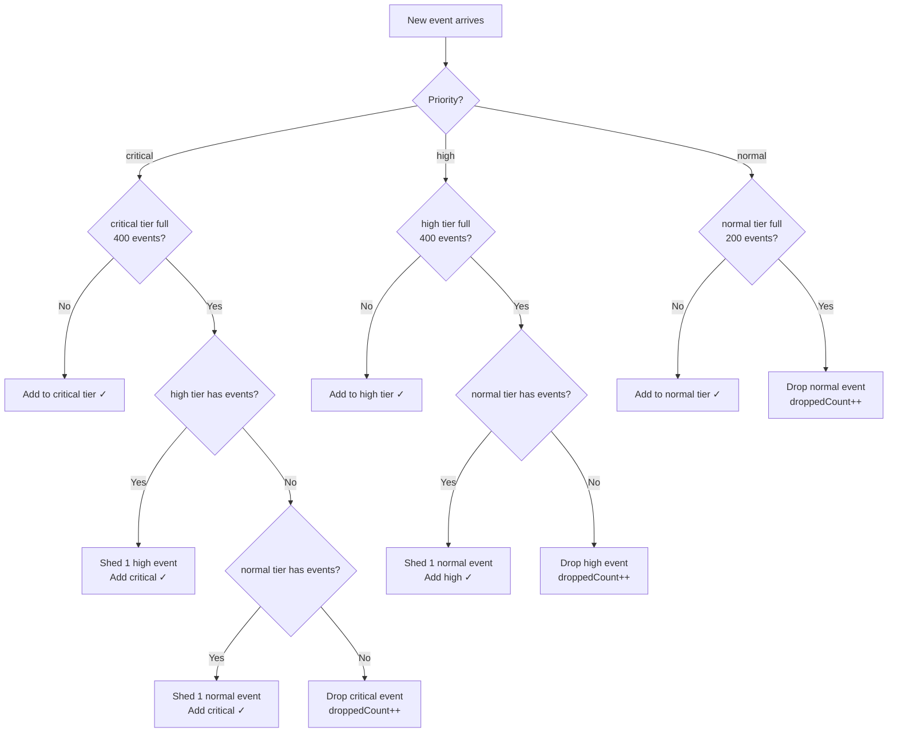
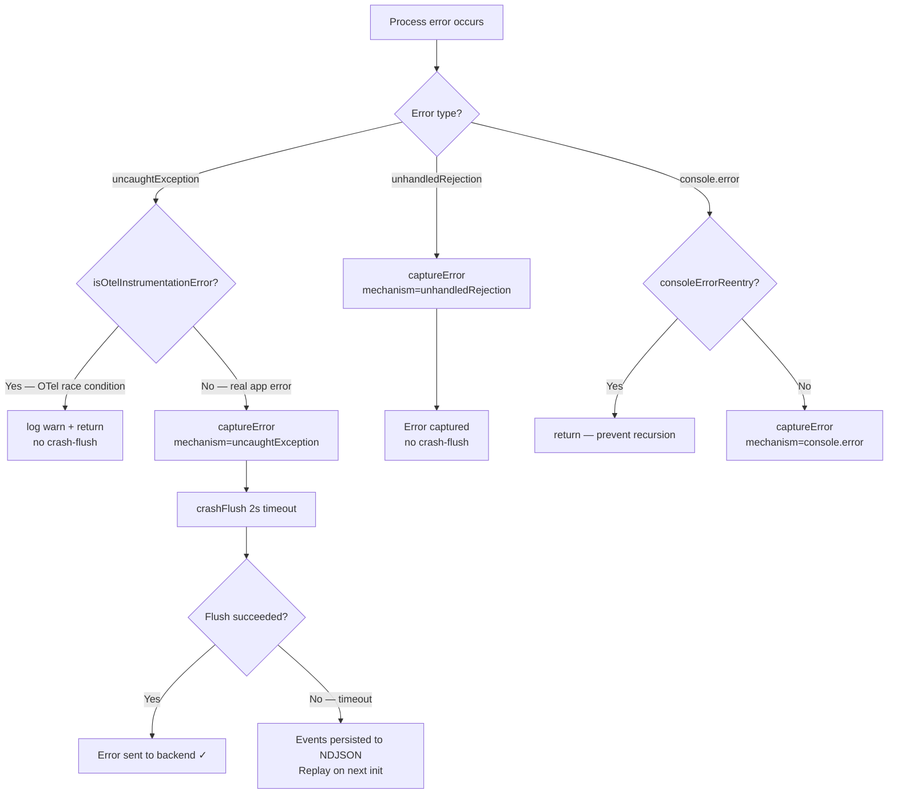
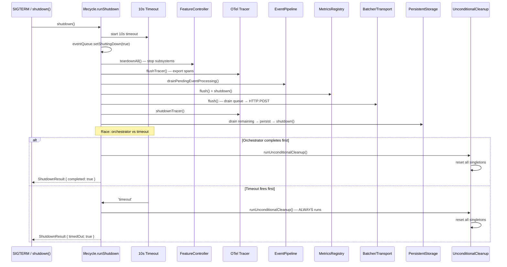
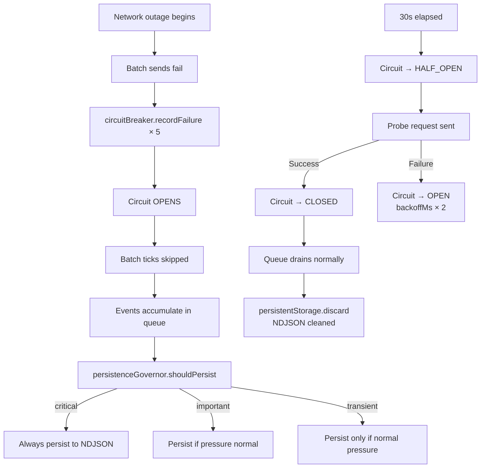
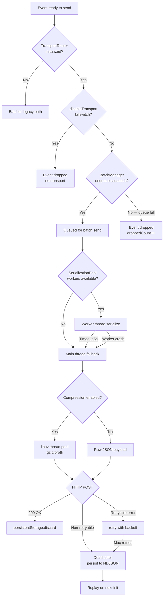
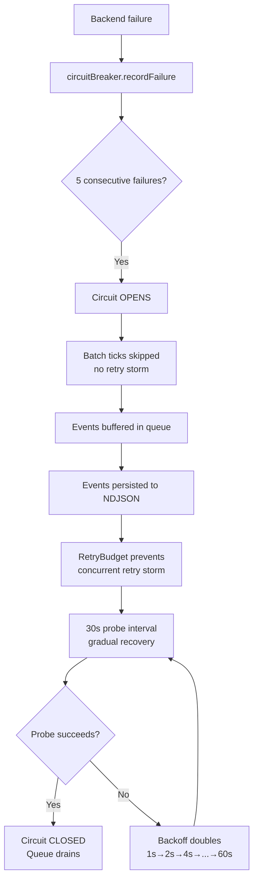
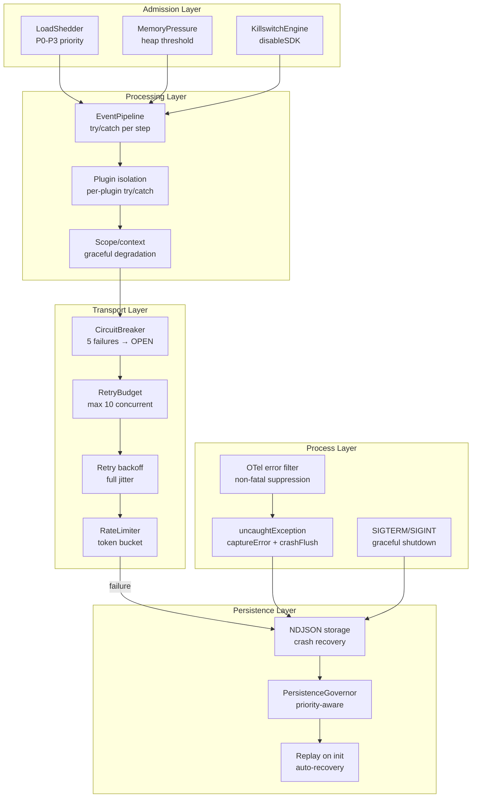

# SDK-NODE ENTERPRISE-GRADE ARCHITECTURE ANALYSIS

## PHASE 6 — FAILURE & RESILIENCE ANALYSIS

This document is a complete failure and resilience audit of the Pulse SDK (`sdk-node`). Every failure path is traced from trigger to recovery with exact source code evidence. Intended for SREs, platform engineers, and backend architects evaluating production reliability.

---

## TABLE OF CONTENTS

1. [Failure Path Taxonomy](#1-failure-path-taxonomy)
2. [Retry Logic — Deep Analysis](#2-retry-logic--deep-analysis)
3. [Circuit Breaking — Full State Analysis](#3-circuit-breaking--full-state-analysis)
4. [Queue Overflow Behavior](#4-queue-overflow-behavior)
5. [SDK Crash Protection](#5-sdk-crash-protection)
6. [Safe Shutdown](#6-safe-shutdown)
7. [Network Outage Handling](#7-network-outage-handling)
8. [Partial Ingestion Handling](#8-partial-ingestion-handling)
9. [Invalid Payload Handling](#9-invalid-payload-handling)
10. [Corrupted Context Handling](#10-corrupted-context-handling)
11. [Transport Fallback Strategy](#11-transport-fallback-strategy)
12. [Config Failure Handling](#12-config-failure-handling)
13. [Failure Interaction Matrix](#13-failure-interaction-matrix)
14. [Resilience Validation Summary](#14-resilience-validation-summary)

---

---

## 1. FAILURE PATH TAXONOMY

### 1.1 Complete Failure Classification

Every failure the SDK can encounter falls into one of these categories:

| Category | Examples | SDK Response | Data Loss Risk |
|----------|---------|-------------|---------------|
| **Network transient** | TCP timeout, DNS blip, 503 | Retry with backoff | None (persisted) |
| **Network permanent** | Wrong URL, 401 auth, 404 | Dead letter | Minimal (errors kept) |
| **Backend overload** | 429 Too Many Requests | Retry-After + backoff | None (persisted) |
| **Backend down** | Circuit OPEN | Buffer + persist | None (NDJSON) |
| **Payload invalid** | Event too large, non-serializable | Drop event | Single event |
| **Config invalid** | Malformed remote config | Use safe defaults | None |
| **Config unavailable** | Backend unreachable at init | Degraded mode | None |
| **SDK crash** | uncaughtException | crashFlush (2s) | Minimal |
| **Process OOM** | Heap exhausted | Load shedding | Low-priority events |
| **Queue overflow** | Arrival > drain rate | Priority shedding | Normal/high events |
| **Serialization failure** | Circular reference, BigInt | Drop batch | Batch events |
| **Context corruption** | ALS miss, null span | Graceful degradation | None (event still sent) |
| **Plugin failure** | Plugin throws | Isolated catch | None |
| **Shutdown timeout** | Graceful shutdown > 10s | Force cleanup | In-flight events |

### 1.2 Failure Propagation Principle

The SDK follows a strict **never-throw, never-crash** principle for all capture paths:

```typescript
// captureError.ts — top-level try/catch
export function captureError(error: unknown, options = {}): void {
    try {
        // ... all capture logic
    } catch (err) {
        logger.error('captureError failed', { error: err })
        // NEVER re-throws — host application is never affected
    }
}
```

This pattern is repeated in every public API function. The SDK is designed to fail silently rather than affect the host application.

### 1.3 Failure Isolation Boundaries

```mermaid
flowchart TD
    subgraph Host["Host Application"]
        A[User Code]
    end
    subgraph SDK["SDK Boundary — never throws to host"]
        B[captureError / captureRequest / captureMetric]
        C[Event Pipeline]
        D[Transport Layer]
        E[Persistent Storage]
    end
    subgraph Backend["Backend Ingestion API"]
        F[/v1/events]
    end

    A -->|"try/catch wraps all"| B
    B -->|"setImmediate — async"| C
    C -->|"BatchManager"| D
    D -->|"retry + circuit breaker"| F
    D -->|"on failure"| E
    E -->|"on next init"| C

    style SDK fill:#e8f5e9
    style Host fill:#fff3e0
    style Backend fill:#e3f2fd
```

---

## 2. RETRY LOGIC — DEEP ANALYSIS

### 2.1 Retry Architecture

The SDK has two distinct retry systems:

**System 1: `retry()` function** — `src/transport/retry.ts`
Used by `sender.ts` for HTTP POST retries. Exponential backoff with full jitter.

**System 2: `batcher.ts` re-queue** — `src/transport/batcher.ts`
Used by the batcher tick loop. Failed batches are re-queued to the front of `EventQueue`.

### 2.2 `retry()` Function — Exact Execution

```typescript
export async function retry<T>(operation: () => Promise<T>, options: RetryOptions): Promise<T> {
    const retries = Math.max(0, Math.floor(options.retries))
    const baseDelayMs = options.baseDelayMs ?? 250
    const maxDelayMs = options.maxDelayMs ?? 5000
    let lastError: Error | undefined

    for (let attempt = 0; attempt <= retries; attempt += 1) {
        try {
            return await operation()  // ← attempt the operation
        } catch (error) {
            lastError = toError(error)

            // Stop conditions
            if (attempt >= retries) throw lastError
            if (options.retryable?.(lastError) === false) throw lastError

            // Budget check
            if (options.budget && !options.budget.tryAcquire()) {
                throw new SDKError('Retry budget exhausted', 'RETRY_BUDGET_EXHAUSTED', ...)
            }

            // Compute delay
            const backoffDelay = backoffWithJitter(baseDelayMs, maxDelayMs, attempt)
            let retryAfterDelay = options.retryAfterMs ?? 0
            if (lastError instanceof SDKError && typeof lastError.context.retryAfterMs === 'number') {
                retryAfterDelay = Math.max(retryAfterDelay, lastError.context.retryAfterMs)
            }
            const nextRetryDelayMs = Math.max(backoffDelay, retryAfterDelay)

            options.onRetry?.({ error: lastError, attempt: attempt + 1, ... })
            await sleep(nextRetryDelayMs)
            options.budget?.release()
        }
    }
    throw new SDKError("Retry failed without an error", "RETRY_FAILED", {}, lastError)
}
```

### 2.3 Retryable vs Non-Retryable Errors

**File:** `src/transport/sender.ts` — `isRetryable()`

```typescript
function isRetryable(error: Error): boolean {
    if (!(error instanceof SDKError)) return false
    if (error.code === 'NETWORK_ERROR') return true  // TCP/DNS failures

    const status = Number(error.context.statusCode ?? error.context.status)
    return status === 408   // Request Timeout
        || status === 429   // Too Many Requests (with Retry-After)
        || status >= 500    // Server errors
}
```

| HTTP Status | Retryable | Reason |
|-------------|-----------|--------|
| 200 OK | N/A | Success |
| 400 Bad Request | ❌ NO | Client error — retrying won't help |
| 401 Unauthorized | ❌ NO | Auth failure — retrying won't help |
| 403 Forbidden | ❌ NO | Permanent rejection |
| 404 Not Found | ❌ NO | Wrong endpoint |
| 408 Request Timeout | ✅ YES | Transient timeout |
| 413 Payload Too Large | ❌ NO | Payload must be split |
| 429 Too Many Requests | ✅ YES | Rate limited — honor Retry-After |
| 500 Internal Server Error | ✅ YES | Transient server error |
| 502 Bad Gateway | ✅ YES | Upstream failure |
| 503 Service Unavailable | ✅ YES | Temporary unavailability |
| 504 Gateway Timeout | ✅ YES | Upstream timeout |
| NETWORK_ERROR | ✅ YES | TCP/DNS failure |

### 2.4 Retry Sequence Diagram



### 2.5 Retry Budget — Storm Prevention

**File:** `src/transport/retry.ts`

```typescript
export class RetryBudget {
    private inFlight = 0
    private totalExhausted = 0

    constructor(private readonly maxConcurrentRetries: number = 10) {}

    tryAcquire(): boolean {
        if (this.inFlight >= this.maxConcurrentRetries) {
            this.totalExhausted += 1
            return false  // ← budget exhausted — no retry
        }
        this.inFlight += 1
        return true
    }

    release(): void {
        this.inFlight = Math.max(0, this.inFlight - 1)
    }
}

export const globalRetryBudget = new RetryBudget(10)
```

**Storm scenario without budget:**
```
50 batches fail simultaneously
50 × 3 retries = 150 concurrent retry attempts
Backend sees 200 requests in burst → likely causes more 503s
```

**Storm scenario with budget (maxConcurrentRetries=10):**
```
50 batches fail simultaneously
10 acquire budget → 10 retries proceed
40 throw RETRY_BUDGET_EXHAUSTED → events persisted to NDJSON
Backend sees 60 requests (50 original + 10 retries)
```

### 2.6 Batcher Re-Queue on Failure

**File:** `src/transport/batcher.ts`

```typescript
} catch (err) {
    circuitBreaker.recordFailure()
    for (const event of events) {
        persistentStorage.persist(event)  // ← persist before re-queue
    }
    eventQueue.requeueFront(events)  // ← re-queue at front (priority)
    logger.error('Batch send failed; events re-queued', { ... })
}
```

**Re-queue behavior:**
```typescript
// queue.ts — requeueFront()
requeueFront(events: Event[]) {
    for (let i = events.length - 1; i >= 0; i--) {
        this.retryQueue.unshift(events[i])  // ← insert at front
    }
    // Bound retry queue at 50% of maxSize
    const maxRetry = Math.floor(this.maxSize * 0.5)
    if (this.retryQueue.length > maxRetry) {
        const spilled = this.retryQueue.length - maxRetry
        this.retryQueue.splice(maxRetry, spilled)
        this.notifyDrop('retry_spilled_to_disk', spilled)
    }
}
```

**Key property:** Failed events are re-queued at the FRONT of the retry queue, giving them priority over new events on the next drain cycle.

---

---

## 3. CIRCUIT BREAKING — FULL STATE ANALYSIS

### 3.1 Circuit Breaker Implementation

**File:** `src/transport/circuit-breaker.ts`

Two circuit breakers exist in the SDK:

1. **`batcher.ts` circuit breaker** — guards the legacy single-queue batcher
2. **`batch-manager.ts` circuit breaker** — guards each per-route `BatchManager`

Both use the same `CircuitBreaker` class with identical state machine logic.

### 3.2 State Transition Rules

```
CLOSED → OPEN:
  Condition: consecutiveFailures >= failureThreshold (default: 5)
  Action: log warn, set openUntil = now + resetTimeoutMs

OPEN → HALF_OPEN:
  Condition: Date.now() >= openUntil (resetTimeoutMs elapsed, default: 30s)
  Action: log info, halfOpenProbeCount = 0, allow 1 probe request

HALF_OPEN → CLOSED (recovery):
  Condition: probe request succeeds (recordSuccess() called)
  Action: log info, consecutiveFailures = 0, backoffMs reset

HALF_OPEN → OPEN (probe failed):
  Condition: probe request fails (recordFailure() called)
  Action: log warn, openUntil = now + backoffMs (exponential: 1s → 2s → 4s → ... → 60s)
```

### 3.3 HealthMonitor — Enhanced Circuit Breaker

**File:** `src/transport/health-monitor.ts`

The `HealthMonitor` provides a more sophisticated circuit breaker with:
- Exponential backoff on repeated failures (1s → 2s → 4s → ... → 60s cap)
- Latency-based degradation (p99 > 5s → DEGRADED state)
- Concurrency scaling (DEGRADED → 50% concurrency, UNAVAILABLE → 5%)
- Batch size scaling (UNAVAILABLE → 2× batch size to drain faster on recovery)

```typescript
recordFailure(): void {
    this.failures.push(now)
    this.pruneFailures(now)

    if (this.failures.length >= FAILURE_THRESHOLD || this.circuit === 'HALF_OPEN') {
        this.state = 'UNAVAILABLE'
        this.circuit = 'OPEN'
        this.openUntil = now + this.backoffMs
        this.backoffMs = Math.min(MAX_BACKOFF_MS, this.backoffMs * 2)  // ← exponential
        return
    }
    this.state = 'DEGRADED'
}
```

### 3.4 Circuit Breaker State Machine



### 3.5 Circuit Breaker Interaction with Queue

When the circuit is OPEN, the batcher tick is skipped entirely:

```typescript
// batcher.ts — tick()
if (!circuitBreaker.canExecute()) {
    logger.warn('Batch tick skipped — circuit breaker OPEN', {
        circuitState: circuitBreaker.getState(),
        queueSize: eventQueue.size(),
    })
    return  // ← events stay in queue, not dropped
}
```

**Key property:** Events are NOT dropped when the circuit is OPEN. They remain in the `EventQueue` and are also persisted to NDJSON. When the circuit recovers (HALF_OPEN → CLOSED), the queue drains normally.

### 3.6 Circuit Breaker Recovery Timeline

```mermaid
gantt
    title Circuit Breaker Recovery Timeline
    dateFormat  x
    axisFormat  %Ls

    section Failure Phase
    Normal operation              :0, 10
    Failure 1                     :10, 11
    Failure 2                     :12, 13
    Failure 3                     :14, 15
    Failure 4                     :16, 17
    Failure 5 — circuit OPENS     :18, 19

    section OPEN Phase (30s)
    Circuit OPEN — fast-fail      :19, 49
    Events buffered in queue      :19, 49
    Events persisted to NDJSON    :19, 49

    section Recovery
    30s elapsed — HALF_OPEN       :49, 50
    Probe request sent            :50, 51
    Probe succeeds — CLOSED       :51, 52
    Normal operation resumes      :52, 70
    Queue drains                  :52, 65
```



---

## 4. QUEUE OVERFLOW BEHAVIOR

### 4.1 Three-Tier Overflow Cascade

**File:** `src/transport/queue.ts`

When a tier is full, the queue attempts to make room by shedding lower-priority events:

```typescript
add(event: Event, priority?: EventPriority): boolean {
    const p = priority ?? getPriority(event)
    const tier = this.tiers[p]

    if (tier.events.length >= tier.maxSize) {
        // Try to make room by shedding lower-priority events
        if (p === 'critical' && this.shedLowerPriority('high')) {
            // Made room — continue
        } else if (p === 'high' && this.shedLowerPriority('normal')) {
            // Made room by shedding normal
        } else {
            tier.droppedCount += 1
            this.notifyDrop('queue_full', 1)
            return false  // ← event dropped
        }
    }
    tier.events.push(event)
    return true
}

private shedLowerPriority(priority: EventPriority): boolean {
    const tier = this.tiers[priority]
    if (tier.events.length > 0) {
        tier.events.shift()  // ← remove oldest lower-priority event
        tier.droppedCount += 1
        this.notifyDrop(`shed_${priority}`, 1)
        return true
    }
    if (priority === 'high') {
        return this.shedLowerPriority('normal')  // ← cascade down
    }
    return false
}
```

### 4.2 Overflow Cascade Diagram



### 4.3 Overflow Behavior by Scenario

| Scenario | Critical Events | High Events | Normal Events |
|----------|----------------|-------------|---------------|
| Queue empty | Accepted | Accepted | Accepted |
| Normal tier full | Accepted | Accepted | Dropped |
| High + Normal full | Accepted | Dropped | Dropped |
| All tiers full | Accepted (sheds high) | Dropped | Dropped |
| Critical tier full | Dropped | Dropped | Dropped |

**Key property:** Critical events (errors, crashes) are NEVER dropped unless the critical tier itself is full (400 events). At 5KB per error event, this is 2MB of error events — an extreme scenario.

### 4.4 Dead Letter Tracking

```typescript
// queue.ts
drop(count: number) {
    const normalizedCount = Math.max(0, Math.floor(count))
    this.deadLetterCount += normalizedCount
    this.notifyDrop('dead_letter', normalizedCount)
}

getDeadLetterCount(): number {
    return this.deadLetterCount
}
```

Dead letter count is reported in `ShutdownResult.deadLetterCount` so operators can monitor data loss.

### 4.5 Shutdown Queue Drain

**File:** `src/core/lifecycle.ts` — `runOrchestratedShutdown()`

```typescript
// Step 13: Drain residual pre-init buffer events to disk
await runStep('persistent-storage.drain', async () => {
    const remaining = eventQueue.drainAll()
    for (const event of remaining) {
        persistentStorage.persist(event)  // ← persist everything remaining
    }
    await persistentStorage.flush()
}, stepErrors)
```

On shutdown, ALL remaining queue events are persisted to NDJSON before the process exits. They will be replayed on the next SDK initialization.

---

## 5. SDK CRASH PROTECTION

### 5.1 `uncaughtException` Handler

**File:** `src/instrumentation/global-errors.ts`

```typescript
uncaughtHandler = (err: Error) => {
    // Step 1: Filter OTel instrumentation lifecycle errors
    if (isOtelInstrumentationError(err)) {
        logger.warn('OTel instrumentation lifecycle error (non-fatal, suppressed)', { ... })
        return  // ← do NOT crash-flush for OTel internal errors
    }

    // Step 2: Capture the error
    try {
        captureError(err, { mechanism: "uncaughtException" })
    } catch { }

    // Step 3: Attempt bounded crash flush
    logger.error("Uncaught exception detected — attempting to flush SDK events", { ... })
    crashFlush().catch(() => { })
    // SDK never calls process.exit — host process decides
}
process.on("uncaughtException", uncaughtHandler)
```

### 5.2 `crashFlush()` — Bounded Emergency Flush

**File:** `src/core/lifecycle.ts`

```typescript
export async function crashFlush(timeoutMs = 2_000): Promise<void> {
    const logger = getLogger()

    // Drain pending setImmediate work first
    await drainPendingEventProcessing()

    // Flush transport with hard 2s timeout
    try {
        await withTimeout(flush(), timeoutMs, 'crashFlush timed out')
    } catch (err) {
        logger.warn('crashFlush failed or timed out', { error: err })
        // Best-effort — if flush fails, events are already persisted
    }
}
```

**Why 2 seconds?** The process is about to exit. We need to:
1. Send the error event to the backend (1 HTTP round trip)
2. Persist any unsent events to NDJSON

2 seconds is enough for a single HTTP POST on a reasonable network. If the backend is down, events are already persisted and will be replayed on restart.

### 5.3 OTel Instrumentation Error Filter

**File:** `src/instrumentation/http-lifecycle-guard.ts`

```typescript
export function isOtelInstrumentationError(err: Error): boolean {
    if (!(err instanceof TypeError)) return false

    const message = err.message || ''
    if (!message.includes('Cannot read properties of null') && ...) return false

    const stack = err.stack || ''
    const hasOtelHttpFrame = stack.includes('@opentelemetry/instrumentation-http') || ...
    const hasNodeHttpFrame = stack.includes('node:_http_client') || ...
    const hasSocketFrame = stack.includes('node:net') || ...

    // Must have at least one OTel or HTTP internal frame
    if (!hasOtelHttpFrame && !hasNodeHttpFrame && !hasSocketFrame) return false

    // Bonus: known OTel crash patterns
    const hasOtelUtilPattern =
        message.includes("reading 'res'") ||
        message.includes("reading 'statusCode'") ||
        message.includes("reading 'socket'") || ...

    return hasOtelHttpFrame || hasOtelUtilPattern || (hasNodeHttpFrame && hasSocketFrame)
}
```

This filter prevents OTel's known socket-destruction race condition from triggering crash-flush. These errors are non-fatal and should not be treated as application crashes.

### 5.4 `unhandledRejection` Handler

```typescript
rejectionHandler = (reason: unknown) => {
    try {
        captureError(toError(reason), { mechanism: "unhandledRejection" })
    } catch { }
    // No crash-flush for rejections — they don't crash the process in Node.js 15+
}
process.on("unhandledRejection", rejectionHandler)
```

**Key difference from `uncaughtException`:** Unhandled rejections do NOT trigger `crashFlush()`. In Node.js 15+, unhandled rejections crash the process by default, but the SDK captures the error before that happens.

### 5.5 `console.error` Wrapping

```typescript
const wrapped: MarkedConsoleError = (...args: unknown[]) => {
    if (originalConsoleError) originalConsoleError.apply(console, args)

    if (consoleErrorReentry) return  // ← re-entry guard
    consoleErrorReentry = true

    try {
        const message = args.map(a => ...).join(' ')
        const error = args.find(a => a instanceof Error) as Error | undefined
        captureError(error ?? new Error(message), { mechanism: 'console.error' })
    } catch { }
    finally {
        consoleErrorReentry = false
    }
}
```

**Re-entry guard:** If `captureError()` internally calls `console.error` (e.g., via the SDK logger), the guard prevents infinite recursion.

### 5.6 Crash Protection Flow



---

---

## 6. SAFE SHUTDOWN

### 6.1 Shutdown Trigger Sources

The SDK registers for three shutdown triggers:

```typescript
// lifecycle.ts — registerSignalHandlers()
process.once('SIGTERM', async () => {
    logger.info('SIGTERM received — initiating graceful shutdown')
    await shutdown()
})
process.once('SIGINT', async () => {
    logger.info('SIGINT received — initiating graceful shutdown')
    await shutdown()
})
// Also: explicit shutdown() call from user code
```

**Idempotency:** `shutdown()` uses a `isShuttingDown` flag to prevent concurrent shutdown calls:

```typescript
let isShuttingDown = false

export async function shutdown(timeoutMs?: number): Promise<ShutdownResult> {
    if (isShuttingDown) {
        return runShutdown(timeoutMs)  // returns existing promise
    }
    isShuttingDown = true
    return runShutdown(timeoutMs)
}
```

### 6.2 Shutdown Orchestration — 14 Steps in Order

**File:** `src/core/lifecycle.ts` — `runOrchestratedShutdown()`

```
Step 1:  beforeShutdown hooks (user-registered, max 5s each)
Step 2:  eventQueue.setShuttingDown(true) — reject new events
Step 3:  FeatureController.teardownAll() — stop subsystems
Step 4:  flushTracer() — export buffered OTel spans
Step 5:  drainPendingEventProcessing() — wait for setImmediate queue
Step 6:  metricsRegistry.flush() + otelMetrics.shutdown()
Step 7:  flush() — drain EventQueue → HTTP POST
Step 8:  teardownPlugins() — call plugin teardown callbacks
Step 9:  shutdownTracer() — release OTel provider
Step 10: CronSubsystem.reset()
Step 11: ProfilingSubsystem.reset()
Step 12: LoggingSubsystem.reset()
Step 13: resetSessionManager()
Step 14: resetGlobalErrorHandlers() — remove process listeners
```

**Unconditional cleanup (runs even if orchestrator timed out):**
```
TransportRouter.shutdown()
eventQueue.clear()
resetEventPipeline()
client.clear()
ConfigManager.reset()
FeatureController.reset()
KillswitchEngine.reset()
SamplingEngine.reset()
LimitsEngine.reset()
SecurityScrubber.reset()
tenantGovernor.reset()
stopBatcher()
```

### 6.3 Shutdown Timeout Architecture

```typescript
async function runShutdown(timeoutMs?: number): Promise<ShutdownResult> {
    const timeout = resolveTimeout(timeoutMs)  // default: 10s

    const timeoutPromise = new Promise<'timeout'>(resolve => {
        timer = setTimeout(() => resolve('timeout'), timeout)
        timer.unref?.()
    })

    const outcome = await Promise.race([
        runOrchestratedShutdown(stepErrors).then(() => 'done' as const),
        timeoutPromise,
    ])

    timedOut = outcome === 'timeout'

    // ALWAYS runs — even on timeout
    await runUnconditionalCleanup(stepErrors)
}
```

**Key design:** `runUnconditionalCleanup()` ALWAYS runs, even if the orchestrated shutdown times out. This guarantees all singletons are reset and no listeners leak across reinit cycles.

### 6.4 Per-Step Failure Isolation

Each shutdown step is wrapped in `runStep()`:

```typescript
async function runStep(step: string, fn: () => Promise<void>, errors: ShutdownStepError[]): Promise<void> {
    try {
        await fn()
    } catch (error) {
        logger.warn(`Shutdown step failed: ${step}`, { error })
        errors.push({ step, error })
        // NEVER re-throws — next step always runs
    }
}
```

**Key property:** A failing step (e.g., `flushTracer()` throws) does NOT abort the shutdown sequence. All subsequent steps still execute. Errors are collected in `stepErrors` and returned in `ShutdownResult`.

### 6.5 Shutdown Result

```typescript
interface ShutdownResult {
    completed: boolean        // true if no timeout and no step errors
    timedOut: boolean         // true if global timeout fired
    durationMs: number        // total shutdown duration
    remainingEvents: number   // events still in queue (should be 0)
    deadLetterCount: number   // events permanently dropped
    stepErrors: readonly ShutdownStepError[]  // per-step failures
}
```

### 6.6 Shutdown Sequence Diagram



### 6.7 Data Safety During Shutdown

| Event State at Shutdown | Outcome |
|------------------------|---------|
| In `setImmediate` queue (not yet processed) | `drainPendingEventProcessing()` waits for completion |
| In `EventQueue` (processed, awaiting send) | `flush()` sends via HTTP POST |
| In `BatchManager` buffer | `flush()` drains all BatchManagers |
| In `BatchSpanProcessor` (OTel spans) | `flushTracer()` exports all buffered spans |
| In `PulseMetricReader` (OTel metrics) | `metricsRegistry.flush()` exports all metrics |
| Unsent after timeout | `persistentStorage.drain()` persists to NDJSON |
| In NDJSON file | Replayed on next `init()` |

---

## 7. NETWORK OUTAGE HANDLING

### 7.1 Outage Detection Timeline

```
t=0:    Backend becomes unavailable
t=0:    First batch send fails (TCP timeout after timeoutMs=10s)
t=10s:  First failure recorded → circuitBreaker.recordFailure()
t=20s:  Second failure → consecutiveFailures=2
t=30s:  Third failure → consecutiveFailures=3
t=40s:  Fourth failure → consecutiveFailures=4
t=50s:  Fifth failure → consecutiveFailures=5 → circuit OPENS
t=50s:  All subsequent batch ticks skipped (fast-fail)
t=50s:  Events accumulate in EventQueue + persisted to NDJSON
t=80s:  resetTimeoutMs=30s elapsed → circuit → HALF_OPEN
t=80s:  One probe request sent
t=80s:  Probe fails → circuit → OPEN again, backoffMs=2s (doubled)
t=82s:  Next probe allowed
...
t=110s: Probe succeeds → circuit → CLOSED
t=110s: Queue drains normally
```

### 7.2 Outage Behavior by Duration

| Outage Duration | Queue State | Data Loss | Recovery |
|----------------|-------------|-----------|---------|
| < 5s | Queue fills partially | None | Auto on recovery |
| 5–30s | Queue fills, shedding starts | Normal events shed | Auto on recovery |
| 30s–5min | Circuit OPEN, NDJSON fills | Normal+high shed | Auto on recovery |
| > 5min | NDJSON rotation risk | Possible if > 10MB | Replay on next init |
| Process restart | NDJSON replayed | None (errors always) | Auto on init |

### 7.3 NDJSON Persistence During Outage

**File:** `src/storage/persistent-storage.ts`

During a network outage, events are persisted to NDJSON:

```typescript
// batcher.ts — on send failure
} catch (err) {
    circuitBreaker.recordFailure()
    for (const event of events) {
        persistentStorage.persist(event)  // ← write to NDJSON
    }
    eventQueue.requeueFront(events)  // ← also keep in queue
}
```

**NDJSON file rotation:**
```typescript
// persistent-storage.ts
private async checkAndRotate(): Promise<void> {
    const stats = await fs.stat(this.filePath)
    if (stats.size > this.maxFileSizeBytes) {  // default: 10MB
        await this.rotate()
        // rename current → .bak
        // if .bak files > maxFiles (5) → delete oldest
    }
}
```

**Worst case:** 10MB × 5 files = 50MB of persisted events during extended outage.

### 7.4 Network Outage Recovery Flow



### 7.5 Offline Fallback Config

**File:** `src/core/config-manager.ts`

If the backend is unreachable at SDK initialization:

```typescript
// config-manager.ts — initialize()
try {
    remoteConfig = await this.fetchConfig()
} catch (err) {
    logger.warn('Remote config fetch failed — using safe defaults', { error: err })
    // Falls through to use BAKED_IN_REMOTE_CONFIG
}
```

The SDK uses `BAKED_IN_REMOTE_CONFIG` — a hardcoded safe default config with:
- Transport disabled (no HTTP sends until config is available)
- Sampling rates at 0 (no data captured)
- All features disabled except errors

This prevents the SDK from sending data to an unknown endpoint.

---

## 8. PARTIAL INGESTION HANDLING

### 8.1 Payload Splitting for Large Batches

**File:** `src/transport/sender.ts` — `createPayloads()`

When a batch exceeds `maxPayloadBytes`, it is split into multiple payloads:

```typescript
function createPayloads(events: Event[], apiKey: string, maxPayloadBytes: number) {
    const wrapperOverhead = safeJsonByteLength(createIngestPayload(apiKey, []))
    const payloads = []
    let current = []
    let currentBatchBytes = wrapperOverhead

    for (const event of events) {
        const eventBytes = safeJsonByteLength(event)
        const separatorBytes = current.length > 0 ? 1 : 0

        // Guard: single event exceeds max
        if (wrapperOverhead + eventBytes > maxPayloadBytes) {
            throw new SDKError('Single event exceeds configured payload maximum', 'EVENT_TOO_LARGE', {
                payloadBytes: wrapperOverhead + eventBytes,
                maxPayloadBytes
            })
        }

        if (current.length > 0 && currentBatchBytes + eventBytes + separatorBytes > maxPayloadBytes) {
            payloads.push(createIngestPayload(apiKey, current))
            current = [event]
            currentBatchBytes = wrapperOverhead + eventBytes
        } else {
            current.push(event)
            currentBatchBytes += eventBytes + separatorBytes
        }
    }
    if (current.length > 0) payloads.push(createIngestPayload(apiKey, current))
    return payloads
}
```

**Partial ingestion scenario:**

```
Batch: 100 events, total 2MB, maxPayloadBytes=1MB
→ Split into 2 payloads of ~1MB each

Payload 1 (events 1-50): POST → 200 OK → sentPayloads=1
Payload 2 (events 51-100): POST → 503 → throw SDKError

Result:
  sentPayloads=1 (events 1-50 ingested)
  events 51-100 NOT ingested
  throw SDKError('INGEST_SEND_FAILED', { sentPayloads: 1, failedPayloadEventCount: 50 })
```

**Recovery:** The entire batch (all 100 events) is re-queued by the batcher on failure. Events 1-50 will be sent again (duplicate ingestion risk).

### 8.2 Duplicate Ingestion Risk

**Scenario:** Payload 1 succeeds, Payload 2 fails. The batcher re-queues ALL events. On retry, Payload 1 events are sent again.

**Mitigation:** Each event has a unique `eventId` (UUID). The backend should deduplicate by `eventId`. The SDK does NOT deduplicate at the transport layer.

**Verdict: KNOWN RISK.** Duplicate events are possible during partial batch failures. Backend deduplication by `eventId` is required for exactly-once semantics.

### 8.3 `sentPayloads` Tracking

```typescript
// sender.ts
let sentPayloads = 0
for (const payload of createPayloads(events, apiKey, maxPayloadBytes)) {
    try {
        await retry(() => postJson(config.ingestUrl, payload, ...), { ... })
        sentPayloads += 1
    } catch (error) {
        throw new SDKError('Failed to send ingest payload', 'INGEST_SEND_FAILED', {
            sentPayloads,                    // ← how many succeeded
            failedPayloadEventCount: payload.events.length,
            totalEventCount: events.length
        }, error)
    }
}
```

The `sentPayloads` count in the error context allows operators to understand partial ingestion.

### 8.4 Flush Max Attempts

**File:** `src/transport/batcher.ts` — `flush()`

```typescript
const MAX_FLUSH_ATTEMPTS = 3
let attempts = 0

while (eventQueue.size() > 0) {
    if (attempts >= MAX_FLUSH_ATTEMPTS) {
        // Retry budget exhausted — persist remaining to disk
        const remaining = eventQueue.drainAll()
        for (const event of remaining) {
            persistentStorage.persist(event)
        }
        logger.warn('Flush max attempts reached — persisted remaining events to disk', {
            remainingEvents: remaining.length,
        })
        break
    }

    const events = eventQueue.drain(batchSize)
    try {
        await sendEvents(events)
        await persistentStorage.discard(events)
        circuitBreaker.recordSuccess()
    } catch (err) {
        circuitBreaker.recordFailure()
        for (const event of events) {
            persistentStorage.persist(event)
        }
        eventQueue.requeueFront(events)
        attempts += 1
    }
}
```

After 3 failed flush attempts, remaining events are persisted to NDJSON and the flush exits. This prevents infinite retry loops during shutdown.

---

## 9. INVALID PAYLOAD HANDLING

### 9.1 Event Validation — Zod Schema

**File:** `src/core/event-pipeline.ts`

All events are validated with Zod before entering the pipeline:

```typescript
// enqueueEvent() — synchronous validation
const validationResult = eventSchema.safeParse(rawEvent)
if (!validationResult.success) {
    return rejectedReceipt(assignedEventId, `Validation failed: ${validationResult.error.message}`)
}
```

**Validation failures return a `rejectedReceipt`** — the event is silently dropped with a reason. No exception is thrown to the caller.

### 9.2 Non-Serializable Payload Handling

**File:** `src/transport/sender.ts` — `safeJsonByteLength()`

```typescript
function safeJsonByteLength(value: unknown, context: Record<string, unknown>) {
    try {
        return Buffer.byteLength(JSON.stringify(value))
    } catch (error) {
        throw new SDKError('Payload is not JSON serializable', 'PAYLOAD_SERIALIZATION_FAILED', context, error)
    }
}
```

**Causes of non-serializable payloads:**
- Circular references in `context` object
- `BigInt` values (not JSON-serializable)
- Functions in context
- `undefined` values (stripped by JSON.stringify, not an error)

**Mitigation:** `normalizeEvent()` uses `truncateObject()` with a `WeakSet` cycle guard:

```typescript
function truncateObject(value: unknown, maxDepth: number, currentDepth = 0, seen?: WeakSet<object>): unknown {
    const visited = seen ?? new WeakSet<object>()
    if (visited.has(value)) {
        return '[circular]'  // ← circular references replaced with string
    }
    visited.add(value)
    // ...
}
```

**Verdict:** Circular references are handled by `normalizeEvent()` before serialization. `BigInt` values would still cause serialization failure — they are not handled.

### 9.3 Oversized Single Event

```typescript
// sender.ts — createPayloads()
if (wrapperOverhead + eventBytes > maxPayloadBytes) {
    throw new SDKError('Single event exceeds configured payload maximum', 'EVENT_TOO_LARGE', {
        payloadBytes: wrapperOverhead + eventBytes,
        maxPayloadBytes
    })
}
```

**Scenario:** An error event with a 500KB stack trace exceeds `maxPayloadBytes=1MB`.

**Handling:** `SDKError('EVENT_TOO_LARGE')` is thrown. The batcher catches this, records a circuit breaker failure, and re-queues the batch. The oversized event will cause the same failure on retry.

**Risk: HIGH.** An oversized event causes infinite retry loops. The circuit breaker will eventually open, but the event is never dropped — it stays in the queue and NDJSON indefinitely.

**Recommendation:** Add a pre-transport size check that drops oversized events with a warning rather than throwing.

### 9.4 Remote Config Validation

**File:** `src/core/config-validator.ts`

Every remote config response is validated before use:

```typescript
export function validateRemoteConfig(payload: unknown): ValidationResult {
    const errors: string[] = []

    // Must be a plain object
    if (payload == null || typeof payload !== 'object' || Array.isArray(payload)) {
        return { valid: false, errors: ['payload is not a JSON object'] }
    }

    // Schema version check
    if (cfg['schemaVersion'] > REMOTE_CONFIG_SCHEMA_VERSION) {
        errors.push(`schemaVersion ${cfg['schemaVersion']} is newer than SDK-supported...`)
    }

    // Required sections
    for (const section of ['features', 'sampling', 'instrumentation', 'privacy', 'limits', 'killswitches', 'transport', 'runtime']) {
        if (!isPlainObject(cfg[section])) {
            errors.push(`${section} is missing or not an object`)
        }
    }

    // Sampling rates must be [0, 1]
    for (const k of ['traces', 'requests', 'errors', 'profiles', 'replays']) {
        if (k in s && !isProbability(s[k])) {
            errors.push(`sampling.${k} is not a number in [0, 1]`)
        }
    }

    // Features and killswitches must be boolean
    for (const [k, v] of Object.entries(features)) {
        if (typeof v !== 'boolean') {
            errors.push(`features.${k} is not a boolean`)
        }
    }

    return { valid: errors.length === 0, errors }
}
```

**On validation failure:** The SDK falls back to the previous valid config (or safe defaults on first init). Invalid configs are never applied.

### 9.5 Safety Clamps on Config Values

**File:** `src/core/config-manager.ts` — `applySafetyClamps()`

Even valid configs are clamped to prevent malicious or misconfigured values:

```typescript
private applySafetyClamps(config: RemoteConfigResponse): RemoteConfigResponse {
    // Sampling rates clamped to [0, 1]
    clampProbability(config.sampling.traces)
    clampProbability(config.sampling.errors)

    // Limits clamped to safety ceilings
    clampMax(config.limits.maxPayloadSize, SAFETY_CEILINGS.maxPayloadSize)
    clampRange(config.limits.maxSpanAttributes, 1, SAFETY_CEILINGS.maxSpanAttributes)

    // Flush interval clamped to [1s, 300s]
    clampRange(config.transport.flushIntervalMs, 1000, 300_000)
    // ...
}
```

**Verdict: PASS.** Even if the backend sends `sampling.traces: 999` or `limits.maxPayloadSize: 0`, the SDK clamps to safe values.

---

---

## 10. CORRUPTED CONTEXT HANDLING

### 10.1 ALS Context Miss

**File:** `src/core/context.ts`

```typescript
export function getRequestContext(): ContextStore | undefined {
    return contextStorage.getStore()
        ?? otelContext.active().getValue(CONTEXT_STORE_KEY) as ContextStore | undefined
}
```

If `getRequestContext()` returns `undefined` (called outside a `withContext()` scope):

```typescript
// event-pipeline.ts — enrichFromContext()
function enrichFromContext(event: SDKEvent): SDKEvent {
    const ctx = getRequestContext()
    if (!ctx) return event  // ← graceful: event sent without context enrichment

    return {
        ...event,
        traceId: event.traceId ?? getTraceId(),
        spanId: event.spanId ?? getSpanId(),
        requestId: event.requestId ?? ctx.requestId,
        breadcrumbs: ctx.breadcrumbs.toArray(),
    }
}
```

**Verdict: PASS.** Missing context is handled gracefully. The event is still sent, just without `requestId`, `breadcrumbs`, or `sessionId` enrichment.

### 10.2 Null/Undefined Active Span

```typescript
// captureError.ts
const activeSpan = trace.getActiveSpan()
if (activeSpan) {
    try {
        activeSpan.recordException(normalized)
        activeSpan.setStatus({ code: SpanStatusCode.ERROR, message: normalized.message })
    } catch {
        // Error capture must remain best-effort and never alter host control flow.
    }
}
```

If `trace.getActiveSpan()` returns `null` (no active span), the error is still captured — just without span linkage. The `try/catch` around span operations ensures that even if the span is in an invalid state, the error capture continues.

### 10.3 Corrupted Stack Trace

**File:** `src/processors/stack-parser.ts`

Stack traces can be:
- `undefined` (some environments don't provide stacks)
- Truncated (V8 `Error.stackTraceLimit`)
- Pre-serialized strings (from serialized errors)
- Non-standard format (non-V8 engines)

```typescript
export function parseStack(stack: string | undefined, error: Error): StackFrame[] {
    if (!stack) return []  // ← graceful: empty frames

    try {
        // Try V8 CallSite API first
        const frames = parseV8Stack(stack)
        if (frames.length > 0) return frames

        // Fallback: regex parsing
        return parseRegexStack(stack)
    } catch {
        return []  // ← graceful: parsing failure returns empty frames
    }
}
```

**Verdict: PASS.** Corrupted or missing stacks return empty `StackFrame[]`. The error event is still sent with `stack: []`.

### 10.4 Corrupted Fingerprint

**File:** `src/processors/fingerprint.ts`

```typescript
export function generateFingerprint(error: Error, stackFrames: StackFrame[], customFingerprint?: string): string {
    if (customFingerprint) {
        return sha256(customFingerprint)
    }

    const parts: string[] = [error.name]
    const inAppFrames = stackFrames.filter(f => f.inApp)

    if (inAppFrames.length > 0) {
        for (const frame of inAppFrames) {
            const normalizedFile = normalizeForFingerprint(frame.filename)
            parts.push(`${frame.function}@${normalizedFile}`)
        }
    } else {
        // Fallback: use all frames if no in-app frames found
        for (const frame of stackFrames.slice(0, 5)) {
            const normalizedFile = normalizeForFingerprint(frame.filename)
            parts.push(`${frame.function}@${normalizedFile}`)
        }
    }

    parts.push(normalizeErrorMessage(error.message))
    return sha256(parts.join('|'))
}
```

If `stackFrames` is empty (corrupted stack), the fingerprint is generated from `error.name` + `error.message` only. This is less precise for grouping but still valid.

### 10.5 Corrupted Scope Data

**File:** `src/core/scope.ts`

```typescript
export function applyScopeToEvent(event: Record<string, unknown>): Record<string, unknown> {
    try {
        const scope = getActiveScope()
        const data = scope.getScopeData()

        return {
            ...event,
            user: data.user ?? event['user'],
            tags: { ...(data.tags ?? {}), ...(event['tags'] as Record<string, string> ?? {}) },
            extra: { ...(data.extra ?? {}), ...(event['extra'] as Record<string, unknown> ?? {}) },
        }
    } catch (err) {
        logger.warn('applyScopeToEvent failed', { error: err })
        return event  // ← return original event on failure
    }
}
```

**Verdict: PASS.** Scope application failures return the original event unchanged.

### 10.6 Plugin Failure Isolation

```typescript
// event-pipeline.ts — plugin processing
for (const plugin of client.plugins) {
    try {
        const result = await withTimeout(
            Promise.resolve(plugin.processEvent(event)),
            PLUGIN_TIMEOUT_MS,
            `Plugin ${plugin.meta.name} processEvent timed out`
        )
        if (result === null) {
            return false  // ← plugin dropped the event
        }
        event = result
    } catch (err) {
        logger.warn('Plugin processEvent failed', { pluginName: plugin.meta.name, error: err })
        // Continue with next plugin — failure is isolated
    }
}
```

**Verdict: PASS.** Plugin failures are isolated. A crashing plugin does not affect other plugins or the event pipeline.

### 10.7 Context Corruption Handling Summary

```mermaid
flowchart TD
    A[Event captured] --> B{ALS context available?}
    B -->|No| C[Event sent without\nrequestId/breadcrumbs]
    B -->|Yes| D{Active OTel span?}
    D -->|No| E[Event sent without\ntraceId/spanId]
    D -->|Yes| F{Span operations succeed?}
    F -->|Throws| G[try/catch — continue\nspan linkage skipped]
    F -->|OK| H[traceId/spanId attached]
    C --> I{Stack trace valid?}
    E --> I
    G --> I
    H --> I
    I -->|Empty/corrupted| J[Empty StackFrame[]\nfingerprint from name+message]
    I -->|Valid| K[Full stack frames\nfingerprint from frames]
    J --> L{Scope apply succeeds?}
    K --> L
    L -->|Throws| M[Original event returned]
    L -->|OK| N[User/tags/extra attached]
    M --> O[TransportRouter.send]
    N --> O
```

---

## 11. TRANSPORT FALLBACK STRATEGY

### 11.1 Transport Layer Hierarchy

The SDK has three transport mechanisms in priority order:

```
1. TransportRouter (primary) — per-route BatchManager + ConnectionManager
   ↓ (if unavailable)
2. Batcher (legacy) — single EventQueue + global batcher
   ↓ (if both unavailable)
3. PersistentStorage (fallback) — NDJSON file persistence
   ↓ (on next init)
4. Replay — persisted events re-enter pipeline on SDK restart
```

### 11.2 TransportRouter Failure Handling

**File:** `src/transport/transport-router.ts`

```typescript
send(event: SDKEvent): boolean {
    if (this.disabled) return false  // ← killswitch: disableTransport

    try {
        const route = this.routeRegistry.resolve(event)
        const batchManager = this.batchManagers.get(route.route)
        if (!batchManager) return false

        return batchManager.enqueue(event)
    } catch (err) {
        getLogger().error('TransportRouter.send failed', { error: err })
        return false  // ← never throws to caller
    }
}
```

**On `TransportRouter.send()` returning `false`:**

```typescript
// event-pipeline.ts
if (!processEvent(traceEvent)) {
    allAccepted = false  // ← reported to BSP but event is lost
}
```

Events rejected by `TransportRouter` are NOT automatically persisted. They are lost unless the caller handles the `false` return.

**Risk: MEDIUM.** Span events rejected by `TransportRouter` (e.g., queue full) are lost — they are not persisted to NDJSON. Only events that go through the `persistenceGovernor` path are persisted.

### 11.3 `MultiplexedTransport` as Alternative Path

**File:** `src/transport/multiplexed-transport.ts`

The `MultiplexedTransport` provides an alternative batching strategy that sends all routes in a single HTTP POST:

```typescript
const payload: MultiplexedPayload = {
    batches: [
        { route: 'errors', events: [...] },
        { route: 'traces', events: [...] },
        { route: 'metrics', events: [...] },
    ],
    timestamp: epochMs(),
    sdk: SDK_VERSION
}
await postJson(`${this.baseUrl}/v1/ingest`, payload, { Authorization: `Bearer ${this.apiKey}` }, 30000)
```

**Advantage:** Single HTTP connection for all event types — reduces connection overhead.
**Disadvantage:** If the single POST fails, ALL event types fail together. Per-route `BatchManager` isolates failures by route.

### 11.4 Serialization Worker Fallback

**File:** `src/transport/serialization-pool.ts`

```typescript
async serialize(events, compression): Promise<...> {
    if (this.workers.length === 0 || this.destroyed) {
        return this.fallbackSerialize(events, compression)  // ← main thread fallback
    }

    // ... worker thread path
    return new Promise((resolve, reject) => {
        const timer = setTimeout(() => {
            this.pendingRequests.delete(id)
            reject(new Error('Serialization worker timeout'))
        }, 5000)
        // ...
    }).catch((err) => {
        logger.warn('Worker serialization failed, falling back to main thread', { error: err })
        return this.fallbackSerialize(events, compression)  // ← fallback on timeout
    })
}
```

**Fallback chain:**
1. Worker thread serialization (primary)
2. Worker timeout (5s) → main thread fallback
3. Worker crash → `handleWorkerCrash()` → restart worker in 1s → main thread fallback during restart

### 11.5 Transport Fallback Decision Tree



### 11.6 `disableTransport` Killswitch Behavior

When `killswitches.disableTransport = true` is received via remote config:

```typescript
// killswitch-engine.ts
if (isActive && !wasActive) {
    // Killswitch activated
    await handlers.get('disableTransport').shutdown()
    // → TransportRouter.disable()
}
```

```typescript
// transport-router.ts
disable(): void {
    this.disabled = true
    // All send() calls return false immediately
    // Events accumulate in queue (if queue is still accepting)
    // Events persisted to NDJSON
}

enable(): void {
    this.disabled = false
    // Transport resumes — queue drains
}
```

**Key property:** `disableTransport` does NOT drop events. They accumulate in the queue and NDJSON. When transport is re-enabled (killswitch deactivated), the queue drains automatically.

---

## 12. CONFIG FAILURE HANDLING

### 12.1 Remote Config Fetch Failure at Init

**File:** `src/core/config-manager.ts`

```typescript
async initialize(options: SDKInitOptions): Promise<Readonly<RemoteConfigResponse>> {
    this.state = ConfigState.INITIALIZING

    let remoteConfig: RemoteConfigResponse | null = null
    try {
        remoteConfig = await this.fetchConfig()
    } catch (err) {
        logger.warn('Remote config fetch failed — using safe defaults', {
            error: err instanceof Error ? err.message : String(err),
        })
        // remoteConfig remains null → use BAKED_IN_REMOTE_CONFIG
    }

    const baseConfig = remoteConfig ?? BAKED_IN_REMOTE_CONFIG
    const merged = this.mergeConfigs(baseConfig, this.buildUserOverrides(options))
    const clamped = this.applySafetyClamps(merged)
    this.config = this.freezeDeep(clamped)
    this.state = ConfigState.LIVE
    return this.config
}
```

**`BAKED_IN_REMOTE_CONFIG`** is a hardcoded safe default:
- `transport.disabled = true` — no HTTP sends
- `sampling.*: 0` — no data captured
- All features disabled except `errors`

This ensures the SDK never sends data to an unknown endpoint when config is unavailable.

### 12.2 Remote Config Refresh Failure

```typescript
async refreshConfig(): Promise<void> {
    try {
        const newConfig = await this.fetchConfig()
        if (!newConfig) return  // ← no change, keep current

        const diff = diffConfigs(this.config, newConfig)
        if (!diff.hasChanges) return  // ← no changes, skip notification

        this.config = this.freezeDeep(newConfig)
        for (const listener of this.listeners) {
            try {
                listener(diff, this.config)
            } catch (err) {
                logger.warn('Config change listener failed', { error: err })
                // Continue notifying other listeners
            }
        }
    } catch (err) {
        logger.warn('Config refresh failed — keeping current config', { error: err })
        this.scheduleRetry()  // ← retry with backoff
    }
}
```

**On refresh failure:** The SDK keeps the last valid config. No subsystems are affected. A retry is scheduled with exponential backoff.

### 12.3 Config Schema Version Mismatch

```typescript
// config-validator.ts
if (cfg['schemaVersion'] > REMOTE_CONFIG_SCHEMA_VERSION) {
    errors.push(`schemaVersion ${cfg['schemaVersion']} is newer than SDK-supported ${REMOTE_CONFIG_SCHEMA_VERSION}`)
}
```

If the backend sends a config with a newer schema version than the SDK supports:
1. `validateRemoteConfig()` returns `valid: false`
2. SDK falls back to previous valid config (or safe defaults)
3. SDK logs a warning suggesting upgrade

**Verdict: PASS.** Forward-incompatible configs are rejected safely.

### 12.4 Config Diff Failure

**File:** `src/core/config-differ.ts`

```typescript
export function diffConfigs(oldConfig, newConfig): ConfigDiff {
    const featuresChanged = !deepEqual(oldConfig.features, newConfig.features)
    // ...
}
```

`diffConfigs()` is a pure function with no side effects. If it throws (e.g., due to a malformed config object), the `refreshConfig()` catch block handles it and keeps the current config.

---

## 13. FAILURE INTERACTION MATRIX

### 13.1 Compound Failure Scenarios

| Failure A | Failure B | Combined Effect | Recovery |
|-----------|-----------|----------------|---------|
| Backend down | Memory pressure | Queue fills + shedding | Auto on backend recovery |
| Backend down | Process crash | NDJSON persisted | Replay on restart |
| Config unavailable | Backend down | Safe defaults + no sends | Manual intervention |
| Plugin crash | Backend down | Event lost (plugin dropped it) | None for that event |
| Serialization failure | Backend down | Batch lost | Re-queue + persist |
| Queue overflow | Backend down | Normal events dropped | Errors preserved |
| Shutdown timeout | Backend down | In-flight events persisted | Replay on restart |
| OTel provider conflict | — | SDK uses existing provider | No data loss |

### 13.2 Failure Cascade Prevention



### 13.3 Failure Detection Latency

| Failure Type | Detection Latency | Mechanism |
|-------------|------------------|-----------|
| HTTP timeout | `timeoutMs` (default 10s) | `AbortController` |
| TCP connection refused | ~1s | OS TCP stack |
| DNS failure | ~5s | OS DNS timeout |
| 5xx response | Immediate | HTTP status check |
| 429 rate limit | Immediate | HTTP status check |
| Memory pressure | 5s poll interval | `MemoryPressureMonitor` |
| Event loop lag | 2s poll interval | `EventLoopLagMonitor` |
| Queue overflow | Immediate | `EventQueue.add()` return |
| Config invalid | Immediate | `validateRemoteConfig()` |

---

## 14. RESILIENCE VALIDATION SUMMARY

### 14.1 Complete Resilience Checklist

| Scenario | Handled | Mechanism | Data Loss |
|----------|---------|-----------|-----------|
| Backend HTTP timeout | ✅ | `AbortController` + retry | None |
| Backend 503 transient | ✅ | Retry with backoff | None |
| Backend 429 rate limit | ✅ | Retry-After header honored | None |
| Backend 401 auth failure | ✅ | No retry (non-retryable) | Batch lost |
| Backend permanently down | ✅ | Circuit breaker + NDJSON | None (replayed) |
| Network DNS failure | ✅ | NETWORK_ERROR retry | None |
| Retry storm | ✅ | `RetryBudget(10)` | None |
| Queue overflow | ✅ | Priority shedding | Normal events |
| Memory pressure | ✅ | Load shedding + batcher skip | Low-priority events |
| Event loop lag | ✅ | Adaptive pressure shedding | Low-priority events |
| `uncaughtException` | ✅ | `crashFlush(2s)` | Minimal |
| `unhandledRejection` | ✅ | `captureError()` | None |
| OTel socket race condition | ✅ | `isOtelInstrumentationError()` filter | None |
| Process SIGTERM | ✅ | Graceful shutdown (10s) | None |
| Shutdown timeout | ✅ | NDJSON persist + unconditional cleanup | In-flight events |
| Plugin crash | ✅ | Isolated try/catch | None (event continues) |
| Serialization failure | ✅ | Worker fallback + main thread | None |
| Circular reference in context | ✅ | `WeakSet` cycle guard in normalizer | None |
| Invalid remote config | ✅ | `validateRemoteConfig()` + safe defaults | None |
| Config schema too new | ✅ | Version check + fallback | None |
| Config refresh failure | ✅ | Keep last valid config + retry | None |
| `disableTransport` killswitch | ✅ | Queue + NDJSON accumulate | None |
| `disableSDK` killswitch | ✅ | All capture no-ops | All events |
| Oversized single event | ⚠️ | `EVENT_TOO_LARGE` error — infinite retry | Batch stuck |
| `BigInt` in context | ⚠️ | JSON.stringify throws | Batch lost |
| Worker thread crash | ✅ | Restart in 1s + main thread fallback | None |
| NDJSON file corruption | ⚠️ | Malformed lines skipped | Corrupted events |
| Duplicate ingestion on retry | ⚠️ | Backend must deduplicate by `eventId` | None (duplicates) |

### 14.2 Critical Risks Requiring Attention

**RISK 1: Oversized Single Event — Infinite Retry Loop**
- **Severity:** HIGH
- **Scenario:** Error with 500KB stack trace exceeds `maxPayloadBytes`
- **Current behavior:** `EVENT_TOO_LARGE` thrown → batcher re-queues → same failure on retry
- **Fix:** Pre-transport size check that drops oversized events with a warning

**RISK 2: `BigInt` in Context — Batch Lost**
- **Severity:** MEDIUM
- **Scenario:** User passes `{ orderId: BigInt(123) }` as context
- **Current behavior:** `JSON.stringify` throws → entire batch fails
- **Fix:** Add `BigInt` → `String` coercion in `normalizeEvent()`

**RISK 3: Duplicate Ingestion on Partial Batch Failure**
- **Severity:** MEDIUM**
- **Scenario:** Payload 1 of 2 succeeds, Payload 2 fails → entire batch re-queued
- **Current behavior:** Payload 1 events sent twice
- **Fix:** Backend deduplication by `eventId` (SDK-side fix not feasible without tracking sent IDs)

**RISK 4: NDJSON Corruption on Crash**
- **Severity:** LOW**
- **Scenario:** Process crashes mid-write to NDJSON file
- **Current behavior:** Last line may be truncated → `JSON.parse` fails → line skipped
- **Mitigation present:** `replay()` skips malformed lines. Only the last write is at risk.

### 14.3 Resilience Architecture Diagram



---

*Document generated by Kiro — Phase 6 Failure & Resilience Analysis*
*SDK: sdk-node (Pulse SDK) | Analysis Date: May 2026*
